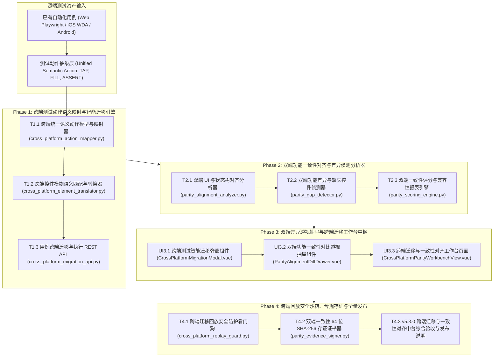

# ATP v5.3.0 研发任务规划表：跨端测试智能迁移与双端一致性对齐中台

**版本代号**: v5.3.0
**规划日期**: 2026-10-17
**核心目标**: 构建多模态测试用例跨端跨端智能迁移（Cross-Platform Test Migration）与双端/多端功能一致性对齐中台（Mobile-Web Parity Alignment Engine），解决 Web / iOS / Android 测试脚本割裂冗余与双端功能差异漏测难题。

---

## 1. 架构设计与系统全景拓扑

---

## 2. 任务分解清单 (Phase 1 ~ Phase 4)

### Phase 1：跨端测试动作语义映射与智能迁移引擎

| ID / 状态 | 任务名称与交付物 | 依赖 | 验收标准 |
|---|---|---|---|
| T1.1 `[x]` | **跨端统一语义动作模型与映射器** | `backend/app/services/cross_platform_action_mapper.py` | 统一抽象 TAP, FILL, SCROLL, ASSERT, WAIT 动作，实现 Web/iOS/Android 跨端双向转译；单测独立通过；见 docs/evidence/cross-platform-action-mapper-t1-1-2026-10-17.md |
| T1.2 `[x]` | **跨端控件模糊语义匹配与转换器** | `backend/app/services/cross_platform_element_translator.py` | 基于元素文本、语义标签、上下文位置模糊推导目标平台对应控件（如 iOS accessibility-id ➔ Android resource-id/text）；单测独立通过；见 docs/evidence/cross-platform-element-translator-t1-2-2026-10-17.md |
| T1.3 `[x]` | **用例跨端迁移与执行 REST API** | `backend/app/api/v1/cross_platform_migration_api.py` | 挂载 `/api/v1/migration/*`，提供用例迁移转换、批量迁移与状态查询端点；单测独立通过；见 docs/evidence/cross-platform-migration-api-t1-3-2026-10-17.md |

---

### Phase 2：双端功能一致性对齐与差异侦测分析器

| ID / 状态 | 任务名称与交付物 | 依赖 | 验收标准 |
|---|---|---|---|
| T2.1 `[x]` | **双端 UI 与状态树对齐分析器** | `backend/app/services/parity_alignment_analyzer.py` | 对比 iOS 与 Android（或移动端与 Web 端）同一功能界面状态树，计算节点匹配矩阵；单测独立通过；见 docs/evidence/parity-alignment-analyzer-t2-1-2026-10-17.md |
| T2.2 `[ ]` | **双端功能差异与缺失控件侦测器** | `backend/app/services/parity_gap_detector.py` | 自动识别单端缺失关键功能按钮、文案不一致、跳转链路差异并输出差异清单；单测独立通过。 |
| T2.3 `[ ]` | **双端一致性评分与兼容性报表引擎** | `backend/app/services/parity_scoring_engine.py` | 计算双端一致性综合健康分（0~100%）并输出多维度合规分析数据；单测独立通过。 |

---

### Phase 3：双端差异透视抽屉与跨端迁移工作台中枢

| ID / 状态 | 任务名称与交付物 | 依赖 | 验收标准 |
|---|---|---|---|
| UI3.1 `[ ]` | **跨端测试智能迁移弹窗组件** | `frontend/src/views/workbench/components/CrossPlatformMigrationModal.vue` | 提供源平台与目标平台选择、步骤映射对比预览与一键转译生成；单测独立通过。 |
| UI3.2 `[ ]` | **双端功能一致性对比透视抽屉组件** | `frontend/src/views/workbench/components/ParityAlignmentDiffDrawer.vue` | 左右分栏对比双端页面控件树、高亮差异红斑与缺失控件；单测独立通过。 |
| UI3.3 `[ ]` | **跨端迁移与一致性对齐工作台页面** | `frontend/src/views/workbench/CrossPlatformParityWorkbenchView.vue` | 落地路由 `/workbench/cross-platform-parity`，集成 4 大 Bento KPI、大盘列表与操作；单测独立通过。 |

---

### Phase 4：跨端回放安全沙箱、合规存证与全量发布

| ID / 状态 | 任务名称与交付物 | 依赖 | 验收标准 |
|---|---|---|---|
| T4.1 `[ ]` | **跨端迁移回放安全防护看门狗** | `backend/app/services/cross_platform_replay_guard.py` | 拦截迁移后目标平台执行时的敏感高危操作与坐标漂移越界；单测独立通过。 |
| T4.2 `[ ]` | **双端一致性 64 位 SHA-256 存证证书器** | `backend/app/services/parity_evidence_signer.py` | 为跨端迁移产物与一致性对齐报告签发防篡改 SHA-256 + HMAC 存证证书；单测独立通过。 |
| T4.3 `[ ]` | **v5.3.0 跨端迁移与一致性对齐中台综合验收与发布说明** | 全局回归与文档 | 全套后端与前端测试 100% PASS，归档 `docs/v5.3.0-release-notes.md` 与专项交付证据。 |

---

## 3. 质量门禁规则

1. **后端质量门禁**：
   - `pytest` 单测 100% PASS；
   - `pytest-standalone-sweep.py` 隔离单跑 100% PASS；
   - `ruff check` 零警告；
   - `ruff format --check` 格式化完全合规；
   - `mypy` 强类型安全通过。
2. **前端质量门禁**：
   - `vue-tsc --noEmit` 严格类型零错误；
   - `vitest run` 单测 100% PASS；
   - `vite build` 生产构建成功。
3. **专项证据链**：每个任务交付均在 `docs/evidence/` 归档带时间戳的完整验证记录。
