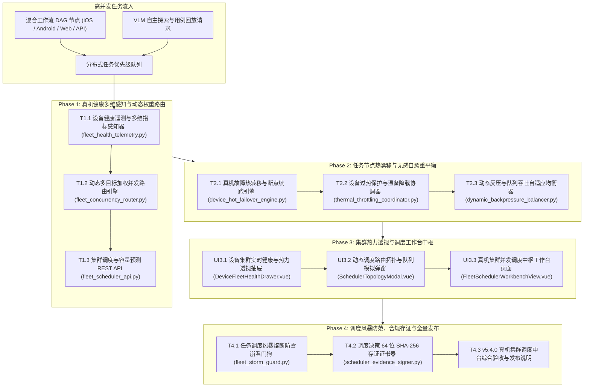

# ATP v5.4.0 研发任务规划表：大规模物理真机集群自适应并发调度与算力拓扑中台

**版本代号**: v5.4.0
**规划日期**: 2026-10-17
**核心目标**: 构建大规模物理真机（iOS / Android）与执行算力集群的自适应动态权重调度（Adaptive Concurrency Router）与无感热漂移自愈中台（Hot-Failover Rebalancing Engine），保障多端高并发工作流与 AI 探索在复杂设备集群中平稳高可用运行。

---

## 1. 架构设计与系统全景拓扑

---

## 2. 任务分解清单 (Phase 1 ~ Phase 4)

### Phase 1：真机健康多维感知与动态权重路由

| ID / 状态 | 任务名称与交付物 | 依赖 | 验收标准 |
|---|---|---|---|
| T1.1 `[x]` | **设备健康遥测与多维指标感知器** | `backend/app/services/fleet_health_telemetry.py` | 实时汇聚真机电池温度、电量、CPU/内存水位、当前任务并发及 USB/WDA 隧道 RTT 时延；单测独立通过；见 docs/evidence/fleet-health-telemetry-t1-1-2026-10-17.md |
| T1.2 `[x]` | **动态多目标加权并发路由引擎** | `backend/app/services/fleet_concurrency_router.py` | 基于平台亲和度、健康得分与当前负载动态挑选全局最优执行设备（Best-Fit Device Router）；单测独立通过；见 docs/evidence/fleet-concurrency-router-t1-2-2026-10-17.md |
| T1.3 `[ ]` | **集群调度与容量预测 REST API** | `backend/app/api/v1/fleet_scheduler_api.py` | 挂载 `/api/v1/scheduler/*`，暴露设备健康状态、最优路由决策计算与集群容量概览端点；单测独立通过。 |

---

### Phase 2：任务节点热漂移与无感自愈重平衡

| ID / 状态 | 任务名称与交付物 | 依赖 | 验收标准 |
|---|---|---|---|
| T2.1 `[ ]` | **真机故障热转移与断点续跑引擎** | `backend/app/services/device_hot_failover_engine.py` | 当执行中的真机掉线或假死时，在 500ms 内无感热迁移至温备同构设备并保留任务上下文继续执行；单测独立通过。 |
| T2.2 `[ ]` | **设备过热保护与温备降载协调器** | `backend/app/services/thermal_throttling_coordinator.py` | 自动感知电池超温（>42°C）触发强制静默降温，动态削减并发分配；单测独立通过。 |
| T2.3 `[ ]` | **动态反压与队列吞吐自适应均衡器** | `backend/app/services/dynamic_backpressure_balancer.py` | 监控全局队列排队深度与执行延迟，自适应调整并发吞吐窗口（动态反压限流）；单测独立通过。 |

---

### Phase 3：集群热力透视与调度工作台中枢

| ID / 状态 | 任务名称与交付物 | 依赖 | 验收标准 |
|---|---|---|---|
| UI3.1 `[ ]` | **设备集群实时健康与热力透视抽屉** | `frontend/src/views/workbench/components/DeviceFleetHealthDrawer.vue` | 可视化展示真实设备池实时温度热力图、电池电量梯度与当前绑定任务拓扑；单测独立通过。 |
| UI3.2 `[ ]` | **动态调度路由拓扑与队列模拟弹窗** | `frontend/src/views/workbench/components/SchedulerTopologyModal.vue` | 提供模拟任务路由演算、分配权重参数调节与节点匹配预览；单测独立通过。 |
| UI3.3 `[ ]` | **真机集群并发调度中枢工作台页面** | `frontend/src/views/workbench/FleetSchedulerWorkbenchView.vue` | 落地路由 `/workbench/fleet-scheduler`，集成 4 大 Bento KPI、大盘列表与操作；单测独立通过。 |

---

### Phase 4：调度风暴防范、合规存证与全量发布

| ID / 状态 | 任务名称与交付物 | 依赖 | 验收标准 |
|---|---|---|---|
| T4.1 `[ ]` | **任务调度风暴熔断防雪崩看门狗** | `backend/app/services/fleet_storm_guard.py` | 防范瞬时超大规模批量触发导致的真机群雷崩与重试雪崩；单测独立通过。 |
| T4.2 `[ ]` | **调度决策 64 位 SHA-256 存证证书器** | `backend/app/services/scheduler_evidence_signer.py` | 为路由决策记录与集群容量分配快照签发不可篡改 SHA-256 + HMAC 存证证书；单测独立通过。 |
| T4.3 `[ ]` | **v5.4.0 真机集群调度中台综合验收与发布说明** | 全局回归与文档 | 全套后端与前端测试 100% PASS，归档 `docs/v5.4.0-release-notes.md` 与专项交付证据。 |

---

## 3. 质量门禁规则

1. **后端质量门禁**：
   - `pytest` 单测 100% PASS；
   - `pytest-standalone-sweep.py` 隔离单跑 100% PASS；
   - `ruff check` 零警告；
   - `ruff format --check` 格式化完全合规；
   - `mypy` 强类型安全通过。
2. **前端质量门禁**：
   - `vue-tsc --noEmit` 严格类型零错误；
   - `vitest run` 单测 100% PASS；
   - `vite build` 生产构建成功。
3. **专项证据链**：每个任务交付均在 `docs/evidence/` 归档带时间戳的完整验证记录。
