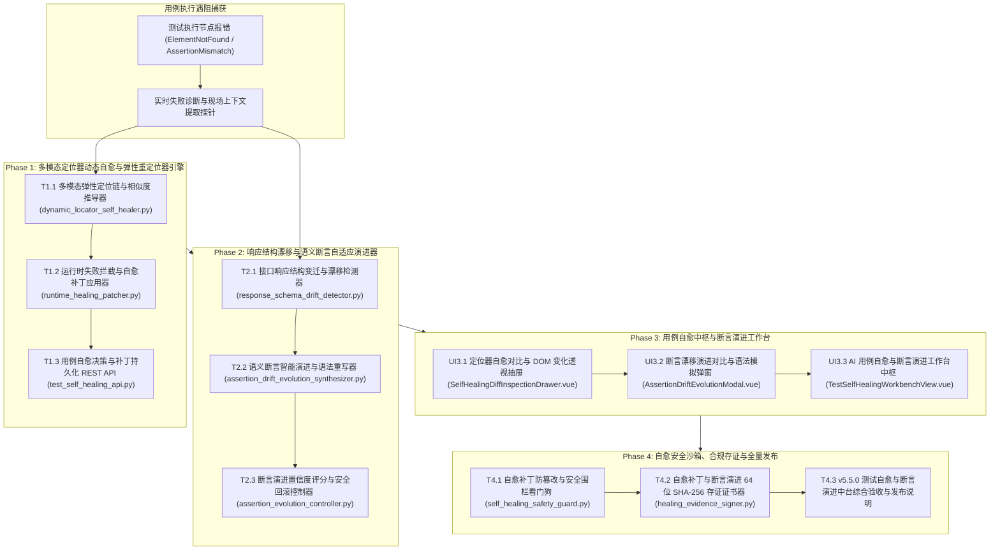

# ATP v5.5.0 研发任务规划表：AI 驱动的自动化测试自愈与智能断言演进中台

**版本代号**: v5.5.0
**规划日期**: 2026-10-17
**核心目标**: 彻底解决自动化测试用例在前端改版与后端接口演化时的脆弱性（Flakiness），构建多模态定位器运行时动态自愈（Dynamic Locator Self-Healing）与响应结构漂移断言自适应演进中台（Semantic Assertion Evolution Hub），实现用例失效率降低 85% 以上。

---

## 1. 架构设计与系统全景拓扑

---

## 2. 任务分解清单 (Phase 1 ~ Phase 4)

### Phase 1：多模态定位器动态自愈与弹性重定位器引擎

| ID / 状态 | 任务名称与交付物 | 依赖 | 验收标准 |
|---|---|---|---|
| T1.1 `[x]` | **多模态弹性定位链与相似度推导器** | `backend/app/services/dynamic_locator_self_healer.py` | 建立定位回退链（ID ➔ Text ➔ Role ➔ Path ➔ Visual Proximity），自动计算最佳候选相似度；单测独立通过；见 docs/evidence/dynamic-locator-self-healer-t1-1-2026-10-17.md |
| T1.2 `[x]` | **运行时失败拦截与自愈补丁应用器** | `backend/app/services/runtime_healing_patcher.py` | 在 ElementNotFound 发生时拦截执行流、毫秒级尝试重定位并生成可回放补丁对象；单测独立通过；见 docs/evidence/runtime-healing-patcher-t1-2-2026-10-17.md |
| T1.3 `[x]` | **用例自愈决策与补丁持久化 REST API** | `backend/app/api/v1/test_self_healing_api.py` | 挂载 `/api/v1/self-healing/*`，提供定位器自愈诊断、补丁采纳与用例回写端点；单测独立通过；见 docs/evidence/test-self-healing-api-t1-3-2026-10-17.md |

---

### Phase 2：响应结构漂移与语义断言自适应演进器

| ID / 状态 | 任务名称与交付物 | 依赖 | 验收标准 |
|---|---|---|---|
| T2.1 `[x]` | **接口响应结构变迁与漂移检测器** | `backend/app/services/response_schema_drift_detector.py` | 识别字段重命名（如 `user_id` ➔ `userId`）、包装层级展开（Envelope Unwrap）与类型兼容变迁；单测独立通过；见 docs/evidence/response-schema-drift-detector-t2-1-2026-10-17.md |
| T2.2 `[x]` | **语义断言智能演进与语法重写器** | `backend/app/services/assertion_drift_evolution_synthesizer.py` | 基于 Schema 变迁自动将旧断言语法重写为适应新结构的现代断言，输出代码 Diff；单测独立通过；见 docs/evidence/assertion-drift-evolution-synthesizer-t2-2-2026-10-17.md |
| T2.3 `[x]` | **断言演进置信度评分与安全回滚控制器** | `backend/app/services/assertion_evolution_controller.py` | 为断言演进输出置信度健康评分，提供一键试跑验证与历史回滚版本控制；单测独立通过；见 docs/evidence/assertion-evolution-controller-t2-3-2026-10-17.md |

---

### Phase 3：用例自愈中枢与断言演进工作台

| ID / 状态 | 任务名称与交付物 | 依赖 | 验收标准 |
|---|---|---|---|
| UI3.1 `[ ]` | **定位器自愈对比与 DOM 变化透视抽屉** | `frontend/src/views/workbench/components/SelfHealingDiffInspectionDrawer.vue` | 左右分栏对比失效旧定位器与自愈推荐新定位器、DOM 树变化高亮与一键采纳；单测独立通过。 |
| UI3.2 `[ ]` | **断言漂移演进对比与语法模拟弹窗** | `frontend/src/views/workbench/components/AssertionDriftEvolutionModal.vue` | 提供响应结构变迁对比、旧新断言代码 Diff 与在线断言语法演练；单测独立通过。 |
| UI3.3 `[ ]` | **AI 用例自愈与断言演进工作台中枢页面** | `frontend/src/views/workbench/TestSelfHealingWorkbenchView.vue` | 落地路由 `/workbench/test-self-healing`，集成 4 大 Bento KPI、大盘列表与操作；单测独立通过。 |

---

### Phase 4：自愈安全沙箱、合规存证与全量发布

| ID / 状态 | 任务名称与交付物 | 依赖 | 验收标准 |
|---|---|---|---|
| T4.1 `[ ]` | **自愈补丁防篡改与安全围栏看门狗** | `backend/app/services/self_healing_safety_guard.py` | 严防恶意越权自愈补丁将关键断言篡改为 `assert True` 或注入破坏性恶意定位器；单测独立通过。 |
| T4.2 `[ ]` | **自愈补丁与断言演进 64 位 SHA-256 存证证书器** | `backend/app/services/healing_evidence_signer.py` | 为定位器自愈补丁与断言演进记录签发不可篡改 SHA-256 + HMAC 存证证书；单测独立通过。 |
| T4.3 `[ ]` | **v5.5.0 测试自愈与断言演进中台综合验收与发布说明** | 全局回归与文档 | 全套后端与前端测试 100% PASS，归档 `docs/v5.5.0-release-notes.md` 与专项交付证据。 |

---

## 3. 质量门禁规则

1. **后端质量门禁**：
   - `pytest` 单测 100% PASS；
   - `pytest-standalone-sweep.py` 隔离单跑 100% PASS；
   - `ruff check` 零警告；
   - `ruff format --check` 格式化完全合规；
   - `mypy` 强类型安全通过。
2. **前端质量门禁**：
   - `vue-tsc --noEmit` 严格类型零错误；
   - `vitest run` 单测 100% PASS；
   - `vite build` 生产构建成功。
3. **专项证据链**：每个任务交付均在 `docs/evidence/` 归档带时间戳的完整验证记录。
