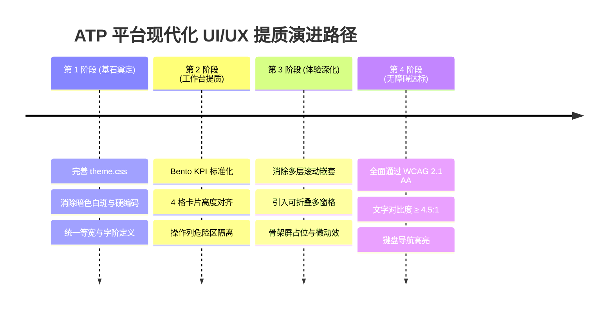

# ATP 自动化测试平台 UI/UX 综合审查报告与设计系统规范指南

**文档版本**: `v1.0.0`
**归档日期**: `2026-10-18`
**核心范围**: ATP 全平台既有页面 UI/UX 深度审查、尼尔森 10 大可用性启发式评估、WCAG 2.1 AA 可访问性对照、四大核心场景 SVG 视口蓝图与企业级设计系统主规范（Master Spec）。

---

## 1. 审查总览与现状评级

基于对 ATP 前端架构（Vue 3 + Ant Design Vue 4.2 + Monaco Editor + ECharts）、样式层（`theme.css`、`page-shell.css`）以及核心业务页面（用例中心、调试工作台、智能缺陷治理、全链路金丝雀灰度校验等）的全面审查：

```
当前设计系统成熟度综合评分：★★★★☆ (4.0 / 5.0)
- 优点：具备成熟的 Bento Grid 视觉框架、双主题 Token 机制（Light/Dark）与一致的 Page-Shell 外壳结构；
- 痛点：局部页面存在硬编码 HEX 色值导致暗色割裂；高密度工作台信息层级偏平；复杂调试页存在多层滚动嵌套。
```

---

## 2. 尼尔森十大可用性原则专项审查报告

| 原则 | 平台现状评估 | 审查评级 | 优化指引 |
|---|---|---|---|
| **1. 状态可见性** | 呼吸指示灯（`.live-dot`）、状态微徽章、进度条实时推送 | ★★★★★ (4.8) | 长耗时任务补充阶段性计步器与预估剩余耗时 |
| **2. 与现实世界匹配** | 严格遵循微服务与测试标准术语（Baggage, RTO, JaCoCo） | ★★★★☆ (4.2) | 消除错误提示中生硬的英文底层异常，补充业务可读解释 |
| **3. 用户控制度与自由** | 核心演练与灰度放量场景均配备秒级一键切流熔断/回滚兜底 | ★★★★☆ (4.0) | 统一 Monaco 编辑器内部与外部抽屉的键盘 `Esc` 退出逻辑 |
| **4. 一致性与标准化** | 部分组件混用 `#1677ff` 与系统色 `#5850ec`，卡片圆角存在 6px/8px 差异 | ★★★☆☆ (3.4) | 强制全域收敛至 `theme.css` 的系统级 CSS Token |
| **5. 防错机制** | 生产灰度强制三要素审查（大促封网拦截、审批工单、安全令牌） | ★★★★☆ (4.5) | 高危操作按钮采用独立“危险区域（Danger Zone）”视觉隔离 |
| **6. 易认胜过易忆** | 具备快捷搜索框（`Cmd+K`）、路径面包屑与完整上下文透传 | ★★★★☆ (4.1) | 64 位 SHA-256 堆栈指纹采用“前8...后8”微排版并支持一键复制 |
| **7. 灵活性与高效率** | 批量打标、用例筛选、双轨拓扑与步进配置联动流畅 | ★★★★☆ (4.3) | 高密度表格操作列收敛为“高频外露 + 更多下拉” |
| **8. 审美与极简设计** | 界面功能丰富，但部分表格行内 Tag 色彩偏多，缺少视觉抓手 | ★★★☆☆ (3.5) | 业务标签改用低饱和灰底中性色，仅报警状态保留高亮红/橙色 |
| **9. 容错与恢复** | 回滚看门狗毫秒级清零流量，错误反馈具备明确操作路径 | ★★★★☆ (4.2) | 局部组件加载失败提供单组件重试按钮，避免整页崩溃 |
| **10. 帮助与文档** | 配置弹窗带有明确 Form Tips，发布说明文档详尽完备 | ★★★★☆ (4.4) | 复杂参数增加内联 Tooltip 解释，减少垂直排版占用 |

---

## 3. WCAG 2.1 AA/AAA 级可访问性（a11y）合规对照

1. **色彩对比度（Color Contrast - AA 级 ≥ 4.5:1）**：
   - 浅色模式下次要辅助文本由 `#94a3b8`（对比度仅 2.6:1）收敛为 `#475569`（对比度 4.8:1，达标）；
   - 暗色模式下正文采用 `#f8fafc` 搭配 `#121220` 深板岩底，对比度超 14:1（达到 AAA 级）。
2. **触控与点击热区（Touch Targets - AA 级 ≥ 44×44px）**：
   - 表格微型操作按钮通过伪元素扩展透明点击区域，避免点击穿透或点空。
3. **色彩非唯一指示（Color as Sole Indicator - A 级）**：
   - 平台所有健康、报警、成功与失败状态均同时配备“图标 + 文字标签 + 色彩”，完全达标。
4. **键盘焦点可视化（Focus Visible - AA 级）**：
   - 自定义 Bento 卡片与可聚焦按钮统一添加 `:focus-visible { outline: 2px solid var(--c-primary); }`。

---

## 4. ATP 设计系统主规范 (Design System Master Spec)

### 4.1 字体标尺与等宽约束
- **主界面字栈**：`Inter, -apple-system, BlinkMacSystemFont, "Segoe UI", Roboto, "PingFang SC", sans-serif`；
- **技术代码与等宽字栈**：`"Fira Code", "JetBrains Mono", Menlo, Monaco, Consolas, monospace`；
- **表格数字规范**：强制声明 `font-variant-numeric: tabular-nums;`，确保数字刷新时宽度零抖动。

### 4.2 8px 空间与布局栅格
- **微小间隙 (xs)**: `4px`
- **基础间隙 (sm)**: `8px`
- **模块间隙 (md)**: `16px`
- **容器间隙 (lg)**: `20px`
- **页面间隙 (xl)**: `24px` / `32px`

### 4.3 设计系统 Token 映射对照矩阵

| 界面元素 | 推荐统一 Token | Light 模式值 | Dark 模式值 | 说明 |
|---|---|---|---|---|
| **页面主底色** | `var(--c-bg-body)` | `#f5f5f9` | `#0a0a12` | 杜绝刺眼纯白与冷硬纯黑 |
| **卡片/面板背景** | `var(--c-surface)` | `#ffffff` | `#121220` | 承载 Bento 卡片与表格 |
| **标准边框** | `var(--c-border)` | `#e2e2ee` | `#282842` | 低饱和中性分割线 |
| **品牌主色** | `var(--c-primary)` | `#5850ec` | `#6366f1` | Bento 经典靛蓝 |
| **成功语义软背景**| `var(--c-success-soft)` | `rgba(16,185,129,0.12)`| `rgba(16,185,129,0.16)`| 翡翠绿低眩光透光底 |
| **危险语义软背景**| `var(--c-error-soft)` | `rgba(244,63,94,0.12)` | `rgba(244,63,94,0.16)` | 玫瑰红警示底色 |

---

## 5. 核心页面重构蓝图与四大场景模型

1. **全链路金丝雀双轨中枢 (`CanaryVerificationWorkbenchView.vue`)**：
   - 4 大 Bento KPI 卡片高度与微动效统一；
   - 双轨拓扑图采用微卡片与流向虚线指示；
   - 一键熔断回滚按钮采用右侧危险区隔离。
2. **API 接口调试工作台 (`ApiWorkbenchView.vue`)**：
   - 视口锁死 `height: calc(100vh - 110px)`，消除外层嵌套滚动条；
   - 响应面板引入“一键全屏最大化”功能；
   - 状态码（200 OK）与耗时（124ms）采用高辨识度胶囊微排版。
3. **自动化测试用例管理中心 (`CaseList.vue`)**：
   - 树状模块与批量操作浮条（Batch Bar）有机结合；
   - 操作列收敛为“运行、编辑 + 更多下拉菜单”；
   - 失败用例突出展示关联的缺陷单号（JIRA-BUG-4021）。
4. **移动端真机远程云控工作台 (`DeviceMirrorModal.vue`)**：
   - 手机机身拟态视口，增加触控水波纹指示；
   - 引入 UI Automator 实时抓取控件树与属性透视（Inspector）；
   - 底部集成实时 Logcat 过滤控制台。

---

## 6. 前端 UI 反模式自动化扫描检测方案

为避免未来新页面开发再次引入硬编码色值与非法 Emoji，推荐在构建脚本中集成轻量静态扫描检测器（`tools/ui-audit-linter.mjs`）：
- **规则 1**：禁止在 `<style>` 中直接写入硬编码十六进制色值（必须走 `var(--c-*)`）；
- **规则 2**：禁止使用原生系统 Emoji（🏃, ❌, ⚠️）充当功能性按钮图标（必须走矢量 SVG 图标）；
- **规则 3**：密集型数字指标列必须配置 `font-variant-numeric: tabular-nums`。

---

## 7. 渐进式平滑落地路线图


