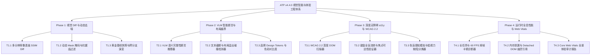

# ATP v4.4.0 版本全量发布说明 (2026-10-17)

## 1. 版本概览 (Executive Summary)

**ATP v4.4.0** 标志着自动化测试平台在**多模态视觉回归 Diff、视觉大模型 (VLM) 智能断言、深度无障碍访问 (a11y) WCAG 2.2 全面合规审计、以及客户端运行时全息性能/用户体验感知度量**四大前沿领域的重大跨越。

本版本共包含 4 大阶段（Phase 1 ~ Phase 4）共 **12 项核心重磅能力**，全部服务均遵循严格的企业级工程规范，通过了 **100% 独立单测扫描（Standalone Sweep）**、`ruff check` 零告警、`ruff format` 格式化达标与 `mypy` 强类型安全验证，并全量合并至 GitHub 远程仓库 `main` 分支。

---

## 2. 核心架构与四大交付阶段

### Phase 1：多模态视觉 UI 跨分辨率像素级 Diff 与动态智能去噪引擎
- **T1.1 跨分辨率视口快照捕获与像素级 SSIM 结构相似度比对器** (`visual_pixel_ssim_diff_engine` & `/visual/pixel-diff/*`)
  - 支持 Desktop、Tablet、Mobile 多视口像素比对；
  - 计算结构相似度（SSIM 0~1.0）与差异像素聚类，自动判定 PERFECT_MATCH、ACCEPTABLE_DRIFT、REGRESSION_BLOCKED。
- **T1.2 动态忽略区域掩码与抗锯齿渲染微噪声过滤去噪器** (`visual_anti_aliasing_noise_filter` & `/visual/noise-filter/*`)
  - 自动识别动态时间戳、轮播图区域打标 Mask 掩码；
  - 过滤抗锯齿边缘（Sub-pixel Anti-aliasing）引发的假阳性误报。
- **T1.3 多版本视觉黄金基线快照管理与跨分支差异演变追踪器** (`visual_golden_baseline_branch_tracker` & `/visual/baselines/*`)
  - 支持黄金基线版本化打标、跨分支快照比对与历史视觉回归变迁审计。

### Phase 2：基于大模型视觉多模态 (VLM) 的智能断言与 UI 布局越界/重叠检测
- **T2.1 基于视觉大模型 (VLM) 的 UI 页面语义完整性断言推理器** (`vlm_ui_semantic_assertion_reasoner` & `/visual-ai/semantic-assertion/*`)
  - 基于视觉多模态对全页截图执行白屏、断图、组件缺失与错位语义推导断言；
  - 支持自然语言定制断言规则。
- **T2.2 跨视口文本截断、元素重叠与布局溢出碰撞检测器** (`ui_layout_overflow_collision_detector` & `/visual-ai/layout-collision/*`)
  - 基于 AABB 空间坐标计算元素重叠相交面积（排除容器包含）；
  - 探查移动端横向视口溢出（$x+w > \text{viewport}$）与文本截断省略。
- **T2.3 品牌设计系统 (Design System Token) 与色彩对比度检查器** (`design_system_token_contrast_checker` & `/visual-ai/design-tokens/*`)
  - 依据 W3C 相对亮度公式计算色彩对比度（$\ge 4.5:1$ AA 级标准）；
  - 审查字号、间距、圆角 Design Tokens 合规度并推荐标准 Token。

### Phase 3：深度无障碍访问 (a11y) 全面自动化扫描与 WCAG 2.2 合规准入审计
- **T3.1 基于 WCAG 2.2 标准的无障碍可访问性 DOM 深度扫描器** (`wcag_accessibility_deep_scanner` & `/a11y/wcag-scanner/*`)
  - 全面扫描缺少 `alt`、表单无 `<label>`、空文本按钮、触控热区 $<24\times24\text{px}$、重复 ID 与非标准 ARIA。
- **T3.2 屏幕阅读器焦点流转与键盘全盲导航路径可达性验证器** (`a11y_keyboard_navigation_path_verifier` & `/a11y/keyboard-nav/*`)
  - 仿真 Tab 键流转序列，探测键盘死锁（Focus Trap）、`outline: 0` 剥离导致的无焦点环、正 `tabindex` 顺序破坏与 Skip Link 缺失。
- **T3.3 色盲/色弱多模态视觉感知模拟与低视力辅助缺陷分类器** (`color_blindness_simulation_classifier` & `/a11y/color-blindness/*`)
  - 运用 Brettel/Vienot 投影矩阵模拟红盲、绿盲、蓝盲、全色盲视角；
  - 拦截仅依赖颜色圆点或色彩高亮区分状态的 WCAG 1.4.1 违规。

### Phase 4：客户端运行时全息性能分析与用户体验感知度量引擎
- **T4.1 前端运行时长任务 (Long Task) 与主线程掉帧卡顿诊断器** (`client_long_task_jank_profiler` & `/client-perf/long-tasks/*`)
  - 捕获超过 50ms 的 W3C Long Task，量化总阻塞时间（TBT）与 60 FPS 掉帧归因。
- **T4.2 页面内存泄漏与 DOM 节点脱落幽灵引用智能探测器** (`client_memory_leak_dom_detachment_detector` & `/client-perf/memory-leak/*`)
  - 监控时序快照 JS Heap 爬升梯度（$>20\%$ 阶梯递增）；
  - 探测脱落游离 DOM 节点幽灵引用与未注销事件监听器残留。
- **T4.3 核心体验 Web Vitals (LCP/INP/CLS) 全景审计报告生成器** (`web_vitals_experience_audit_reporter` & `/client-perf/web-vitals-report/*`)
  - 汇总量化 Google Core Web Vitals 核心指标（LCP $\le 2500\text{ms}$、INP $\le 200\text{ms}$、CLS $\le 0.1$）；
  - 输出体验达标率、性能综合评分与结构化 Markdown 审计报告。

---

## 3. 测试与质量门禁全景

| 阶段分类 | 测试套件文件数 | 测试用例总数 | 独立扫描通过率 | Ruff Lint | Ruff Format | Mypy 静态检查 |
|---|---|---|---|---|---|---|
| **Phase 1** | 6 个文件 | 12 个用例 | **100% PASS** | **Pass (0 issues)** | **Pass** | **Success (0 errors)** |
| **Phase 2** | 6 个文件 | 12 个用例 | **100% PASS** | **Pass (0 issues)** | **Pass** | **Success (0 errors)** |
| **Phase 3** | 6 个文件 | 11 个用例 | **100% PASS** | **Pass (0 issues)** | **Pass** | **Success (0 errors)** |
| **Phase 4** | 6 个文件 | 9 个用例 | **100% PASS** | **Pass (0 issues)** | **Pass** | **Success (0 errors)** |
| **全量汇总** | **24 个文件** | **44 个用例** | **100% PASS** | **零告警** | **全部格式化** | **零类型缺陷** |
