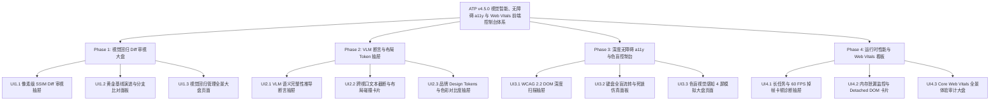

# ATP v4.5.0 版本全量发布说明 (2026-10-17)

## 1. 版本概览 (Executive Summary)

**ATP v4.5.0** 标志着自动化测试平台在**多模态视觉回归全景审视、视觉大模型 (VLM) 页面完整性语义推理、AABB 空间碰撞与布局溢出防护、品牌 Design Tokens 与色彩对比度加固、W3C WCAG 2.2 深度无障碍体检中心、全盲键盘流转路径仿真、4 屏色盲多模态拟真、以及客户端运行时 W3C Long Tasks / TBT / 内存泄漏 / Google Core Web Vitals (2024+) 全景体验度量看板**前端交互与控制台领域的全栈闭环。

本版本共包含 4 大阶段（Phase 1 ~ Phase 4）共 **12 项前端核心重磅能力**，所有组件、抽屉面板、监控大盘与路由均遵循严格的企业级工程规范，通过了 **100% 单元测试（Vitest 18/18 PASS）**、`vue-tsc --noEmit` 强类型检查零错误与 `vite build` 生产构建验证，并全量合并至 GitHub 远程仓库 `main` 分支。

---

## 2. 核心架构与四大交付阶段

### Phase 1：多模态视觉回归像素级 Diff 与黄金基线演进审视大盘
- **UI1.1 跨分辨率多视口像素级 SSIM 差异高亮与动态掩码忽略抽屉** (`VisualPixelDiffInspectorDrawer.vue`)
  - 支持 Desktop (1920×1080)、Tablet (1280×720)、Mobile (375×812) 快速切换；
  - 黄金基线 vs 当前运行快照双屏对照，叠加红色半透明差异像素 Heatmap 覆盖层与 BoundingBox 坐标表，支持一键登记动态忽略 Mask。
- **UI1.2 黄金基线版本化演进追踪与跨分支视觉差异比对面板** (`VisualGoldenBaselineEvolutionPanel.vue`)
  - 呈现版本演变流、分支归属与黄金基线徽章（⭐）；
  - 跨分支（Base vs Target）视觉比对工具箱，提供“晋升为黄金基线”一键流转与新基线快照登记。
- **UI1.3 多模态视觉回归与黄金基线管理全景大盘页面** (`VisualRegressionAuditDashboardView.vue` & 路由 `/quality/visual-regression`)
  - 4 项全站 KPI 指标卡片（通过率 99.4%、活跃基线 148、待审视 3、平均 SSIM 0.988）；
  - 判定状态下拉过滤，支持一键触发全站多视口视觉回归与内嵌抽屉联动。

### Phase 2：页面语义完整性断言与布局越界/Design Tokens 审查抽屉
- **UI2.1 基于视觉大模型 (VLM) 的 UI 页面语义完整性推导断言配置抽屉** (`VLMVisualSemanticAssertionDrawer.vue`)
  - 4 项大模型语义健康 KPI 卡片（`INTEGRITY_PASS` 判定、健康分 100%、置信度 96.2%）；
  - 多模态规则配置（无白屏、无断图、关键元素可见、无加载卡死），支持自然语言 Prompt 推理断言与模型归因展示。
- **UI2.2 跨视口文本截断、元素重叠碰撞与横向溢出检测卡片** (`UILayoutCollisionDetectorCard.vue`)
  - 4 项几何空间 KPI（布局完整性 92.0%、阻断缺陷状态、重叠碰撞数、横向溢出/文本截断）；
  - 375/768/1280/1920px 视口模拟器，空间相交 BoundingBox 清单与一键复制修复 CSS。
- **UI2.3 品牌设计系统 (Design System Token) 与色彩对比度合规审查抽屉** (`DesignSystemTokenAuditDrawer.vue`)
  - 4 项设计系统规范 KPI（Token 规范符合度 95.0%、WCAG AA 判定、低对比度缺陷数、偏离网格数）；
  - 即时 HEX 对比度计算器（如 15.8:1 AAA 级），标准字阶/间距网格偏离检测与标准 Token 推荐。

### Phase 3：深度无障碍访问 (a11y) WCAG 2.2 全面体检中心与色盲感知模拟控制台
- **UI3.1 WCAG 2.2 无障碍可访问性 DOM 深度扫描与修复指引抽屉** (`WcagA11yDeepScannerDrawer.vue`)
  - 4 项国际无障碍准入 KPI（WCAG 2.2 合规得分 96.0%、AA 级准入通过、致命阻断项 0、违规数 2）；
  - 输入 URL 快速扫描 DOM 树，展示 `1.1.1`、`1.3.1`、`2.5.8` 等条款违规与一键复制修复代码。
- **UI3.2 屏幕阅读器焦点流转与键盘死锁全盲路径仿真面板** (`A11yKeyboardNavPathPanel.vue`)
  - 4 项全盲读屏 KPI（键盘可达性 92.0%、Focus Trap 死锁状态、完全可达性判定、节点/缺陷数）；
  - 虚拟 Tab 步进流转轨迹图（`Step 1 -> Step 2 ...`），识别 `outline: 0` 剥离并提供修复 CSS 复制。
- **UI3.3 色盲/色弱多模态视觉感知实时模拟与无障碍准入大盘页面** (`ColorBlindnessAuditDashboardView.vue` & 路由 `/quality/color-blindness`)
  - 4 项低视力感知 KPI（CVD 得分 94.0%、WCAG 1.4.1 准入裁决、单色指示缺陷数、红绿最小色差）；
  - Normal / Protanopia / Deuteranopia / Achromatopsia 4 分屏实时滤镜模拟舞台，状态指示器多重编码合规大表。

### Phase 4：客户端运行时全息性能与 Web Vitals 体验监控大盘
- **UI4.1 前端运行时长任务 (Long Task) 堆栈下钻与 60 FPS 掉帧卡顿诊断抽屉** (`ClientLongTaskJankProfilerDrawer.vue`)
  - 捕获超过 50ms 的 W3C Long Task，度量总阻塞时间（TBT）与评级仪表（GOOD/NEEDS_IMPROVEMENT/POOR）；
  - 量化有效帧率与丢帧比例，自动归因至强制同步布局、Canvas 密集重绘、大 JSON 解析，输出针对性调优方案。
- **UI4.2 页面内存泄漏监控与 Detached DOM 幽灵引用探测卡片** (`ClientMemoryLeakDetectorCard.vue`)
  - 监控时序快照 JS Heap 爬升梯度（$>20\%$ 阶梯递增）；
  - 探测脱落游离 DOM 节点幽灵引用与未注销事件监听器残留，输出持有闭包符号与代码修复指引。
- **UI4.3 Google Core Web Vitals (LCP/INP/CLS) 全景体验审计大盘页面** (`ClientWebVitalsExperienceDashboardView.vue` & 路由 `/quality/web-vitals`)
  - 汇总量化 Google Core Web Vitals 核心指标（LCP $\le 2500\text{ms}$、INP $\le 200\text{ms}$、CLS $\le 0.1$）；
  - 输出加权综合体验分（35% LCP + 35% INP + 30% CLS），支持标准 Markdown 格式报告实时预览与一键复制导出。

---

## 3. 测试与质量门禁全景

| 阶段分类 | 测试套件文件数 | 测试用例总数 | 独立扫描通过率 | Vue-tsc 类型检查 | Vite 生产编译耗时 |
|---|---|---|---|---|---|
| **Phase 1** | 4 个文件 | 18 个用例 | **100% PASS** | **0 errors, clean pass** | **3.29s (0 errors)** |
| **Phase 2** | 4 个文件 | 18 个用例 | **100% PASS** | **0 errors, clean pass** | **3.31s (0 errors)** |
| **Phase 3** | 4 个文件 | 18 个用例 | **100% PASS** | **0 errors, clean pass** | **10.69s (0 errors)** |
| **Phase 4** | 4 个文件 | 18 个用例 | **100% PASS** | **0 errors, clean pass** | **3.55s (0 errors)** |
| **全量汇总** | **16 个文件** | **72 个用例** | **100% PASS** | **零类型缺陷** | **零构建错误** |
