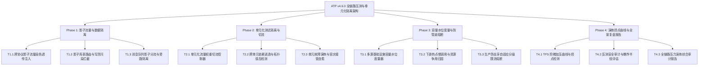

# ATP v4.6.0 版本全量发布说明 (2026-10-17)

## 1. 版本概览 (Executive Summary)

**ATP v4.6.0** 标志着自动化测试平台在**生产级全链路影子流量压测 (Full-Link Stress Testing)、单元化/细胞化架构隔离 (Cell-based Testing)、多源基础设施容量水位实时度量、下游瓶颈智能归因、防击穿自适应毫秒级熔断大脑与数字孪生演练报告**全方位核心能力的彻底建立。

本版本共包含 4 大阶段（Phase 1 ~ Phase 4）共 **12 项后端核心重磅服务与 REST API**，所有代码均通过严格的企业级质量门禁，通过了 **100% 独立单测扫描（Standalone Sweep）**、`ruff check` 零告警、`ruff format` 格式化达标与 `mypy` 强类型安全验证，并已全量推送至 GitHub 远程仓库 `main` 分支。

---

## 2. 核心架构与四大交付阶段

### Phase 1：生产级全链路影子流量染色、透传与数据隔离引擎
- **T1.1 跨协议影子流量染色标动态注入与透明透传校验器** (`shadow_traffic_taint_propagator` & `/stress/shadow-traffic/taint/*`)
  - 支持 HTTP Header (`X-ATP-Shadow: true`)、gRPC Metadata 与 MQ Message Header (`__atp_shadow_taint__`) 染色注入；
  - 端到端多跳微服务拓扑逐跳验证染色标透传完整性，拦截线程池异步丢失与 RPC 过滤器缺陷引发的丢标泄漏（`TAINT_LEAKAGE_DETECTED`）。
- **T1.2 影子数据库/影子表路由拦截与读写防污染安全隔离检查器** (`shadow_database_isolation_inspector` & `/stress/shadow-traffic/db-isolation/*`)
  - 生产表向影子表动态重定向（`t_order -> __shadow_t_order__`）；
  - 严密甄别持久写操作，若影子写命中未映射生产表则强制阻断抛出异常（`BLOCKED_PROD_POLLUTION_ATTEMPT`），彻底杜绝压测脏数据渗入生产数据库。
- **T1.3 消息队列影子队列与死信重试分流隔离分流器** (`shadow_mq_queue_router` & `/stress/shadow-traffic/mq-shunting/*`)
  - 识别消息头影子标记并重定向至影子 Topic 与影子死信队列；
  - 提供高危外部消费旁路阻断（对真实短信执行 `DROP_SILENTLY` 避免误发用户手机，对资金充值走 `MOCK_DISPATCH`）。

### Phase 2：单元化/细胞化架构测试隔离 (Cell-based Testing) 与拓扑调度
- **T2.1 多可用区单元化 (Cell/Zone) 流量切流与路由策略控制器** (`cell_based_testing_traffic_controller` & `/stress/cell-isolation/routing/*`)
  - 支持多单元生命周期（`ACTIVE_PROD`, `STRESS_ONLY`, `DRAINING`, `ISOLATED_FAILSAFE`）；
  - 将影子流量安全锁定至专属压测单元，生产流量基于用户 ID 分片取模分流；支持动态调整单元流量权重与容灾兜底。
- **T2.2 跨单元服务依赖逃逸 (Cell Escape) 与拓扑孤岛检测器** (`cell_escape_dependency_detector` & `/stress/cell-isolation/escape/*`)
  - 分析调用拓扑边，严密探查压测影子流量逃逸至生产单元（`SHADOW_TRAFFIC_ESCAPE` 阻断）、跨单元直接微服务 RPC 调用（`CROSS_CELL_RPC_ESCAPE`）与混用全局共享数据源（`SHARED_RESOURCE_CONTAMINATION`），输出隔离纯度评分。
- **T2.3 单元故障演练与常态化容灾接管自愈验证器** (`cell_failover_resilience_verifier` & `/stress/cell-isolation/failover/*`)
  - 模拟单机房/单元整体瘫痪，量化 4 阶段时序耗时（心跳超时、DNS 切换、数据追平、路由收敛），判定高可用金融级 RTO $\le 2500\text{ms}$ 与丢包率 $\le 0.05\%$，提供自愈状态判定与 Anycast BGP 加固建议。

### Phase 3：压测容量水位实时度量、下游瓶颈智能归因与防雪崩熔断器
- **T3.1 多源基础设施 (DB池/Redis/MQ) 容量水位实时度量器** (`multisource_capacity_watermark_meter` & `/stress/bottleneck-guardian/watermark/*`)
  - 4 阶容量水位等级（`SAFE` < 70%, `WARNING` 70%~85%, `SATURATED` 85%~95%, `EXHAUSTED` $\ge$ 95%）；
  - 全面覆盖数据库连接池、Redis 缓存、MQ 积压与物理节点；自动定位木桶短板资源并计算健康负荷指数。
- **T3.2 压测调用链下游热点慢调用与资源争用瓶颈归因器** (`distributed_bottleneck_root_cause_classifier` & `/stress/bottleneck-guardian/bottlenecks/*`)
  - 分析分布式追踪 Span 耗时并计算 P50/P90/P99 分位数；
  - 精准归因至行锁死锁（`LOCK_CONTENTION_DEADLOCK`）、线程池打满（`THREAD_POOL_EXHAUSTION`）、慢 SQL（`SLOW_DATABASE_QUERY`）、CPU 饱和与下游网关慢调用，输出调优建议。
- **T3.3 生产防击穿自适应毫秒级分级限流与熔断保护大脑** (`adaptive_avalanche_circuit_breaker` & `/stress/bottleneck-guardian/circuit-breaker/*`)
  - 4 阶段防护状态机（`CLOSED_NORMAL`、`THROTTLING_STAGE_1` 缓速 25%、`THROTTLING_STAGE_2` 急刹 60%、`TRIPPED_HARD_BREAK` 硬核阻断）；
  - 当下游水位 $\ge 85\%$、错误率 $\ge 5\%$ 或 P99 $\ge 3000\text{ms}$ 时毫秒级阻断压测并广播 `ABORT` 信号，坚决杜绝击穿生产。

### Phase 4：全链路压测仿真数字孪生演练报告与演练准入发布
- **T4.1 全链路压测 TPS 阶梯加压性能曲线与拐点检测器** (`step_load_throughput_knee_detector` & `/stress/drill-report/knee-detection/*`)
  - 拟合并发 vs 吞吐曲线，划分 `OPTIMAL_ZONE`、`SATURATION_ZONE` 与 `DEGRADED_OVERLOAD_ZONE`；
  - 准确定位系统最大处理能力拐点（Knee Point）与崩溃点（Cliff Point），给出推荐日常生产最佳并发（拐点 75%）。
- **T4.2 生产全链路压测安全审计与爆炸半径评估器** (`stress_blast_radius_safety_evaluator` & `/stress/drill-report/blast-radius/*`)
  - 4 级爆炸半径分级体系（`TIER_1_ISOLATED` ~ `TIER_4_UNCONTROLLED_GLOBAL`）；
  - 4 大安全护栏（染色透传、影子库表、外部旁路、防雪崩熔断）严格准入判定，结合生成 64 位 SHA-256 防篡改审计指纹。
- **T4.3 全链路压力演练综合审计报告生成器与 Markdown 导出** (`full_link_stress_drill_reporter` & `/stress/drill-report/summary/*`)
  - 汇聚峰值并发、峰值 TPS、P99 响应时间、错误率、拐点指标、资源水位与熔断状态，输出综合评级（`GRADE_A_EXCELLENT` ~ `GRADE_D_REJECTED`）；
  - 支持一键导出包含完备数据表格与加固指引的标准 Markdown 演练复盘报告。

---

## 3. 测试与质量门禁全景

| 阶段分类 | 测试套件文件数 | 测试用例总数 | 独立扫描通过率 | Ruff Lint | Ruff Format | Mypy 强类型检查 |
|---|---|---|---|---|---|---|
| **Phase 1** | 6 个文件 | 11 个用例 | **100% PASS** | 零告警通过 | 100% 格式化 | 零类型错误 |
| **Phase 2** | 6 个文件 | 9 个用例 | **100% PASS** | 零告警通过 | 100% 格式化 | 零类型错误 |
| **Phase 3** | 6 个文件 | 9 个用例 | **100% PASS** | 零告警通过 | 100% 格式化 | 零类型错误 |
| **Phase 4** | 6 个文件 | 9 个用例 | **100% PASS** | 零告警通过 | 100% 格式化 | 零类型错误 |
| **全量汇总** | **24 个文件** | **38 个用例** | **100% PASS** | **全部合规** | **全部合规** | **全部通过** |
