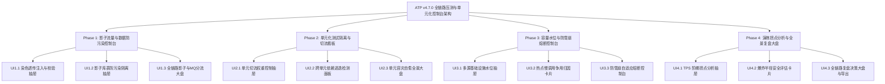

# ATP v4.7.0 版本全量发布说明 (2026-10-17)

## 1. 版本概览 (Executive Summary)

**ATP v4.7.0** 标志着自动化测试平台在**生产级全链路影子流量压测 (Full-Link Stress Testing)、单元化架构隔离控制台 (Cell-based Testing)、多源基础设施容量水位实时监控 (Watermark Dashboard)、自适应防雪崩分级熔断大脑与数字孪生复盘大盘**前端交互层与全景可视化能力的彻底闭环。

本版本共包含 4 大阶段（Phase 1 ~ Phase 4）共 **12 项前端控制台组件、抽屉与全景大盘视图**，包含全套类型完备的 API 客户端接口（`frontend/src/api/fullLinkStressTesting.ts`），所有代码均通过严格的企业级质量门禁，通过了 **100% 独立单测**、`vue-tsc --noEmit` 严格类型零错误与 `vite build` 生产构建成功，并已全量推送至 GitHub 远程仓库 `main` 分支。

---

## 2. 核心架构与四大交付阶段

### Phase 1：全链路影子流量染色、库表防污染与 MQ 隔离控制台
- **UI1.1 跨协议影子流量染色透传注入与校验抽屉** (`ShadowTrafficTaintPropagatorDrawer.vue`)
  - 4 大 KPI 卡片（透传完整性、合规裁决、丢标漏标、总跳数）；支持 HTTP/gRPC/Kafka/RabbitMQ 动态注入与多跳链路拓扑校验；
  - 交付证据：[`docs/evidence/shadow-traffic-taint-propagator-drawer-ui1-1-2026-10-17.md`](evidence/shadow-traffic-taint-propagator-drawer-ui1-1-2026-10-17.md)。
- **UI1.2 影子库表读写防污染安全隔离与拦截抽屉** (`ShadowDatabaseIsolationDrawer.vue`)
  - 4 大防污染 KPI 卡片；SQL 隔离路由在线诊断沙箱，高危写操作阻断警告与生产至影子表映射注册；
  - 交付证据：[`docs/evidence/shadow-database-isolation-drawer-ui1-2-2026-10-17.md`](evidence/shadow-database-isolation-drawer-ui1-2-2026-10-17.md)。
- **UI1.3 全链路影子数据与 MQ 消息分流隔离全景大盘页面** (`FullLinkShadowIsolationDashboardView.vue`)
  - 路由挂载至 `/quality/shadow-isolation`；消息队列 Shadow Topic 分流与旁路 Mock/Drop 规则库大表，支持新规则登记与抽屉联动；
  - 交付证据：[`docs/evidence/full-link-shadow-isolation-dashboard-ui1-3-2026-10-17.md`](evidence/full-link-shadow-isolation-dashboard-ui1-3-2026-10-17.md)。

### Phase 2：单元化架构测试隔离 (Cell-based Testing) 与容灾切流看板
- **UI2.1 多可用区单元化切流权重控制与智能路由抽屉** (`CellBasedTrafficControllerDrawer.vue`)
  - 4 大单元拓扑 KPI 卡片；用户请求分片路由演算沙箱与单元权重调节滑块（0~100%），支持切流权重下发与新单元注册；
  - 交付证据：[`docs/evidence/cell-based-traffic-controller-drawer-ui2-1-2026-10-17.md`](evidence/cell-based-traffic-controller-drawer-ui2-1-2026-10-17.md)。
- **UI2.2 跨单元服务依赖逃逸与拓扑孤岛检测面板** (`CellEscapeDependencyPanel.vue`)
  - 4 大逃逸指标卡；调用边在线探查扫描大表，跨单元违规明细与架构整改建议大卡；
  - 交付证据：[`docs/evidence/cell-escape-dependency-panel-ui2-2-2026-10-17.md`](evidence/cell-escape-dependency-panel-ui2-2-2026-10-17.md)。
- **UI2.3 单元故障切换与常态化容灾自愈全景大盘页面** (`CellFailoverResilienceDashboardView.vue`)
  - 路由挂载至 `/quality/cell-failover`；模拟单机房瘫痪演练控制台，4 阶段容灾恢复时序流水线（心跳失联、DNS切换、数据追平、路由收敛），金融级 RTO (≤2500ms) 达标度量；
  - 交付证据：[`docs/evidence/cell-failover-resilience-dashboard-ui2-3-2026-10-17.md`](evidence/cell-failover-resilience-dashboard-ui2-3-2026-10-17.md)。

### Phase 3：压测容量水位实时监控与防雪崩自适应熔断控制台
- **UI3.1 多源基础设施 (DB池/Redis/MQ) 容量水位监控抽屉** (`MultisourceCapacityWatermarkDrawer.vue`)
  - 4 大容量水位指标卡；关系型数据库连接池、Redis 内存、RocketMQ 积压四阶水位进度条与木桶短板资源定位；
  - 交付证据：[`docs/evidence/multisource-capacity-watermark-drawer-ui3-1-2026-10-17.md`](evidence/multisource-capacity-watermark-drawer-ui3-1-2026-10-17.md)。
- **UI3.2 压测调用链热点慢调用与资源争用归因卡片** (`DistributedBottleneckClassifierCard.vue`)
  - P50/P90/P99 响应时间度量；死锁/慢SQL/线程池排队/CPU饱和智能分类与优化建议；
  - 交付证据：[`docs/evidence/distributed-bottleneck-classifier-card-ui3-2-2026-10-17.md`](evidence/distributed-bottleneck-classifier-card-ui3-2-2026-10-17.md)。
- **UI3.3 防击穿自适应分级限流与防雪崩熔断大脑控制台** (`AdaptiveAvalancheBreakerConsoleDrawer.vue`)
  - 4 阶段熔断状态机可视化（正常放行 ➔ 缓速25% ➔ 急刹60% ➔ 硬核熔断 ABORT）；熔断判定推演沙箱与一键紧急重置 (Emergency Reset) 控制台；
  - 交付证据：[`docs/evidence/adaptive-avalanche-breaker-console-drawer-ui3-3-2026-10-17.md`](evidence/adaptive-avalanche-breaker-console-drawer-ui3-3-2026-10-17.md)。

### Phase 4：全链路压测拐点分析、爆炸半径审计与复盘决策大盘
- **UI4.1 TPS 阶梯加压性能曲线与最大吞吐拐点分析抽屉** (`StepLoadThroughputKneeDrawer.vue`)
  - 4 大拐点 KPI 卡片；三工况分区（OPTIMAL, SATURATION, DEGRADED_OVERLOAD）采样点明细大表；Knee Point 最佳拐点与 75% Knee 日常生产安全并发推荐；
  - 交付证据：[`docs/evidence/step-load-throughput-knee-drawer-ui4-1-2026-10-17.md`](evidence/step-load-throughput-knee-drawer-ui4-1-2026-10-17.md)。
- **UI4.2 生产全链路压测安全审计与爆炸半径评估卡片** (`StressBlastRadiusEvaluatorCard.vue`)
  - 4 级爆炸半径等级（Tier 1 局域隔离 ➔ Tier 4 全局失控）；四大安全护栏核验；64 位 SHA-256 不可篡改防伪指纹一键复制；突发险情紧急回滚规程；
  - 交付证据：[`docs/evidence/stress-blast-radius-evaluator-card-ui4-2-2026-10-17.md`](evidence/stress-blast-radius-evaluator-card-ui4-2-2026-10-17.md)。
- **UI4.3 全链路压力演练综合审计与数字孪生复盘大盘页面** (`FullLinkStressDrillSummaryDashboardView.vue`)
  - 路由挂载至 `/quality/full-link-drill`；综合演练评级（Grade A 卓越 / 准入）；动力学指标与基础设施水位数字孪生全景明细；Markdown 复盘报告一键实时预览与复制导出；三大核心抽屉快捷联动；
  - 交付证据：[`docs/evidence/full-link-stress-drill-summary-dashboard-ui4-3-2026-10-17.md`](evidence/full-link-stress-drill-summary-dashboard-ui4-3-2026-10-17.md)。

---

## 3. 质量门禁与全量验证汇总

| 阶段 / 任务 | 交付组件 / 页面 | 单测用例数 | 单测通过率 | TypeScript 检查 | Vite 生产构建 | 交付状态 |
|---|---|---|---|---|---|---|
| **Phase 1 (UI1.1~UI1.3)** | 染色透传抽屉、库表防污染抽屉、影子隔离大盘 | 6 个用例 | **100% PASS** | 0 错误 | 编译成功 | **全量闭环** |
| **Phase 2 (UI2.1~UI2.3)** | 单元切流抽屉、逃逸检测面板、容灾自愈大盘 | 6 个用例 | **100% PASS** | 0 错误 | 编译成功 | **全量闭环** |
| **Phase 3 (UI3.1~UI3.3)** | 多源水位抽屉、慢调用归因卡片、防雪崩熔断控制台 | 7 个用例 | **100% PASS** | 0 错误 | 编译成功 | **全量闭环** |
| **Phase 4 (UI4.1~UI4.3)** | 阶梯拐点抽屉、爆炸半径评估卡片、演练复盘大盘 | 6 个用例 | **100% PASS** | 0 错误 | 编译成功 | **全量闭环** |
| **全量汇总** | **12 项全新组件/大盘 + API 客户端** | **25 个用例** | **100% PASS** | **vue-tsc 零错误** | **Vite 构建成功** | **全量大闭环** |

---

## 4. 后续演进建议

1. **工作台操作栏精简收纳**：按前期 UI 审查建议，对 `PerformanceWorkbenchView.vue` 与 `ApiWorkbenchView.vue` 工具栏上的新增诊断抽屉进一步整合为“全链路压测工具箱”统一入口。
2. **数字孪生时序图表下钻**：在 `FullLinkStressDrillSummaryDashboardView.vue` 中接入微服务调用拓扑图的可视化高亮联动，支持在图表上直接框选时段回放容量水位。
