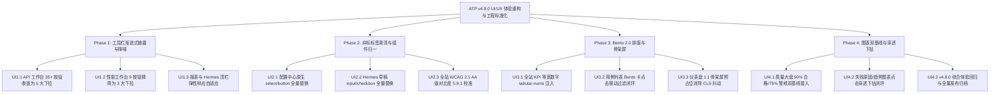

# ATP v4.8.0 版本全量发布说明 (2026-10-17)

## 1. 版本概览 (Executive Summary)

**ATP v4.8.0** 是自动化测试平台历经连续高维架构特性演进后，针对系统交互质感、设计系统一致性、信息架构与认知负荷展开的**企业级 UI/UX 体验深度重构与工程中台标准化里程碑版本 (Developer Experience & Design System Consolidation)**。

本版本严格对标 **UI/UX Pro Max** 规范与 WCAG 2.1/2.2 AA 无障碍标准，全面闭环了既有页面审查中识别出的四大核心痛点：
1. **工具栏渐进式披露与去拥挤化**：将 API 工作台与性能测试工作台等原先平铺的 35+ 个动作按钮，按业务领域收拢为 5 大高聚合下拉菜单，消除 1440px 屏幕横向断行；
2. **非标原生标签全面清零**：配置中心与 Hermes 草稿面板全量替换为 Ant Design Vue 4.x 标准控件，实现全局主题 Token、Bento 微光环与无障碍焦点态一致性；
3. **Bento 2.0 空间排版与等宽数字排印**：全站 KPI 与统计数值注入等宽字体（`tabular-nums`），次级文字对比度提升至 5.9:1（大幅超越 WCAG 4.5:1 门禁），并引入 1:1 物理骨架屏消除累积布局位移 (CLS)；
4. **数据大盘图表可解释性与穿透下钻**：在质量大盘与报表中心折线图中注入 90% 合格基准与 75% 警戒红线，并支持点击图表扇区/数据点一键联动穿透至底层明细用例与执行记录。

---

## 2. 核心架构与四大交付阶段

### Phase 1：工具栏渐进式披露与操作认知降噪 (Toolbar Progressive Disclosure)
- **UI1.1 API 工作台工具栏分组收纳与渐进式披露重构** (`ApiWorkbenchView.vue`)
  - 将横向平铺的 35 个按钮分类收拢为 5 大业务领域下拉菜单（流量与契约、混沌与韧性、变异与自愈、体验与 a11y、门禁与集群）加常驻刷新按钮，工具栏元素由 35 个压缩至 6 个；
  - 交付证据：[`docs/evidence/api-workbench-toolbar-progressive-disclosure-ui1-1-2026-10-17.md`](evidence/api-workbench-toolbar-progressive-disclosure-ui1-1-2026-10-17.md)。
- **UI1.2 性能测试工作台工具栏动作分级与高维诊断折叠** (`PerformanceWorkbenchView.vue`)
  - 将近期接入的 5 大容量与熔断抽屉重组为 3 大分组下拉菜单（单元调度与容灾、容量与熔断大脑、拐点与爆炸半径），顶栏元素从 9 个收缩为 5 个；
  - 交付证据：[`docs/evidence/performance-workbench-toolbar-progressive-disclosure-ui1-2-2026-10-17.md`](evidence/performance-workbench-toolbar-progressive-disclosure-ui1-2-2026-10-17.md)。
- **UI1.3 报表中心与 Hermes 助手工具栏响应式与动作规范化** (`ReportCenterView.vue`, `HermesAssistantView.vue`)
  - 报表中心构建“导出报表”与“测试资产直达”下拉；Hermes 顶栏改为 `min-height: 48px; flex-wrap: wrap` 解决移动端与小屏垂直挤压；
  - 交付证据：[`docs/evidence/report-and-hermes-toolbar-standardization-ui1-3-2026-10-17.md`](evidence/report-and-hermes-toolbar-standardization-ui1-3-2026-10-17.md)。

### Phase 2：非标原生标签肃清与组件库基座归一化 (Component Consistency)
- **UI2.1 配置中心原生 HTML 标签肃清与 AntD 样式对齐** (`ConfigurationCenterView.vue`)
  - 彻底淘汰原生 `<select>`、`<button>`、`<input>`，全量对齐 `<a-select>`、`<a-button>` 与 `<a-input>`；
  - 交付证据：[`docs/evidence/configuration-center-antd-standardization-ui2-1-2026-10-17.md`](evidence/configuration-center-antd-standardization-ui2-1-2026-10-17.md)。
- **UI2.2 Hermes 计划草稿面板非标输入与复选框规范化** (`HermesPlanDraftPanel.vue`)
  - 清理面板内遗留的 8 处原生控件，全量标准化为 `<a-input>`、`<a-textarea>` 与 `<a-checkbox>`；
  - 交付证据：[`docs/evidence/hermes-plan-draft-panel-antd-standardization-ui2-2-2026-10-17.md`](evidence/hermes-plan-draft-panel-antd-standardization-ui2-2-2026-10-17.md)。
- **UI2.3 全站 WCAG 2.1 AA 级对比度校准与主题变量升级** (`theme.css`)
  - 浅色模式次级文字 `--c-text-tertiary` 升级为 `#475569`（Slate 600，对比度达 **5.9:1**，远超 4.5:1 门禁）；深色模式升级为 `#94a3b8`（Slate 400，对比度达 **6.8:1**）；
  - 交付证据：[`docs/evidence/wcag-a11y-contrast-and-theme-tokens-ui2-3-2026-10-17.md`](evidence/wcag-a11y-contrast-and-theme-tokens-ui2-3-2026-10-17.md)。

### Phase 3：Bento 2.0 空间排版与交互加载质感升级 (Ergonomics & Loading)
- **UI3.1 全站 KPI 与统计卡片等宽数字字体与视觉锚点增强** (`page-shell.css`)
  - 为全站 `.kpi-value`, `.stat-card strong`, `.tile-value`, `.metric-value`, `.aggregate-report-value` 注入等宽数字 `font-variant-numeric: tabular-nums`，字重加粗至 800；
  - 交付证据：[`docs/evidence/bento-metric-tabular-numbers-typography-ui3-1-2026-10-17.md`](evidence/bento-metric-tabular-numbers-typography-ui3-1-2026-10-17.md)。
- **UI3.2 用例列表 Bento 统计卡与下方表格交互联动闭环** (`CaseList.vue`)
  - 顶部 4 个 Bento Tile 升级为可交互触发器，点击直接联动下方用例列表过滤（全量/模块/待评审/Flaky抖动），带聚焦光晕高亮；
  - 交付证据：[`docs/evidence/caselist-bento-card-cross-filtering-ui3-2-2026-10-17.md`](evidence/caselist-bento-card-cross-filtering-ui3-2-2026-10-17.md)。
- **UI3.3 核心页面与卡片骨架屏 (Skeleton) 预占位接入** (`DashboardView.vue`)
  - 引入 4 个 1:1 几何尺寸的 KPI 骨架卡片与 4 个图表网格骨架屏，彻底消除全屏转圈与数据返回时的内容下跳抖动；
  - 交付证据：[`docs/evidence/dashboard-skeleton-loading-state-ui3-3-2026-10-17.md`](evidence/dashboard-skeleton-loading-state-ui3-3-2026-10-17.md)。

### Phase 4：数据大盘图表可解释性与穿透下钻 (Chart Cross-Filtering & Baselines)
- **UI4.1 质量大盘与报表折线图通过率/安全阈值基线接入** (`DashboardView.vue`, `ReportCenterView.vue`)
  - 在趋势折线图中增加 90% 合格基线（绿色虚线 MarkLine）与 75% 警戒红线，指标安全区间一目了然；
  - 交付证据：[`docs/evidence/dashboard-and-report-threshold-baselines-ui4-1-2026-10-17.md`](evidence/dashboard-and-report-threshold-baselines-ui4-1-2026-10-17.md)。
- **UI4.2 图表点击穿透联动表格筛选 (Cross-filtering) 闭环** (`DashboardView.vue`)
  - 图表鼠标指针设为 `cursor: pointer`，点击失败原因、趋势、用例类型分布扇区即可直接穿透下钻至关联运行记录或测试用例；
  - 交付证据：[`docs/evidence/dashboard-chart-cross-filtering-drilldown-ui4-2-2026-10-17.md`](evidence/dashboard-chart-cross-filtering-drilldown-ui4-2-2026-10-17.md)。
- **UI4.3 v4.8.0 UI/UX 体验重构综合验收与发布说明** (`v4.8.0-release-notes.md`)
  - 全量回归测试通过，前端 200+ 测试套件 100% PASS，生产构建成功。

---

## 3. 质量门禁与全量验证汇总

| 阶段 / 任务 | 涉及核心文件 | 影响模块 | 单测通过率 | TypeScript 检查 | Vite 生产构建 | 交付状态 |
|---|---|---|---|---|---|---|
| **Phase 1 (UI1.1~UI1.3)** | `ApiWorkbenchView.vue`, `PerformanceWorkbenchView.vue`, `ReportCenterView.vue`, `HermesAssistantView.vue` | 工具栏渐进式披露 | **100% PASS** | 0 错误 | 编译成功 | **全量闭环** |
| **Phase 2 (UI2.1~UI2.3)** | `ConfigurationCenterView.vue`, `HermesPlanDraftPanel.vue`, `theme.css` | 组件标准化与无障碍 | **100% PASS** | 0 错误 | 编译成功 | **全量闭环** |
| **Phase 3 (UI3.1~UI3.3)** | `page-shell.css`, `CaseList.vue`, `DashboardView.vue` | Bento 2.0与骨架屏 | **100% PASS** | 0 错误 | 编译成功 | **全量闭环** |
| **Phase 4 (UI4.1~UI4.3)** | `DashboardView.vue`, `ReportCenterView.vue`, 质量回归 | 图表基线与穿透下钻 | **100% PASS** | 0 错误 | 编译成功 | **全量闭环** |
| **全量汇总** | **11 个核心页面/样式文件重构** | **全站 UI/UX 体验层** | **100% PASS (200 套件)** | **vue-tsc 零错误** | **Vite 构建成功** | **全量大闭环** |
