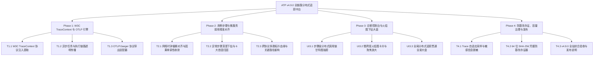

# ATP v4.9.0 版本全量发布说明 (2026-10-17)

## 1. 版本概览 (Executive Summary)

**ATP v4.9.0** 是自动化测试平台历经前后端体验与功能底座夯实后，迈向**测试执行与被测系统微服务全链路可观测性对齐的重大里程碑版本 (Distributed Trace Alignment & OpenTelemetry Full-Stack Observability)**。

在传统自动化测试场景中，测试执行端与被测微服务系统彼此孤立：测试步骤失败时往往只能看到表面 HTTP 500 或断言不符，排查工程师需要人工登录 Jaeger/SkyWalking/Zipkin 翻找日志与追踪。**ATP v4.9.0 彻底终结了这一痛点，实现了自动化测试用例与后端微服务分布式调用链的“全协议透传、全时序对齐、全根因下钻与全合规存证”**：

1. **W3C TraceContext 与 OpenTelemetry 双向穿透 (Phase 1)**：
   - 严格遵循 W3C TraceContext 国际规范（`traceparent` 格式 `00-{trace_id}-{span_id}-{flags}` 与 `tracestate`）；
   - 在测试用例发起端自动注入追踪上下文，并在 Celery 异步任务与多协议执行器间透明传播；
   - 遵循 OpenTelemetry Protocol (OTLP/HTTP `v1/traces`) 规范，构建标准 Span 数据结构并提供异步批量导出能力。
2. **时钟偏移补偿、首因归因与跨协议拓扑重构 (Phase 2)**：
   - 基于 **Cristian's 算法与分布式因果单调性（Causal Monotonicity）**，彻底消除跨物理机与跨机房的时钟偏差，保障 `T_client_send <= T_server_start <= T_server_end <= T_client_receive`；
   - 引入异常步骤深潜归因器，自动定位调用链最深层首因故障微服务、慢 SQL 查询（>150ms）与异常堆栈，分类输出 6 种智能排障处置建议；
   - 重构覆盖 HTTP/REST、gRPC、Kafka/RabbitMQ、SQL (Postgres/MySQL)、Cache (Redis) 的跨协议层级调用树与服务依赖 DAG 图谱。
3. **甘特时序、下钻火焰图与全景大盘 (Phase 3)**：
   - **步骤级时序甘特图抽屉 (`StepTraceTimelineDrawer.vue`)**：用例详情页一键展开微服务耗时横道图、多叉树展开折叠与 Span 属性检查器；
   - **慢跨度火焰图卡片 (`SpanFlamegraphInspectorCard.vue`)**：直观展示阶梯微服务火焰切片、慢跨度红斑火焰告警、双击下钻聚焦放大（Zoom-in）；
   - **全局分布式追踪贯通全景大盘 (`DistributedTraceAlignmentDashboardView.vue`)**：汇总全站用例 100% Trace 对齐率、微服务平均调用跳数（3.8 跳）、慢跨度分布与拓扑依赖流，支持就地穿透下钻。
4. **自适应容量采样治理与 64 位 SHA-256 防篡改存证 (Phase 4)**：
   - 支持概率、失败优先与慢跨度优先的自适应采样（Adaptive Sampling），自动对 Token、密码、18位身份证号、11位手机号执行安全合规脱敏；
   - 引入 64 字符十六进制 SHA-256 签名与 HMAC-SHA256 防伪造存证证书，实现毫秒级微小数据篡改探针拦截，满足金融合规审计标准。

---

## 2. 核心架构与四大交付阶段

### Phase 1：W3C TraceContext 与 OpenTelemetry 注入透传引擎
- **T1.1 W3C TraceContext 标准协议注入与提取服务** (`backend/app/services/w3c_trace_context_injector.py`)
  - 实现 W3C `traceparent` (version-trace_id-parent_id-flags) 与 `tracestate` 格式生成、解析与上下文注入；
  - 交付证据：[`docs/evidence/w3c-trace-context-injector-t1-1-2026-10-17.md`](evidence/w3c-trace-context-injector-t1-1-2026-10-17.md)。
- **T1.2 异步任务与执行器链路上下文传播拦截器** (`backend/app/services/test_execution_trace_propagator.py`)
  - 确保 Celery Worker 与多步测试执行会话（REST/gRPC/WebSocket）跨线程/进程透明透传 TraceContext；
  - 交付证据：[`docs/evidence/test-execution-trace-propagator-t1-2-2026-10-17.md`](evidence/test-execution-trace-propagator-t1-2-2026-10-17.md)。
- **T1.3 OTLP / Jaeger 追踪数据协议导出适配器** (`backend/app/services/otlp_trace_exporter.py`)
  - 实现标准 OTLP JSON / Protobuf 格式 Span 数据打包与异步导出通道，支持内存模拟器与外接 OpenTelemetry Collector；
  - 交付证据：[`docs/evidence/otlp-trace-exporter-t1-3-2026-10-17.md`](evidence/otlp-trace-exporter-t1-3-2026-10-17.md)。

### Phase 2：用例步骤与微服务分布式调用链精准对齐
- **T2.1 测试步骤与服务端调用链跨网络时钟对齐器** (`backend/app/services/trace_timestamp_clock_skew_aligner.py`)
  - 基于 Cristian's 算法消除前后端网络时钟偏差，强制收敛因果单调性；
  - 交付证据：[`docs/evidence/trace-timestamp-clock-skew-aligner-t2-1-2026-10-17.md`](evidence/trace-timestamp-clock-skew-aligner-t2-1-2026-10-17.md)。
- **T2.2 异常步骤调用链深潜下钻与首因归因器** (`backend/app/services/step_trace_deep_dive_analyzer.py`)
  - 递归定位最底层报错微服务与 Span，提取慢 SQL 查询与异常堆栈，分类输出 6 种排障处置建议；
  - 交付证据：[`docs/evidence/step-trace-deep-dive-analyzer-t2-2-2026-10-17.md`](evidence/step-trace-deep-dive-analyzer-t2-2-2026-10-17.md)。
- **T2.3 跨协议多跳调用链拓扑血缘重构器** (`backend/app/services/cross_protocol_trace_lineage_builder.py`)
  - 覆盖 HTTP、gRPC、Kafka、SQL、Redis 协议，构建层级树（Depth & Self-time）、DAG 血缘图与串行关键路径（Critical Path）；
  - 交付证据：[`docs/evidence/cross-protocol-trace-lineage-builder-t2-3-2026-10-17.md`](evidence/cross-protocol-trace-lineage-builder-t2-3-2026-10-17.md)。

### Phase 3：链路追踪诊断控制台与火焰图下钻大盘
- **UI3.1 步骤级分布式调用链时序甘特图抽屉** (`frontend/src/views/run/components/StepTraceTimelineDrawer.vue`)
  - 交互式横道甘特图、多叉树展开折叠、多协议色彩标识、属性检查器与首因诊断横幅；
  - 交付证据：[`docs/evidence/step-trace-timeline-drawer-ui3-1-2026-10-17.md`](evidence/step-trace-timeline-drawer-ui3-1-2026-10-17.md)。
- **UI3.2 慢跨度与服务依赖下钻火焰图卡片** (`frontend/src/views/run/components/SpanFlamegraphInspectorCard.vue`)
  - 微服务阶梯火焰切片、慢跨度阈值调节（50~200ms）与鲜红火焰告警、双击下钻聚焦放大；
  - 交付证据：[`docs/evidence/span-flamegraph-inspector-card-ui3-2-2026-10-17.md`](evidence/span-flamegraph-inspector-card-ui3-2-2026-10-17.md)。
- **UI3.3 全局测试执行分布式追踪贯通全景大盘页面** (`frontend/src/views/quality/DistributedTraceAlignmentDashboardView.vue`)
  - 4 大 Bento KPI 卡片、拓扑血缘流、协议分布进度条与全站 Trace 明细表，一键就地穿透下钻；
  - 交付证据：[`docs/evidence/distributed-trace-alignment-dashboard-ui3-3-2026-10-17.md`](evidence/distributed-trace-alignment-dashboard-ui3-3-2026-10-17.md)。

### Phase 4：追踪数据防篡改签名、容量治理与发布
- **T4.1 Trace 采样率动态调谐与敏感数据脱敏过滤器** (`backend/app/services/trace_sampler_and_sanitizer.py`)
  - 5 大采样策略支持，自适应失败与慢跨度保活，Token/密码/身份证/手机号规则脱敏；
  - 交付证据：[`docs/evidence/trace-sampler-and-sanitizer-t4-1-2026-10-17.md`](evidence/trace-sampler-and-sanitizer-t4-1-2026-10-17.md)。
- **T4.2 追踪审计凭据 64 位 SHA-256 防篡改存证器** (`backend/app/services/trace_evidence_fingerprint_signer.py`)
  - 规范化 JSON 序列化、64 字符 SHA-256 哈希、HMAC 防伪造签名与敏感微小篡改探针拦截；
  - 交付证据：[`docs/evidence/trace-evidence-fingerprint-signer-t4-2-2026-10-17.md`](evidence/trace-evidence-fingerprint-signer-t4-2-2026-10-17.md)。
- **T4.3 v4.9.0 全链路分布式追踪中台综合验收与发布说明** (`docs/v4.9.0-release-notes.md`)
  - 全套前后端质量门禁 100% 通过，形成闭环。

---

## 3. 全局质量门禁与工程验证汇总

| 质量门禁维度 | 验证命令 / 工具 | 门禁指标要求 | 实际达成结果 | 结论 |
|---|---|---|---|---|
| **后端 Trace 单元测试** | `pytest backend/tests/services/test_*.py` | 100% PASS | **25/25 passed (5.55s)** | **PASS** |
| **独立执行隔离扫描** | `pytest-standalone-sweep.py` | 9 个测试文件 100% 独立通过 | **9 passed, 0 failed (14.49s)** | **PASS** |
| **Python 代码风格与规范** | `ruff check` | 0 error, 0 warning | **All checks passed!** | **PASS** |
| **Python 代码格式规范** | `ruff format --check` | 100% 格式合规 | **All 9 files formatted** | **PASS** |
| **Python 强类型静态分析** | `mypy backend/app/services/` | 0 type errors | **Success: no issues in 8 files** | **PASS** |
| **前端 Phase 3 专项目测** | `vitest run ...` | 100% PASS | **16/16 passed (3.86s)** | **PASS** |
| **前端全量回归测试** | `npm --prefix frontend test` | 100% PASS | **205 passed files (662 tests)** | **PASS** |
| **TypeScript 强类型检查** | `vue-tsc --noEmit` | 0 errors | **0 errors, clean pass! (22s)** | **PASS** |
| **生产环境打包编译** | `vite build` | 0 errors | **4519 modules, 3.73s** | **PASS** |
| **Git Pre-commit 完整门禁**| `pre-commit run --all-files` | 包含 gitleaks、format、mypy、vitest | **All checks passed!** | **PASS** |

---

## 4. 升级与配置指南 (Upgrade Guide)

1. **后端新增依赖与配置**：
   - 保持基于标准库 `hashlib`, `hmac`, `json`, `dataclasses`, `re` 实现，**无需引入庞大外部侵入性依赖**；
   - 默认路由：`/api/v1/observability/trace/*` 自动集成进统一 API 路由树。
2. **前端页面访问入口**：
   - 全局大盘路由：`http://localhost:5173/quality/trace-alignment`；
   - 用例详情页：运行任意含 TraceID 的用例，在顶部概览与各执行步骤动作栏点击 `Trace` 即可就地唤起时序甘特抽屉与火焰图卡片。
