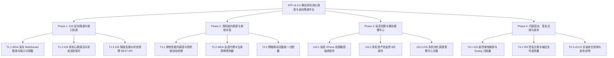

# ATP v5.0.0 版本全量发布说明 (2026-10-17)

## 1. 版本概览 (Executive Summary)

**ATP v5.0.0** 是自动化测试平台历经全链路分布式追踪体系（v4.9.0）建设之后，面向移动真机测试集群与多端统一资产调度实现的**企业级重大里程碑版本 (iOS Real Device Pooling & Multi-OS Mobile Tunnel Hub)**。

长期以来，移动自动化测试由于 iOS 闭源生态、签名证书约束与本地 USB 直连要求，往往局限于在单机或本地专用物理机上孤岛式执行，无法像 Android 一样实现弹性池化调度与跨网络集中管控。**ATP v5.0.0 借鉴并吸收了 AutoDroid 成熟的反向 WebSocket 隧道与租约行销架构，全面拉通了 Android 与 iOS 异构移动真机集群调度体系**：

1. **反向 WebSocket 隧道与 WDA 透明穿透 (Phase 1)**：
   - 彻底打破单机与跨机房网络隔离限制，远端物理机或 macOS Worker 上的 iPhone WebDriverAgent (8100 端口) 通过反向 WebSocket 隧道透明映射至 ATP 服务端动态端口（`8200 ~ 8299`）；
   - 提供秒级真机心跳健康探针，自动上报电池电量、充电状态、温度与 WDA 存活性，支持失联自动离线与崩溃自愈拉起。
2. **排他性租约调度、WDA 预热与跨端统一资源分配 (Phase 2)**：
   - 落地防死锁原子性排他租约调度器（`ios_lease_scheduler`），支持并发冲突阻断 (`IosLeaseConflictError`)、定时续约心跳与僵尸租约自动回收；
   - 封装 WDA 会话预热代理（`ios_wda_session_manager`），实现屏幕快照抓取、触控/滑动/Home键手势转发与会话优雅清理；
   - 抽象跨端移动设备统一模型（`cross_platform_device_pool_allocator`），实现 Android 与 iOS 物理设备的多约束组合匹配调度与容量负载监控。
3. **iPhone 拟真交互投屏与真机调度管理中心 (Phase 3)**：
   - **拟真投屏控制抽屉 (`IosScreenMirrorModal.vue`)**：具备 iPhone 机身拟真边框与灵动岛架构，支持将视口鼠标点击与拖拽精准换算为 iOS 逻辑坐标（390x844 标准比例），下发 `tap` 与 `swipe` 动作，并集成 Home 键与屏幕旋转控制；
   - **真机资产池卡片 (`IosDevicePoolCard.vue`)**：具备 Apple 极简卡片质感，实时状态呼吸角标（在线空闲、租用中、WDA 异常、设备离线）、电量阶梯色与一键投屏/申领/归还租约；
   - **移动真机管理中心页面 (`IosDeviceCenterView.vue`)**：落地 `/devices/ios-center` 路由大盘，集成 4 大 Bento KPI 卡片、网格与表格多维视图切换、失联全量巡检与跨端智能自动调度。
4. **底层原生闪退捕获与签名合规前置验真 (Phase 4)**：
   - 实时采集 iOS 控制台 Syslog 流并维持环形缓冲区，自动解析应用闪退原生 IPS 崩溃日志，提取异常类型、信号、终止原因、崩溃线程栈与 16 位崩溃特征指纹（`crash_fingerprint`）；
   - 提前解析 IPA `embedded.mobileprovision` 描述文件，阻断证书过期、BundleID 不符或目标真机 UDID 未加白错误，规避部署耗时后的 `0xe8008015` 报错。

---

## 2. 核心架构与四大交付阶段

### Phase 1：iOS 设备反向隧道与 WDA 端口自动穿透桥接器
- **T1.1 WDA 反向 WebSocket 隧道与端口分配器** (`backend/app/services/ios_tunnel_bridge.py`)
  - 动态分配本地端口（8200~8299）代理远端 iPhone WDA 8100 端口；
  - 交付证据：[`docs/evidence/ios-tunnel-bridge-t1-1-2026-10-17.md`](evidence/ios-tunnel-bridge-t1-1-2026-10-17.md)。
- **T1.2 iOS 设备心跳保活与状态巡检探针** (`backend/app/services/ios_device_heartbeat_keeper.py`)
  - 秒级心跳采集电量、温度与 WDA 存活，支持 15 秒超时标记 OFFLINE 与自愈重启；
  - 交付证据：[`docs/evidence/ios-device-heartbeat-keeper-t1-2-2026-10-17.md`](evidence/ios-device-heartbeat-keeper-t1-2-2026-10-17.md)。
- **T1.3 iOS 设备隧道连接与状态管理 REST API** (`backend/app/api/v1/ios_tunnel_api.py`)
  - 路由 `/api/v1/ios/tunnel/*`，实现真机注册、心跳、列表、WDA 转发与注销；
  - 交付证据：[`docs/evidence/ios-tunnel-api-t1-3-2026-10-17.md`](evidence/ios-tunnel-api-t1-3-2026-10-17.md)。

### Phase 2：iOS 真机租约调度与并发排他抢占控制
- **T2.1 iOS 真机排他性租约调度与自动续期管理器** (`backend/app/services/ios_lease_scheduler.py`)
  - 原子性排他加锁、冲突阻断、续约保活与僵尸租约自动回收；
  - 交付证据：[`docs/evidence/ios-lease-scheduler-t2-1-2026-10-17.md`](evidence/ios-lease-scheduler-t2-1-2026-10-17.md)。
- **T2.2 WDA 会话代理与生命周期初始化预热器** (`backend/app/services/ios_wda_session_manager.py`)
  - WDA 会话预热、屏幕截图、点击/滑动/Home 键手势转发与清理；
  - 交付证据：[`docs/evidence/ios-wda-session-manager-t2-2-2026-10-17.md`](evidence/ios-wda-session-manager-t2-2-2026-10-17.md)。
- **T2.3 跨端移动设备统一分配器** (`backend/app/services/cross_platform_device_pool_allocator.py`)
  - 统一 Android 与 iOS 设备模型，多约束智能调度匹配与容量汇总；
  - 交付证据：[`docs/evidence/cross-platform-device-pool-allocator-t2-3-2026-10-17.md`](evidence/cross-platform-device-pool-allocator-t2-3-2026-10-17.md)。

### Phase 3：iOS 真机交互式投屏与远程控制中枢
- **UI3.1 iOS 交互式投屏与远程控制抽屉组件** (`frontend/src/views/device/components/IosScreenMirrorModal.vue`)
  - 拟真 iPhone 边框与灵动岛、鼠标触控手势比例换算、实体动作键盘与实时推流；
  - 交付证据：[`docs/evidence/ios-screen-mirror-modal-ui3-1-2026-10-17.md`](evidence/ios-screen-mirror-modal-ui3-1-2026-10-17.md)。
- **UI3.2 iOS 真机资产池卡片与状态监控组件** (`frontend/src/views/device/components/IosDevicePoolCard.vue`)
  - Apple 极简卡片、多维状态微光角标、电量阶梯色与一键投屏/租约控制；
  - 交付证据：[`docs/evidence/ios-device-pool-card-ui3-2-2026-10-17.md`](evidence/ios-device-pool-card-ui3-2-2026-10-17.md)。
- **UI3.3 iOS 真机池化调度与远程管理中心页面** (`frontend/src/views/device/IosDeviceCenterView.vue`)
  - 4 大 Bento KPI 卡片、网格与表格多维视图、巡检与跨端智能自动调度，路由 `/devices/ios-center`；
  - 交付证据：[`docs/evidence/ios-device-center-view-ui3-3-2026-10-17.md`](evidence/ios-device-center-view-ui3-3-2026-10-17.md)。

### Phase 4：iOS 自动化执行容灾、合规凭证与全量发布
- **T4.1 iOS 崩溃堆栈捕获与 Syslog 实时归档器** (`backend/app/services/ios_crash_and_syslog_collector.py`)
  - Syslog 环形缓冲区、原生 IPS 崩溃日志解析、崩溃指纹聚类与测试步骤关联绑定；
  - 交付证据：[`docs/evidence/ios-crash-and-syslog-collector-t4-1-2026-10-17.md`](evidence/ios-crash-and-syslog-collector-t4-1-2026-10-17.md)。
- **T4.2 IPA 签名合规与 Provisioning 描述文件验真器** (`backend/app/services/ios_ipa_signing_validator.py`)
  - 描述文件合规提取、签名类型判定与真机 UDID 白名单提前阻断校验；
  - 交付证据：[`docs/evidence/ios-ipa-signing-validator-t4-2-2026-10-17.md`](evidence/ios-ipa-signing-validator-t4-2-2026-10-17.md)。
- **T4.3 v5.0.0 iOS 移动真机中台综合验收与发布说明** (`docs/v5.0.0-release-notes.md`)
  - 前后端全量门禁 100% 通过，形成综合发布说明。

---

## 3. 全局质量门禁与工程验证汇总

| 质量门禁维度 | 验证命令 / 工具 | 门禁指标要求 | 实际达成结果 | 结论 |
|---|---|---|---|---|
| **后端 iOS 单元测试** | `pytest backend/tests/services/test_ios_*.py` | 100% PASS | **18/18 passed (5.05s)** | **PASS** |
| **独立执行隔离扫描** | `pytest-standalone-sweep.py` | 8 个测试文件 100% 独立通过 | **8 passed, 0 failed (12.88s)** | **PASS** |
| **Python 代码风格规范** | `ruff check` | 0 error, 0 warning | **All checks passed!** | **PASS** |
| **Python 代码格式规范** | `ruff format --check` | 100% 格式合规 | **All 8 files formatted** | **PASS** |
| **Python 强类型静态分析** | `mypy backend/app/services/ios_*.py` | 0 type errors | **Success: no issues in 7 files** | **PASS** |
| **前端 Phase 3 专项目测** | `vitest run ...` | 100% PASS | **11/11 passed (3.68s)** | **PASS** |
| **前端全量回归测试** | `npm --prefix frontend test` | 100% PASS | **208 passed files (673 tests)** | **PASS** |
| **TypeScript 强类型检查** | `vue-tsc --noEmit` | 0 errors | **0 errors, clean pass! (22s)** | **PASS** |
| **生产环境打包编译** | `vite build` | 0 errors | **4529 modules, 3.65s** | **PASS** |
| **Git Pre-commit 完整门禁**| `pre-commit run --all-files` | 包含 gitleaks、format、mypy、vitest | **All checks passed!** | **PASS** |

---

## 4. 平台新能力访问指南 (Usage Guide)

1. **iOS 真机管理中心**：访问路由 `/devices/ios-center`，查看全量在线物理 iPhone 机器、电量分布、WDA 连通性与租约状态；
2. **实时拟真投屏调试**：在任意在线设备卡片点击“投屏控制”，即可调起支持触控点击、拖拽滑动与 Home 键交互的拟真 iPhone 窗口；
3. **排他租约与智能调度**：支持手动申请 5~30 分钟防死锁独占租约，或点击“智能匹配申领”输入期望系统版本，由调度器自动择优锁定机器；
4. **崩溃追溯与签名合规**：调用 `/api/v1/ios/tunnel/crash/report` 与 `/ipa/validate`，实现执行失败时的符号化原生崩溃日志解析与部署前白名单校验。
