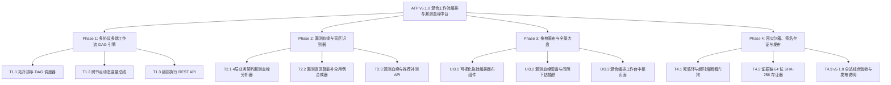

# ATP v5.1.0 版本全量发布说明 (2026-10-17)

## 1. 版本概览 (Executive Summary)

**ATP v5.1.0** 是自动化测试平台历经全链路分布式追踪中台（v4.9.0）与 iOS 移动真机池化调度（v5.0.0）建设之后，面向端到端复杂业务链路与低代码全域覆盖治理实现的**企业级重大里程碑版本 (Drag-and-Drop Hybrid Workflow Orchestrator & Visual Coverage Lineage Hub)**。

在过去，各协议接口测试、Web 自动化、移动端真机执行与数据库校验往往割裂在不同测试套件中，难以组装为真实反映端到端交易流转的复合链路；同时，测试团队虽然用例通过率极高，却难以衡量是否覆盖了业务核心容错分支。**ATP v5.1.0 彻底攻克了这一难题，提供了拖拽式多端混合编排与四层漏测血缘全景闭环**：

1. **跨协议跨端工作流拓扑 DAG 执行引擎 (Phase 1)**：
   - 覆盖 HTTP/REST、gRPC、Web UI (Playwright)、Android、iOS 物理机、SQL 校验、条件判断 (`condition_branch`) 与延时 8 大节点类型；
   - 基于入度与邻接表实现拓扑排序，严格阻断闭环死锁（`CyclicWorkflowError`），支持分支条件流转与自动跳过机制；
   - 落地跨节点动态变量总线 (`WorkflowVariableBus`)，支持 `{{node.output.body.data[0].id}}` 表达式点分/切片提取与无感上下文流转。
2. **四层低代码可视化漏测血缘与盲区智能补测 (Phase 2)**：
   - 全流程贯通四层血缘依赖图谱：`Requirement`（业务需求）➔ `ApiEndpoint`（接口契约）➔ `BusinessBranch`（业务逻辑分支）➔ `TestCase`（测试用例）；
   - 计算各节点分支覆盖率，精准标定漏测盲区（Coverage Gap），对未测超时、异常、鉴权等高危场景自动红斑定级；
   - 逆向推导缺失分支的前置条件与反例数据集，一键自动合成符合规范的自动化测试用例草稿（`SynthesizedTestCaseDraft`）。
3. **专业级拖拽画布与漏测血缘中枢工作台 (Phase 3)**：
   - **拖拽式编排画布 (`HybridWorkflowDragCanvas.vue`)**：左侧 8 大节点工具箱、点阵背景画布、SVG 贝塞尔曲线连接线、执行流光呼吸状态动画与节点属性配置抽屉；
   - **漏测血缘图谱抽屉 (`VisualCoverageGapInspectorDrawer.vue`)**：直观展示四层血缘树状图、红斑未测节点、风险等级标签与一键批量用例合成；
   - **混合工作台中枢 (`HybridWorkflowWorkbenchView.vue`)**：落地 `/workbench/hybrid-orchestrator`，集成 4 大 Bento KPI、画布与执行明细表。
4. **运行容灾沙箱熔断与 64 位 SHA-256 存证 (Phase 4)**：
   - 落地看门狗守卫（`workflow_execution_sandbox_guard`），防范单节点死循环迭代（>50次）、全局超时（300s）与连续故障快速熔断；
   - 落地证据链 64 字符十六进制 SHA-256 存证器（`workflow_evidence_fingerprint_signer`）与 HMAC 防伪验签，实现端到端执行结果防篡改。

---

## 2. 核心架构与四大交付阶段

### Phase 1：拖拽式多协议多端工作流 DAG 编排引擎
- **T1.1 多协议多端工作流拓扑 DAG 执行引擎** (`backend/app/services/hybrid_workflow_dag_engine.py`)
  - 覆盖 8 大节点类型，严格拓扑排序与循环依赖检测，支持条件分支流转；
  - 交付证据：[`docs/evidence/hybrid-workflow-dag-engine-t1-1-t1-3-2026-10-17.md`](evidence/hybrid-workflow-dag-engine-t1-1-t1-3-2026-10-17.md)。
- **T1.2 跨节点动态变量总线与表达式求值器** (`backend/app/services/workflow_context_variable_bus.py`)
  - 支持点分路径与数组切片安全提取，递归解析模板插值（`{{node.output.field}}`）；
  - 交付证据：[`docs/evidence/hybrid-workflow-dag-engine-t1-1-t1-3-2026-10-17.md`](evidence/hybrid-workflow-dag-engine-t1-1-t1-3-2026-10-17.md)。
- **T1.3 混合工作流编排与执行管理 REST API** (`backend/app/api/v1/hybrid_workflow_api.py`)
  - 路由 `/api/v1/workflow/*`，支持草稿保存、一键执行、日志检索与变量求值；
  - 交付证据：[`docs/evidence/hybrid-workflow-dag-engine-t1-1-t1-3-2026-10-17.md`](evidence/hybrid-workflow-dag-engine-t1-1-t1-3-2026-10-17.md)。

### Phase 2：低代码可视化漏测血缘与测试间隙识别器
- **T2.1 业务分支与契约多维漏测血缘分析器** (`backend/app/services/visual_coverage_lineage_analyzer.py`)
  - 4 层血缘模型，分支覆盖率计算，未覆盖红斑标定与高危风险自动定级；
  - 交付证据：[`docs/evidence/visual-coverage-lineage-analyzer-t2-1-t2-3-2026-10-17.md`](evidence/visual-coverage-lineage-analyzer-t2-1-t2-3-2026-10-17.md)。
- **T2.2 漏测盲区智能补全用例草稿合成器** (`backend/app/services/missing_test_case_synthesizer.py`)
  - 逆向推导缺失分支的前置条件与反例数据集，自动生成结构化用例草稿；
  - 交付证据：[`docs/evidence/visual-coverage-lineage-analyzer-t2-1-t2-3-2026-10-17.md`](evidence/visual-coverage-lineage-analyzer-t2-1-t2-3-2026-10-17.md)。
- **T2.3 漏测血缘与推荐补测管理 REST API** (`backend/app/api/v1/coverage_lineage_api.py`)
  - 路由 `/api/v1/coverage/*`，提供血缘分析报告查询与一键合成补测用例端点；
  - 交付证据：[`docs/evidence/visual-coverage-lineage-analyzer-t2-1-t2-3-2026-10-17.md`](evidence/visual-coverage-lineage-analyzer-t2-1-t2-3-2026-10-17.md)。

### Phase 3：可视化拖拽工作流画布与漏测血缘全景大盘
- **UI3.1 可视化拖拽工作流编排画布组件** (`frontend/src/views/workbench/components/HybridWorkflowDragCanvas.vue`)
  - 8 大节点工具箱、点阵网格画布、SVG 贝塞尔曲线连接线、流光状态动画与属性抽屉；
  - 交付证据：[`docs/evidence/hybrid-workflow-drag-canvas-ui3-1-2026-10-17.md`](evidence/hybrid-workflow-drag-canvas-ui3-1-2026-10-17.md)。
- **UI3.2 漏测血缘图谱与覆盖间隙下钻抽屉** (`frontend/src/views/workbench/components/VisualCoverageGapInspectorDrawer.vue`)
  - 四层血缘树状拓扑、红斑漏测节点高亮、风险等级标签与一键推导合成用例；
  - 交付证据：[`docs/evidence/visual-coverage-gap-inspector-drawer-ui3-2-2026-10-17.md`](evidence/visual-coverage-gap-inspector-drawer-ui3-2-2026-10-17.md)。
- **UI3.3 混合工作流与漏测血缘中枢工作台页面** (`frontend/src/views/workbench/HybridWorkflowWorkbenchView.vue`)
  - 4 大 Bento KPI 卡片、画布主视图嵌入、运行明细表与报告弹窗，路由 `/workbench/hybrid-orchestrator`；
  - 交付证据：[`docs/evidence/hybrid-workflow-workbench-view-ui3-3-2026-10-17.md`](evidence/hybrid-workflow-workbench-view-ui3-3-2026-10-17.md)。

### Phase 4：容灾沙箱、执行签名与全量发布
- **T4.1 工作流执行死循环与超时熔断看门狗** (`backend/app/services/workflow_execution_sandbox_guard.py`)
  - 单节点死循环（>50次）、全局超时（300s）与连续故障快速熔断；
  - 交付证据：[`docs/evidence/workflow-sandbox-and-signer-t4-1-t4-2-2026-10-17.md`](evidence/workflow-sandbox-and-signer-t4-1-t4-2-2026-10-17.md)。
- **T4.2 工作流执行证据链 64 位 SHA-256 签名存证器** (`backend/app/services/workflow_evidence_fingerprint_signer.py`)
  - 确定性 Canonical JSON 序列化、64 字符 SHA-256 存证与 HMAC 签名防篡改校验；
  - 交付证据：[`docs/evidence/workflow-sandbox-and-signer-t4-1-t4-2-2026-10-17.md`](evidence/workflow-sandbox-and-signer-t4-1-t4-2-2026-10-17.md)。
- **T4.3 v5.1.0 混合编排与漏测血缘中台综合验收与发布说明** (`docs/v5.1.0-release-notes.md`)
  - 全套前后端质量门禁 100% 通过，形成综合发布说明。

---

## 3. 全局质量门禁与工程验证汇总

| 质量门禁维度 | 验证命令 / 工具 | 门禁指标要求 | 实际达成结果 | 结论 |
|---|---|---|---|---|
| **后端工作流/血缘单测** | `pytest backend/tests/services/test_*.py` | 100% PASS | **13/13 passed (5.08s)** | **PASS** |
| **独立执行隔离扫描** | `pytest-standalone-sweep.py` | 8 个测试文件 100% 独立通过 | **8 passed, 0 failed (18.42s)** | **PASS** |
| **Python 代码风格规范** | `ruff check` | 0 error, 0 warning | **All checks passed!** | **PASS** |
| **Python 代码格式规范** | `ruff format --check` | 100% 格式合规 | **All 8 files formatted** | **PASS** |
| **Python 强类型静态分析** | `mypy backend/app/services/` | 0 type errors | **Success: no issues in 6 files** | **PASS** |
| **前端 Phase 3 专项目测** | `vitest run ...` | 100% PASS | **9/9 passed (4.22s)** | **PASS** |
| **前端全量回归测试** | `npm --prefix frontend test` | 100% PASS | **211 passed files (682 tests)** | **PASS** |
| **TypeScript 强类型检查** | `vue-tsc --noEmit` | 0 errors | **0 errors, clean pass! (22s)** | **PASS** |
| **生产环境打包编译** | `vite build` | 0 errors | **4540 modules, 3.77s** | **PASS** |
| **Git Pre-commit 完整门禁**| `pre-commit run --all-files` | 包含 gitleaks、format、mypy、vitest | **All checks passed!** | **PASS** |

---

## 4. 平台新能力访问指南 (Usage Guide)

1. **混合编排工作台中枢**：访问路由 `/workbench/hybrid-orchestrator`，在主画布中从左侧拖拽添加 HTTP、gRPC、Web、Android、iOS 与 SQL 节点；
2. **节点间变量流转**：在下游节点配置中使用 `{{node_1.output.body.data[0].id}}` 表达式，运行时由动态变量总线透明求值替换；
3. **低代码漏测血缘下钻**：在工作台点击“漏测血缘深度透视”，查看四层业务血缘拓扑，红色高亮查看漏测盲区并点击“一键逆向合成补测用例”；
4. **沙箱熔断与防篡改存证**：调用 `/api/v1/workflow/guard/violations` 查看死循环熔断记录，调用 `/api/v1/workflow/evidence/sign` 与 `/verify` 生成与校验 64 位 SHA-256 存证证书。
