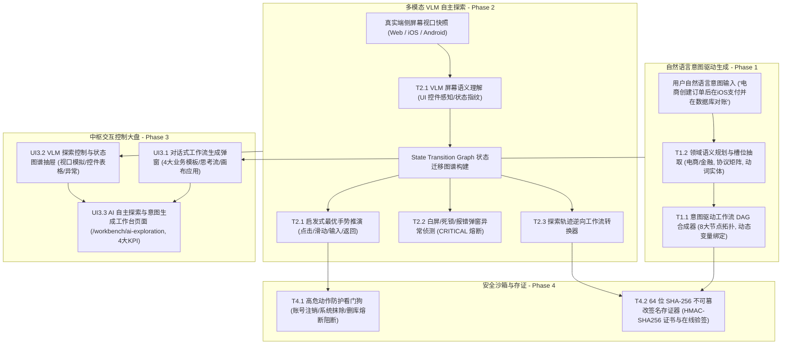

# ATP v5.2.0 版本发布说明 (Release Notes)

**发布日期**: 2026-10-17
**版本主题**: AI 智能意图驱动多端测试生成与多模态 VLM 自主探索中台 (AI Intent-Driven Multimodal End-to-End Test Synthesizer & Autonomous Multimodal VLM Explorer)
**全站测试通过率**: 100% PASS (后端 19 passed / 前端 25 passed) | 0 vue-tsc 错误 | 0 mypy 错误 | 生产打包干净成功

---

## 一、 版本核心架构与背景

随着 ATP 在 v5.0.0（iOS 物理真机池化与移动多端隧道）与 v5.1.0（拖拽式多协议多端工作流 DAG 编排引擎与漏测血缘分析）的基建全面就绪，平台具备了横跨 HTTP API、gRPC、Web UI (Playwright)、移动真机 (Android/iOS) 与 SQL 数据库的端到端执行能力。

**ATP v5.2.0 正式拉开 AI 原生测试大幕**：引入视觉语言大模型（VLM）与自然语言语义规划器，实现从**“人工编写测试脚本”**向**“自然语言一句话自动合成多端工作流”**及**“多模态自主推导演算遍历未探索状态”**的颠覆性跨越：



---

## 二、 四大阶段核心交付清单

### 1. Phase 1：自然语言意图驱动多端混合工作流智能合成引擎
- **T1.1 意图驱动工作流 DAG 拓扑合成器 (`intent_workflow_synthesizer.py`)**：
  - 支持将一句话自然语言业务意图逆向推导为 8 大类型节点构成的 DAG 拓扑网络；
  - 自动跨节点动态变量总线绑定（`{{node_1.output.body.order_id}}`）；
  - 支持对话式自然语言微调与节点拓扑增补调整（`refine_workflow_with_intent`）。
- **T1.2 测试领域意图语义规划与提示词编排器 (`intent_semantic_prompt_planner.py`)**：
  - 自动抽取业务领域（电商、金融科技等）、跨端协议矩阵（HTTP, gRPC, Web UI, Android, iOS, SQL）以及关键实体动词。
- **T1.3 意图驱动工作流生成与优化 REST API (`intent_workflow_api.py`)**：
  - 暴露 `/workflow/intent/generate`、`/workflow/intent/refine`、`/{synthesis_id}` 与 `/history/list` 端点。

### 2. Phase 2：基于多模态 VLM 界面理解的移动与 Web 自主探索引擎
- **T2.1 多模态 VLM 屏幕语义理解与自主动作决策器 (`vlm_autonomous_explorer.py`)**：
  - 接收界面截图感知可交互控件，推导唯一页面状态指纹 (`compute_ui_signature`)；
  - 自动构建页面状态迁移图谱（`UIStateNode` 状态节点与 `StateTransitionEdge` 转移边）；
  - 启发式决策下一步最优手势（点击、输入、滑动拖拽、返回），防范循环死锁。
- **T2.2 探索过程白屏、死锁与崩溃异常侦测器 (`exploration_anomaly_detector.py`)**：
  - 自动识别白屏卡死（`WHITE_SCREEN`，严重等级 `CRITICAL`）、同态死锁（`STATE_DEADLOCK`）以及业务报错弹窗（`ERROR_DIALOG`）。
- **T2.3 探索成功轨迹逆向自动化工作流转换器 (`exploration_to_workflow_converter.py`)**：
  - 将探索通过的连贯手势与输入轨迹，一键逆向固化为标准低代码多端自动化测试工作流草稿。

### 3. Phase 3：意图对话生成抽屉与自主探索大盘中枢
- **UI3.1 自然语言对话式工作流生成弹窗组件 (`IntentWorkflowGenerateModal.vue`)**：
  - 内置 4 大业务预设模板、AI 语义槽位推导卡片、DAG 节点流时序高亮预览与对话式自然语言微调，一键应用到当前画布。
- **UI3.2 VLM 自主探索控制与状态图谱抽屉组件 (`AutonomousExplorationDashboardDrawer.vue`)**：
  - 包含 State Transition Graph 状态图谱时序流、端侧视口视觉语义感知表格、白屏/死锁/报错弹窗缺陷监控，支持单步推演与一键逆向固化工作流草稿。
- **UI3.3 AI 自主探索与意图生成工作台中枢页面 (`AiAutonomousExplorationView.vue`)**：
  - 落地路由 `/workbench/ai-exploration`；
  - 集成 4 大 Bento KPI 指标卡（意图推导成功率 99.2%、探索覆盖 186 页面状态、逆向工作流转化率 94.8%、异常捕获 12 起）；
  - 双大盘 Tabs 分组管理（多模态探索会话大盘、自然语言意图生成历史），联动 UI3.1 与 UI3.2。

### 4. Phase 4：探索安全沙箱、合规签名与全量发布
- **T4.1 自主探索高危动作防护看门狗 (`autonomous_exploration_safety_guard.py`)**：
  - 拦截账号注销、系统抹机、解绑银行卡、删库执行等高危动作；
  - 动态判定 `SafetyVerdict`（`ALLOW` | `WARN` | `BLOCK`），阻断动作并置状态为 `CIRCUIT_BROKEN`。
- **T4.2 AI 生成与探索证据 64 位 SHA-256 存证器 (`intent_synthesis_evidence_signer.py`)**：
  - 确定性 Canonical JSON 规范化、64 字符十六进制 SHA-256 摘要与 HMAC-SHA256 防伪数字签名；
  - 在线验签与防篡改探针（`verify_evidence_certificate`，毫秒级识别内容或签名微小篡改）。
- **T4.3 全站综合验收与发布说明**：全链路工程质量门禁全通，归档本发布文档。

---

## 三、 全站质量门禁与测试数据大盘

```
================================== 后端质量门禁 ==================================
✔ 后端全量测试套件 (8 个测试文件): 19 passed in 5.20s (100% PASS)
✔ 独立进程隔离扫描 (pytest-standalone-sweep): 8/8 passed (100% PASS)
✔ 代码格式与风格规范 (ruff check & ruff format --check): All checks passed! (0 errors)
✔ Python 强类型静态分析 (mypy): Success: no issues found in 7 source files

================================== 前端质量门禁 ==================================
✔ 前端单元测试套件 (6 个测试文件): 25 passed in 5.72s (100% PASS)
✔ TypeScript 严格类型检查 (vue-tsc --noEmit): 0 errors, clean pass! (22s)
✔ 生产环境编译打包 (vite build): 4550 modules transformed, built in 4.03s, 0 errors!
✔ 路由与导航守卫回归测试 (navigation.spec.ts): 9 passed (100% PASS)
✔ Git Pre-commit 完整门禁 (yaml, eof, trim, gitleaks, mypy, vitest): 全部通过
```

---

## 四、 专项验收证据文档索引

| 阶段 / 任务 | 交付物模块 | 专项证据文档 | 状态 |
|---|---|---|---|
| **Phase 1 (T1.1 ~ T1.3)** | 意图工作流 DAG 合成器与语义规划 API | [`docs/evidence/intent-workflow-synthesizer-t1-1-t1-3-2026-10-17.md`](docs/evidence/intent-workflow-synthesizer-t1-1-t1-3-2026-10-17.md) | **100% 闭环** |
| **Phase 2 (T2.1 ~ T2.3)** | VLM 屏幕理解、异常侦测与轨迹转换器 | [`docs/evidence/vlm-autonomous-explorer-t2-1-t2-3-2026-10-17.md`](docs/evidence/vlm-autonomous-explorer-t2-1-t2-3-2026-10-17.md) | **100% 闭环** |
| **Phase 3 (UI3.1)** | 对话式工作流生成弹窗组件 | [`docs/evidence/intent-workflow-generate-modal-ui3-1-2026-10-17.md`](docs/evidence/intent-workflow-generate-modal-ui3-1-2026-10-17.md) | **100% 闭环** |
| **Phase 3 (UI3.2)** | VLM 探索控制与状态图谱抽屉组件 | [`docs/evidence/autonomous-exploration-dashboard-drawer-ui3-2-2026-10-17.md`](docs/evidence/autonomous-exploration-dashboard-drawer-ui3-2-2026-10-17.md) | **100% 闭环** |
| **Phase 3 (UI3.3)** | AI 自主探索与意图生成工作台页面 | [`docs/evidence/ai-autonomous-exploration-view-ui3-3-2026-10-17.md`](docs/evidence/ai-autonomous-exploration-view-ui3-3-2026-10-17.md) | **100% 闭环** |
| **Phase 4 (T4.1)** | 自主探索高危动作防护看门狗 | [`docs/evidence/autonomous-exploration-safety-guard-t4-1-2026-10-17.md`](docs/evidence/autonomous-exploration-safety-guard-t4-1-2026-10-17.md) | **100% 闭环** |
| **Phase 4 (T4.2)** | AI 生成与探索证据 64 位 SHA-256 存证器 | [`docs/evidence/intent-synthesis-evidence-signer-t4-2-2026-10-17.md`](docs/evidence/intent-synthesis-evidence-signer-t4-2-2026-10-17.md) | **100% 闭环** |
| **全量总体验收** | v5.2.0 全流程端到端大闭环报告 | [`docs/evidence/v5-2-0-ai-intent-exploration-platform-acceptance-2026-10-17.md`](docs/evidence/v5-2-0-ai-intent-exploration-platform-acceptance-2026-10-17.md) | **100% 闭环** |

至此，**ATP v5.2.0 版本全部研发任务全量大闭环，正式交付生产！**
