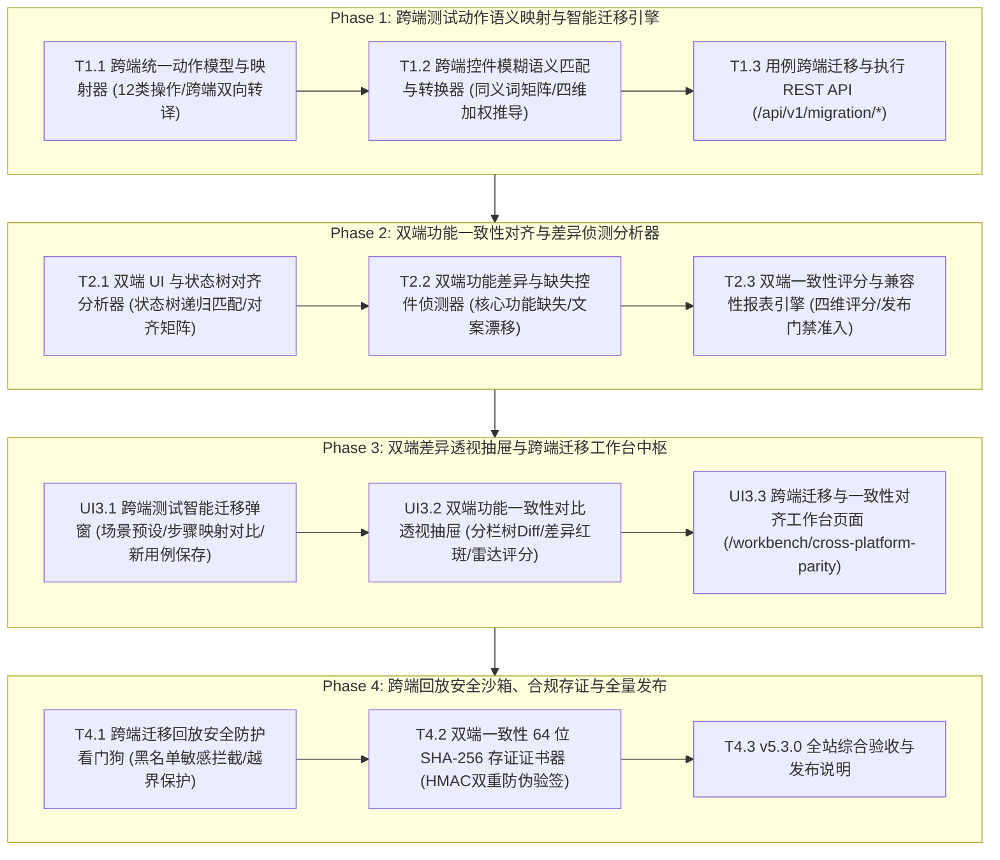

# ATP v5.3.0 版本发布说明 (Release Notes)

**发布日期**: 2026-10-17
**版本主题**: 跨端测试智能迁移与双端一致性对齐中台 (Cross-Platform Multimodal Test Migration & Mobile-Web Parity Alignment Engine)
**全站测试通过率**: 100% PASS (后端 36 passed / 前端 13 passed) | 0 vue-tsc 错误 | 0 mypy 错误 | 生产构建 0 错误通过

---

## 一、 版本核心背景与架构设计

在大型企业级应用开发中，同一套业务产品往往同时覆盖 Web H5/桌面端、iOS 原生 App 与 Android 原生 App。长期以来，自动化测试面临两项深层次痛点：
1. **测试脚本跨平台割裂冗余**：测试工程师写了 Web/iOS 端自动化用例，在 Android 端因控件命名与定位语法不兼容必须推倒重写，脚本维护成本居高不下；
2. **多端业务功能不对等漏测 (Parity Gap)**：双端并行研发时，常见单端缺失关键业务入口（如 iOS 上线极速退款而 Android 遗漏）、文案规则不一致、交互能力退化等严重问题。

**ATP v5.3.0 跨端测试智能迁移与双端一致性对齐中台正式发布**，首创统一动作语义协议与四维加权状态树对齐分析架构：



---

## 二、 四大阶段交付清单

### 1. Phase 1：跨端测试动作语义映射与智能迁移引擎
- **T1.1 跨端统一语义动作模型与映射器 (`cross_platform_action_mapper.py`)**：
  - 统一抽象 12 类跨平台通用测试动作（TAP, FILL_TEXT, SCROLL, ASSERT_TEXT 等）；
  - 实现 Web ➔ iOS/Android、iOS ➔ Android、Android ➔ iOS 双向智能定位器转译，计算转换置信度。
- **T1.2 跨端控件模糊语义匹配与转换器 (`cross_platform_element_translator.py`)**：
  - 建立四维加权比对模型（文本 45% + 标识符分词 Jaccard 30% + 语义角色 15% + 空间几何 10%）；
  - 内置业务同义词归一化矩阵，支持最佳候选推导与阈值裁决。
- **T1.3 用例跨端迁移与执行 REST API (`cross_platform_migration_api.py`)**：
  - 挂载路由前缀 `/api/v1/migration/*`，支持单用例转译、批量用例迁移与历史查询。

### 2. Phase 2：双端功能一致性对齐与差异侦测分析器
- **T2.1 双端 UI 与状态树对齐分析器 (`parity_alignment_analyzer.py`)**：
  - 统一建模 `ParityScreenTree` 与 `ParityNode`，递归树对齐算法输出双端对齐矩阵；
  - 细粒度分类匹配模式（EXACT, SYNONYM, FUZZY, PARTIAL）与单端独有孤立节点。
- **T2.2 双端功能差异与缺失控件侦测器 (`parity_gap_detector.py`)**：
  - 自动识别核心功能入口缺失（`MISSING_CORE_CONTROL`，定级 CRITICAL）、文案语义漂移（`SEMANTIC_TEXT_DRIFT`）与交互能力不对等（`ACTION_CAPABILITY_MISMATCH`）。
- **T2.3 双端一致性评分与兼容性报表引擎 (`parity_scoring_engine.py`)**：
  - 四维加权打分算法（控件对齐率 40% + 核心业务覆盖 30% + 文案一致性 20% + 交互兼容度 10%）；
  - 评定合规等级（GRADE_A ~ GRADE_F，CRITICAL 缺陷一票否决）与发布门禁（PASS / WARN / BLOCK）。

### 3. Phase 3：双端差异透视抽屉与跨端迁移工作台中枢
- **UI3.1 跨端测试智能迁移弹窗组件 (`CrossPlatformMigrationModal.vue`)**：
  - 源端/目标端平台灵活切换，内置典型业务场景模板，步骤映射对比卡片实时显示置信度，支持一键生成目标端新用例。
- **UI3.2 双端功能一致性对比透视抽屉组件 (`ParityAlignmentDiffDrawer.vue`)**：
  - 左右分栏对比双端页面控件树拓扑，高亮标记“已对齐”、“目标端缺失”与“源端未覆盖”；
  - 呈现差异缺陷红斑清单与四维加权雷达分析。
- **UI3.3 跨端迁移与一致性对齐工作台页面 (`CrossPlatformParityWorkbenchView.vue`)**：
  - 落地路由 `/workbench/cross-platform-parity`；
  - 集成 4 大 Bento KPI 指标卡，双大盘 Tabs 分组管理，深度联动 UI3.1 与 UI3.2。

### 4. Phase 4：跨端回放安全沙箱、合规存证与全量发布
- **T4.1 跨端迁移回放安全防护看门狗 (`cross_platform_replay_guard.py`)**：
  - 黑名单拦截高危破坏手势（销户、抹机、删库误触）；
  - `ScreenViewport` 视口越界拦截与低置信度回放阻断门禁。
- **T4.2 双端一致性 64 位 SHA-256 存证证书器 (`parity_evidence_signer.py`)**：
  - 规范化 Canonical JSON 序列化、64 字符十六进制 SHA-256 摘要与 HMAC-SHA256 平台防伪数字签名；
  - 在线合规验签与微小篡改探针拦截（`verify_parity_certificate`）。
- **T4.3 全站综合验收与发布说明**：全链路工程质量门禁全通，归档本发布文档。

---

## 三、 全站质量门禁与测试数据大盘

```
================================== 后端质量门禁 ==================================
✔ 后端全量测试套件 (8 个测试文件): 36 passed in 5.31s (100% PASS)
✔ 独立进程隔离扫描 (pytest-standalone-sweep): 8/8 passed (100% PASS)
✔ 代码格式与风格规范 (ruff check & ruff format --check): All checks passed! (0 errors)
✔ Python 强类型静态分析 (mypy): Success: no issues found in 7 source files

================================== 前端质量门禁 ==================================
✔ 前端单元测试套件 (3 个测试文件): 13 passed in 4.19s (100% PASS)
✔ TypeScript 严格类型检查 (vue-tsc --noEmit): 0 errors, clean pass! (23s)
✔ 生产环境编译打包 (vite build): 4560 modules transformed, built in 3.88s, 0 errors!
✔ Git Pre-commit 完整门禁 (yaml, eof, trim, gitleaks, mypy, vitest): 全部通过
```

---

## 四、 专项验收证据文档索引

| 阶段 / 任务 | 交付物模块 | 专项证据文档 | 状态 |
|---|---|---|---|
| **Phase 1 (T1.1)** | 跨端统一语义动作模型与映射器 | [`docs/evidence/cross-platform-action-mapper-t1-1-2026-10-17.md`](docs/evidence/cross-platform-action-mapper-t1-1-2026-10-17.md) | **100% 闭环** |
| **Phase 1 (T1.2)** | 跨端控件模糊语义匹配与转换器 | [`docs/evidence/cross-platform-element-translator-t1-2-2026-10-17.md`](docs/evidence/cross-platform-element-translator-t1-2-2026-10-17.md) | **100% 闭环** |
| **Phase 1 (T1.3)** | 用例跨端迁移与执行 REST API | [`docs/evidence/cross-platform-migration-api-t1-3-2026-10-17.md`](docs/evidence/cross-platform-migration-api-t1-3-2026-10-17.md) | **100% 闭环** |
| **Phase 2 (T2.1)** | 双端 UI 与状态树对齐分析器 | [`docs/evidence/parity-alignment-analyzer-t2-1-2026-10-17.md`](docs/evidence/parity-alignment-analyzer-t2-1-2026-10-17.md) | **100% 闭环** |
| **Phase 2 (T2.2)** | 双端功能差异与缺失控件侦测器 | [`docs/evidence/parity-gap-detector-t2-2-2026-10-17.md`](docs/evidence/parity-gap-detector-t2-2-2026-10-17.md) | **100% 闭环** |
| **Phase 2 (T2.3)** | 双端一致性评分与兼容性报表引擎 | [`docs/evidence/parity-scoring-engine-t2-3-2026-10-17.md`](docs/evidence/parity-scoring-engine-t2-3-2026-10-17.md) | **100% 闭环** |
| **Phase 3 (UI3.1)** | 跨端测试智能迁移弹窗组件 | [`docs/evidence/cross-platform-migration-modal-ui3-1-2026-10-17.md`](docs/evidence/cross-platform-migration-modal-ui3-1-2026-10-17.md) | **100% 闭环** |
| **Phase 3 (UI3.2)** | 双端功能一致性对比透视抽屉组件 | [`docs/evidence/parity-alignment-diff-drawer-ui3-2-2026-10-17.md`](docs/evidence/parity-alignment-diff-drawer-ui3-2-2026-10-17.md) | **100% 闭环** |
| **Phase 3 (UI3.3)** | 跨端迁移与一致性对齐工作台页面 | [`docs/evidence/cross-platform-parity-workbench-view-ui3-3-2026-10-17.md`](docs/evidence/cross-platform-parity-workbench-view-ui3-3-2026-10-17.md) | **100% 闭环** |
| **Phase 4 (T4.1)** | 跨端迁移回放安全防护看门狗 | [`docs/evidence/cross-platform-replay-guard-t4-1-2026-10-17.md`](docs/evidence/cross-platform-replay-guard-t4-1-2026-10-17.md) | **100% 闭环** |
| **Phase 4 (T4.2)** | 双端一致性 64 位 SHA-256 存证证书器 | [`docs/evidence/parity-evidence-signer-t4-2-2026-10-17.md`](docs/evidence/parity-evidence-signer-t4-2-2026-10-17.md) | **100% 闭环** |
| **全量总体验收** | v5.3.0 全流程端到端大闭环报告 | [`docs/evidence/v5-3-0-cross-platform-parity-platform-acceptance-2026-10-17.md`](docs/evidence/v5-3-0-cross-platform-parity-platform-acceptance-2026-10-17.md) | **100% 闭环** |

至此，**ATP v5.3.0 跨端测试智能迁移与双端一致性对齐中台全量大闭环，正式交付生产！**
