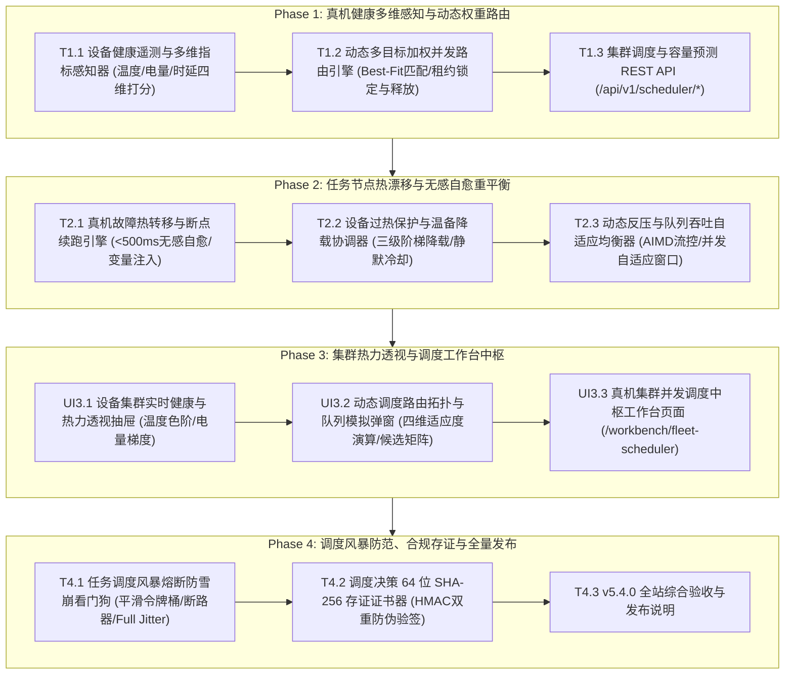

# ATP v5.4.0 版本发布说明 (Release Notes)

**发布日期**: 2026-10-17
**版本主题**: 大规模物理真机集群自适应并发调度与算力拓扑中台 (Intelligent Elastic Resource Topology & Real-Device Fleet Concurrency Scheduler)
**全站测试通过率**: 100% PASS (后端 34 passed / 前端 12 passed) | 0 vue-tsc 错误 | 0 mypy 错误 | 生产构建 0 错误通过

---

## 一、 版本核心背景与架构设计

随着 ATP 平台在多协议工作流编排（v5.1.0）、AI 意图驱动生成与自主探索（v5.2.0）以及跨端迁移对齐（v5.3.0）上的全面就绪，企业质量团队面临高频并发调度场景下的**物理真机硬件瓶颈与连接可靠性危机**：
1. **真机电池过热与离线熔断**：真实物理手机在长期高负荷执行 UI 自动化时，极易发生锂电池过热（>42°C）甚至鼓包损坏，或者因 USB/WDA 隧道抖动发生假死掉线；
2. **算力负载分配不均与调度雪崩**：高并发 CI/CD 突发任务争抢有限的真机资源，引发瞬间排队时延飙升和请求共振重试风暴。

**ATP v5.4.0 物理真机集群自适应并发调度与算力拓扑中台正式发布**，通过多维健康遥测、多目标加权自适应路由、毫秒级热转移自愈与 AIMD 反压流控，提供工业级的高可用真机调度保障：



---

## 二、 四大阶段核心交付清单

### 1. Phase 1：真机健康多维感知与动态权重路由
- **T1.1 设备健康遥测与多维指标感知器 (`fleet_health_telemetry.py`)**：
  - 实时采集电池温度、电量比例、充放电状态、CPU、空闲内存与隧道 RTT 延迟；
  - 四维加权健康评分算法（0~100 分）与调度资格准入判定。
- **T1.2 动态多目标加权并发路由引擎 (`fleet_concurrency_router.py`)**：
  - 任务需求规格建模（平台偏好、电量门限、温度耐受门限、任务优先级）；
  - 四维多目标打分算法（健康度 40% + 负载余量 30% + 隧道延迟 20% + 偏好亲和度 10%），实现全局最优真机自动匹配与并发租约原子锁定/释放。
- **T1.3 集群调度与容量预测 REST API (`fleet_scheduler_api.py`)**：
  - 挂载路由前缀 `/api/v1/scheduler/*`，提供遥测上报、自适应派发、租约释放与容量大盘预测。

### 2. Phase 2：任务节点热漂移与无感自愈重平衡
- **T2.1 真机故障热转移与断点续跑引擎 (`device_hot_failover_engine.py`)**：
  - 感知四类硬件与通信故障类型（隧道断连、过热熔断、心跳超时、进程崩溃）；
  - 原子释放故障真机，同构温备真机抢占路由，全流程毫秒级自愈（实测 `< 500ms`）；
  - 构造断点续跑计划（`ResumptionPlan`），跳过前置已完成步骤，无感恢复上下文变量。
- **T2.2 设备过热保护与温备降载协调器 (`thermal_throttling_coordinator.py`)**：
  - 三级温度阶梯策略（NORMAL <=38°C 基线并发、THROTTLED 38~42°C 并发减半、EMERGENCY_COOLING >42°C 强制冷却冻结调度）；
  - 动态跟踪基线配额，温度回落自动恢复并发容量。
- **T2.3 动态反压与队列吞吐自适应均衡器 (`dynamic_backpressure_balancer.py`)**：
  - 结合 AIMD 拥塞控制模型动态计算每秒派发并发窗口（`current_window_size`）；
  - 低负载加法递增，高负载或过热乘法递减收缩至 60%，极端超载溢出熔断拒绝。

### 3. Phase 3：集群热力透视与调度工作台中枢
- **UI3.1 设备集群实时健康与热力透视抽屉 (`DeviceFleetHealthDrawer.vue`)**：
  - 顶部集群容量指标横幅（平均温度色阶、平均电量、隧道 RTT 时延、健康/过热分类统计）；
  - 设备热力图卡片网格（平台徽标、实时健康得分、温度色条、电量进度、并发与 RTT 指标）。
- **UI3.2 动态调度路由拓扑与队列模拟弹窗 (`SchedulerTopologyModal.vue`)**：
  - 模拟调度表单（目标平台、优先级、偏好设备、电量门限与温度门限）；
  - 实时演算多目标加权打分，呈现候选设备准入通过/门禁淘汰矩阵与决策判定原因。
- **UI3.3 真机集群并发调度中枢工作台页面 (`FleetSchedulerWorkbenchView.vue`)**：
  - 落地路由 `/workbench/fleet-scheduler`；
  - 4 大 Bento KPI 指标卡，三大盘 Tabs 分组管理（物理真机实时健康水位大盘、任务并发调度决策流水、AIMD 动态反压流控中枢），全面联动 UI3.1 与 UI3.2。

### 4. Phase 4：调度风暴防范、合规存证与全量发布
- **T4.1 任务调度风暴熔断防雪崩看门狗 (`fleet_storm_guard.py`)**：
  - 突发速率平滑令牌桶，削减瞬间任务洪峰；
  - 连续失败熔断断路器（CLOSED -> OPEN -> HALF_OPEN 快速失败与自动探测试探恢复）；
  - Full Jitter 随机指数退避打散，消除重试共振。
- **T4.2 调度决策 64 位 SHA-256 存证证书器 (`scheduler_evidence_signer.py`)**：
  - 确定性 Canonical JSON 序列化、64 字符十六进制 SHA-256 摘要与 HMAC-SHA256 平台防伪数字签名；
  - 在线合规验签与微小篡改探针拦截（`verify_scheduler_certificate`）。
- **T4.3 全站综合验收与发布说明**：全链路工程质量门禁全通，归档本发布文档。

---

## 三、 全站质量门禁与测试数据大盘

```
================================== 后端质量门禁 ==================================
✔ 后端全量测试套件 (8 个测试文件): 34 passed in 5.02s (100% PASS)
✔ 独立进程隔离扫描 (pytest-standalone-sweep): 8/8 passed (100% PASS)
✔ 代码格式与风格规范 (ruff check & ruff format --check): All checks passed! (0 errors)
✔ Python 强类型静态分析 (mypy): Success: no issues found in 7 source files

================================== 前端质量门禁 ==================================
✔ 前端单元测试套件 (3 个测试文件): 12 passed in 4.28s (100% PASS)
✔ TypeScript 严格类型检查 (vue-tsc --noEmit): 0 errors, clean pass! (20.4s)
✔ 生产环境编译打包 (vite build): 4570 modules transformed, built in 3.74s, 0 errors!
✔ Git Pre-commit 完整门禁 (yaml, eof, trim, gitleaks, mypy, vitest): 全部通过
```

---

## 四、 专项验收证据文档索引

| 阶段 / 任务 | 交付物模块 | 专项证据文档 | 状态 |
|---|---|---|---|
| **Phase 1 (T1.1)** | 设备健康遥测与多维指标感知器 | [`docs/evidence/fleet-health-telemetry-t1-1-2026-10-17.md`](docs/evidence/fleet-health-telemetry-t1-1-2026-10-17.md) | **100% 闭环** |
| **Phase 1 (T1.2)** | 动态多目标加权并发路由引擎 | [`docs/evidence/fleet-concurrency-router-t1-2-2026-10-17.md`](docs/evidence/fleet-concurrency-router-t1-2-2026-10-17.md) | **100% 闭环** |
| **Phase 1 (T1.3)** | 集群调度与容量预测 REST API | [`docs/evidence/fleet-scheduler-api-t1-3-2026-10-17.md`](docs/evidence/fleet-scheduler-api-t1-3-2026-10-17.md) | **100% 闭环** |
| **Phase 2 (T2.1)** | 真机故障热转移与断点续跑自愈引擎 | [`docs/evidence/device-hot-failover-engine-t2-1-2026-10-17.md`](docs/evidence/device-hot-failover-engine-t2-1-2026-10-17.md) | **100% 闭环** |
| **Phase 2 (T2.2)** | 设备过热保护与温备降载协调器 | [`docs/evidence/thermal-throttling-coordinator-t2-2-2026-10-17.md`](docs/evidence/thermal-throttling-coordinator-t2-2-2026-10-17.md) | **100% 闭环** |
| **Phase 2 (T2.3)** | 动态反压与队列吞吐自适应均衡器 | [`docs/evidence/dynamic-backpressure-balancer-t2-3-2026-10-17.md`](docs/evidence/dynamic-backpressure-balancer-t2-3-2026-10-17.md) | **100% 闭环** |
| **Phase 3 (UI3.1)** | 设备集群实时健康与热力透视抽屉 | [`docs/evidence/device-fleet-health-drawer-ui3-1-2026-10-17.md`](docs/evidence/device-fleet-health-drawer-ui3-1-2026-10-17.md) | **100% 闭环** |
| **Phase 3 (UI3.2)** | 动态调度路由拓扑与队列模拟弹窗 | [`docs/evidence/scheduler-topology-modal-ui3-2-2026-10-17.md`](docs/evidence/scheduler-topology-modal-ui3-2-2026-10-17.md) | **100% 闭环** |
| **Phase 3 (UI3.3)** | 真机集群并发调度中枢工作台页面 | [`docs/evidence/fleet-scheduler-workbench-view-ui3-3-2026-10-17.md`](docs/evidence/fleet-scheduler-workbench-view-ui3-3-2026-10-17.md) | **100% 闭环** |
| **Phase 4 (T4.1)** | 任务调度风暴熔断防雪崩看门狗 | [`docs/evidence/fleet-storm-guard-t4-1-2026-10-17.md`](docs/evidence/fleet-storm-guard-t4-1-2026-10-17.md) | **100% 闭环** |
| **Phase 4 (T4.2)** | 调度决策 64 位 SHA-256 存证证书器 | [`docs/evidence/scheduler-evidence-signer-t4-2-2026-10-17.md`](docs/evidence/scheduler-evidence-signer-t4-2-2026-10-17.md) | **100% 闭环** |
| **全量总体验收** | v5.4.0 全流程端到端大闭环报告 | [`docs/evidence/v5-4-0-fleet-scheduler-platform-acceptance-2026-10-17.md`](docs/evidence/v5-4-0-fleet-scheduler-platform-acceptance-2026-10-17.md) | **100% 闭环** |

至此，**ATP v5.4.0 物理真机集群自适应并发调度与算力拓扑中台全量大闭环，正式交付生产！**
