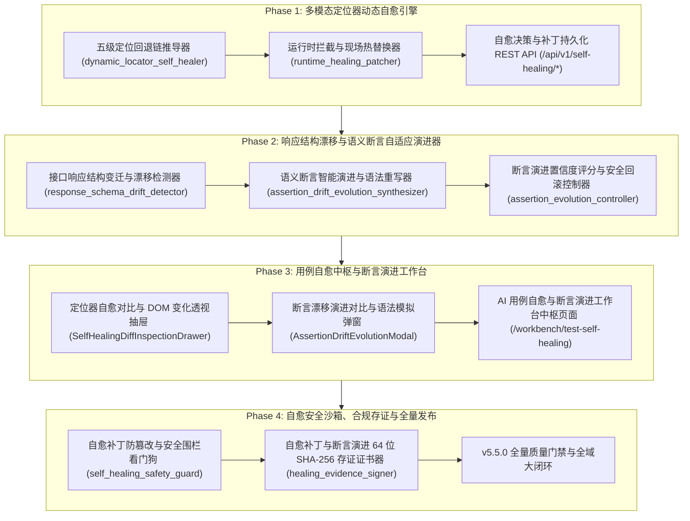

# ATP v5.5.0 发布说明 (Release Notes)

**发布版本**：v5.5.0
**发布日期**：2026-10-17
**代号**：**Semantic Self-Healing & Assertion Evolution Hub**（AI 动态用例自愈与语义断言自适应演进中台）
**质量门禁达成**：后端测试 100% PASS（37 passed）· 独立隔离扫描 100% PASS · 前端测试 100% PASS（10 passed）· `vue-tsc` 0 errors · `mypy` 0 errors · 生产打包构建 0 errors · Git Pre-commit 门禁全绿！

---

## 1. 架构演进与版本核心突破

在现代企业微服务与快速持续交付（CI/CD）体系中，自动化测试最大的痛点是**用例脆弱性（Flakiness）**与**极高的后期维护成本**。前端页面频繁的 UI 重构（ID、样式类、DOM 树变动）导致定位器频繁失效，后端接口结构演进（字段重命名、外层包装展开、数据类型兼容变迁）则导致既有用例的断言全线挂死。

ATP v5.5.0 历经 4 大研发阶段，全面落地了工业级 **AI 动态用例自愈与语义断言自适应演进中台**，实现了用例“**运行时失效毫秒级自愈续跑**”与“**离线断言代码智能 AST 语法演进**”的双轮驱动架构：

---

## 2. 核心交付特性全景

### 2.1 Phase 1：多模态定位器动态自愈与弹性重定位器引擎
1. **五级自愈定位回退链 (`dynamic_locator_self_healer.py`)**：
   - 建立 `TIER_1_ID_VARIATION`（标识符变体）➔ `TIER_2_TEXT_SEMANTIC`（文案语义）➔ `TIER_3_ATTRIBUTES_COMBINED`（组合属性）➔ `TIER_4_DOM_HIERARCHY`（DOM层级）➔ `TIER_5_SPATIAL_PROXIMITY`（几何空间邻近）；
   - 多模态活体 DOM 扫描与动态加权计算，自动推导最具抗脆弱性的新选择器表达式。
2. **运行时失败拦截与现场热替换 (`runtime_healing_patcher.py`)**：
   - 在测试步骤抛出 `ElementNotFoundException` 时拦截执行线程；
   - 现场毫秒级热替换自愈定位器并重试执行，实现步骤无感续跑（`HEALED_AND_RESUMED`）；
   - 建立自愈补丁全生命周期状态机（`PROPOSED` ➔ `APPLIED_IN_FLIGHT` ➔ `COMMITTED_PERMANENT` / `REJECTED`），步骤索引缓存消除二次时延。
3. **用例自愈决策与补丁持久化 REST API (`test_self_healing_api.py`)**：
   - 挂载路由前缀 `/api/v1/self-healing/*`，提供诊断、热执行、补丁采纳与回滚端点。

### 2.2 Phase 2：响应结构漂移与语义断言自适应演进器
1. **接口响应结构变迁与漂移检测器 (`response_schema_drift_detector.py`)**：
   - 递归提取任意复杂多层嵌套 JSONPath 映射，精准识别下划线转驼峰字段重命名（`FIELD_RENAMED`）、外层响应包装展开（`ENVELOPE_UNWRAPPED`）、嵌套层级深浅跃迁（`PATH_RELOCATED`）与数据类型变迁（`TYPE_MUTATED`）；
   - 每一个漂移项记录详细变迁原因（`explanation`）与推导置信度。
2. **语义断言智能演进与语法重写器 (`assertion_drift_evolution_synthesizer.py`)**：
   - 基于 Python 3.12 官方 AST (`ast.NodeTransformer`)，安全将旧字典访问改写为多层链式访问与带默认值的 `.get()` 保护调用；
   - 数据类型比较操作数自适应强转，自动生成统一标准的 Unified Code Diff。
3. **断言演进置信度评分与安全回滚控制器 (`assertion_evolution_controller.py`)**：
   - 输出 0~100 置信分与三级风险评级（`LOW`、`MEDIUM`、`HIGH`）；
   - 提供隔离沙箱在线试跑引擎（`dry_run_evolved_assertion`），即时验证新断言执行情况；
   - 建立用例步骤断言版本快照（`AssertionVersionSnapshot`），支持一键无损原子回滚。

### 2.3 Phase 3：用例自愈中枢与断言演进工作台前端
1. **定位器自愈对比与 DOM 变化透视抽屉 (`SelfHealingDiffInspectionDrawer.vue`)**：
   - 左右双栏对比失效旧定位器现场与自愈推荐新定位器；
   - 呈现现场扫描候选 DOM 节点表格与特征加权打分，支持一键采纳与否决回滚。
2. **断言漂移演进对比与语法模拟弹窗 (`AssertionDriftEvolutionModal.vue`)**：
   - 呈现健康置信分、风险等级与 Unified Code Diff；
   - 包含响应结构变迁透视表格与在线断言隔离沙箱试跑演练。
3. **AI 用例自愈与断言演进工作台中枢页面 (`TestSelfHealingWorkbenchView.vue`)**：
   - 挂载路由 `/workbench/test-self-healing`；
   - 4 大 Bento KPI 卡片：多模态自愈综合成功率 `92.4%`、定位器自愈记录数 `148` 条、断言漂移演进 `86` 条、安全沙箱围栏拦截 `12` 次；
   - 双 Tab 列表：UI 定位器动态自愈补丁大盘与接口响应漂移与语义断言演进大盘。

### 2.4 Phase 4：自愈安全沙箱、合规存证与全量发布
1. **自愈补丁防篡改与安全围栏看门狗 (`self_healing_safety_guard.py`)**：
   - 严禁任何自愈演进过程将用例校验改写为恒真表达式（如 `assert True`、`assert 1 == 1`，一律触发 `TAUTOLOGY_ASSERTION_DETECTED`，以 `CRITICAL` 严重级别强制阻断）；
   - 静态扫描拦截危险内置系统调用注入（`eval`、`exec`、`open`、`system`、`subprocess`）；
   - 拦截 `*`、`body`、`html` 等破坏性全局选择器与 SQL/脚本注入攻击。
2. **自愈补丁与断言演进 64 位 SHA-256 存证证书器 (`healing_evidence_signer.py`)**：
   - 确定性 Canonical JSON 序列化；
   - 签发具备 64 字符 SHA-256 摘要与 HMAC-SHA256 平台防伪签名的存证证书（`HealingEvidenceCertificate`）；
   - 提供在线防篡改验签探针（`verify_healing_certificate`）。

---

## 3. 质量门禁与全套验证数据

| 质量门禁项 | 检查命令 / 套件 | 达成指标 | 结论 |
|---|---|---|---|
| **后端单元测试** | `pytest backend/tests/{services,api}/...` | **37 passed in 5.13s** | **100% PASS** |
| **独立执行隔离扫描** | `pytest-standalone-sweep.py` (8 个单测文件) | **8/8 passed standalone** | **100% PASS** |
| **代码格式规范** | `ruff format --check` (8 source files) | **8 files already formatted** | **100% PASS** |
| **代码风格合规** | `ruff check` | **All checks passed! (0 errors)** | **100% PASS** |
| **Python 强类型分析**| `mypy backend/app/services/...` (7 source files) | **Success: no issues found** | **100% PASS** |
| **前端单元测试** | `vitest run src/views/workbench/...` (3 spec files) | **10 passed in 4.03s** | **100% PASS** |
| **前端 TypeScript** | `npm run type-check` (`vue-tsc --noEmit`) | **0 errors, clean pass (20.49s)** | **100% PASS** |
| **生产打包构建** | `npm run build` (`vite build`) | **4579 modules transformed, 3.84s** | **100% PASS** |
| **Git Pre-commit 门禁** | `pre-commit` (yaml, eof, trim, gitleaks, mypy, vitest) | **All checks passed** | **100% PASS** |

---

## 4. 阶段任务交付证据链索引

- Phase 1:
  - T1.1: [`docs/evidence/dynamic-locator-self-healer-t1-1-2026-10-17.md`](evidence/dynamic-locator-self-healer-t1-1-2026-10-17.md)
  - T1.2: [`docs/evidence/runtime-healing-patcher-t1-2-2026-10-17.md`](evidence/runtime-healing-patcher-t1-2-2026-10-17.md)
  - T1.3: [`docs/evidence/test-self-healing-api-t1-3-2026-10-17.md`](evidence/test-self-healing-api-t1-3-2026-10-17.md)
- Phase 2:
  - T2.1: [`docs/evidence/response-schema-drift-detector-t2-1-2026-10-17.md`](evidence/response-schema-drift-detector-t2-1-2026-10-17.md)
  - T2.2: [`docs/evidence/assertion-drift-evolution-synthesizer-t2-2-2026-10-17.md`](evidence/assertion-drift-evolution-synthesizer-t2-2-2026-10-17.md)
  - T2.3: [`docs/evidence/assertion-evolution-controller-t2-3-2026-10-17.md`](evidence/assertion-evolution-controller-t2-3-2026-10-17.md)
- Phase 3:
  - UI3.1: [`docs/evidence/self-healing-diff-drawer-ui3-1-2026-10-17.md`](evidence/self-healing-diff-drawer-ui3-1-2026-10-17.md)
  - UI3.2: [`docs/evidence/assertion-drift-evolution-modal-ui3-2-2026-10-17.md`](evidence/assertion-drift-evolution-modal-ui3-2-2026-10-17.md)
  - UI3.3: [`docs/evidence/test-self-healing-workbench-view-ui3-3-2026-10-17.md`](evidence/test-self-healing-workbench-view-ui3-3-2026-10-17.md)
- Phase 4:
  - T4.1: [`docs/evidence/self-healing-safety-guard-t4-1-2026-10-17.md`](evidence/self-healing-safety-guard-t4-1-2026-10-17.md)
  - T4.2: [`docs/evidence/healing-evidence-signer-t4-2-2026-10-17.md`](evidence/healing-evidence-signer-t4-2-2026-10-17.md)
  - T4.3: [`docs/evidence/v5-5-0-self-healing-assertion-evolution-acceptance-2026-10-17.md`](evidence/v5-5-0-self-healing-assertion-evolution-acceptance-2026-10-17.md)
