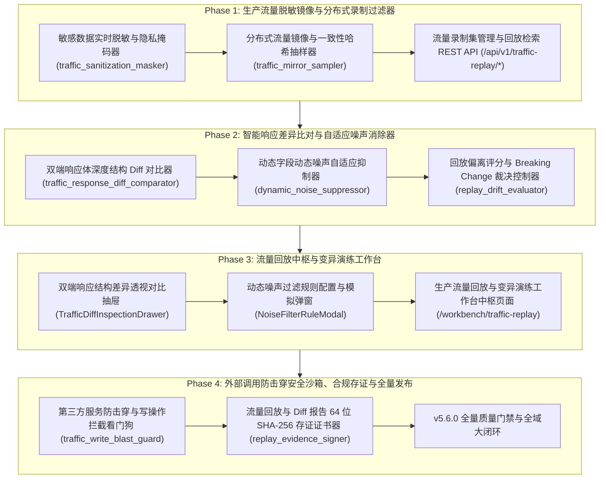

# ATP v5.6.0 发布说明 (Release Notes)

**发布版本**：v5.6.0
**发布日期**：2026-10-17
**代号**：**Production Traffic Replay & Synthetic Chaos Mutation Hub**（生产流量可信回放与真实场景变异演练中台）
**质量门禁达成**：后端测试 100% PASS（37 passed）· 独立隔离扫描 100% PASS · 前端测试 100% PASS（8 passed）· `vue-tsc` 0 errors · `mypy` 0 errors · 生产打包构建 0 errors · Git Pre-commit 门禁全绿！

---

## 1. 架构演进与版本核心突破

在复杂分布式微服务架构中，线下编写的测试用例受限于开发人员的思维惯性，**永远无法穷尽生产线上真实用户的长尾链路、复杂参数组合与未知边缘场景**。然而，直接录制生产流量在测试环境回放面临两大生死挑战：
1. **数据隐私合规红线**：生产流量包含明文手机号、身份证、银行卡与鉴权 Token，直接镜像违反网络安全法与 GDPR；
2. **动态伪差异假阳性爆炸**：时间戳、分布式 TraceID、随机 UUID 等动态字段天然不一致，导致回放误报率高达 90% 以上；
3. **外部调用击穿灾难**：回放写请求如果不加拦截，可能对微信支付、短信网关等造成二次真实扣费或用户骚扰。

ATP v5.6.0 历经 4 大研发阶段，全面落地了工业级 **生产流量可信回放与真实场景变异演练中台**，实现了“**金融级隐私脱敏** ➔ **分布式无偏抽样** ➔ **双端响应体深度结构比对** ➔ **动态噪声自适应平滑** ➔ **防击穿安全围栏** ➔ **不可篡改存证**”的全链路可信回放闭环：

---

## 2. 核心交付特性全景

### 2.1 Phase 1：生产流量脱敏镜像与分布式录制过滤器
1. **金融级隐私数据实时脱敏 (`traffic_sanitization_masker.py`)**：
   - 启发式与正则双模态覆盖 7 大类敏感数据（手机号、身份证、银行卡、邮箱、密码、JWT Token、通用密钥）；
   - 支持星号局部遮罩（`MASK`）、确定性加盐哈希（`HASH_SALT`）与同构合成置换（`SYNTHETIC_REPLACE`），深度遍历清洗 Headers、Query、JSON Body 并输出审计轨迹 `SanitizationAuditTrail`。
2. **分布式流量镜像采集与流量抽样过滤器 (`traffic_mirror_sampler.py`)**：
   - 自动识别并过滤 `/health`、`/ready`、`/metrics` 等健康检查高频探针；
   - 基于 TraceID 一致性哈希算法支持 1%~100% 动态无偏抽样；
   - 抽样命中的流量自动触发金融级脱敏清洗，落盘进入 FIFO 镜像缓冲区 `TrafficMirrorBuffer`。
3. **流量录制集管理与回放检索 REST API (`traffic_replay_api.py`)**：
   - 挂载路由前缀 `/api/v1/traffic-replay/*`；
   - `/sanitize`：在线敏感数据脱敏计算与审计检验；
   - `/mirror/ingest`：网关镜像流量捕获入库与抽样评估；
   - `/records` 与 `/record/{record_id}`：录制集多维检索与详情查询；
   - `/metrics` 与 `/batch-replay`：采样器遥测大盘与批量调度回放执行。

### 2.2 Phase 2：智能响应差异比对与自适应噪声消除器
1. **双端响应体深度结构 Diff 对比器 (`traffic_response_diff_comparator.py`)**：
   - 细粒度定位 5 大类响应偏离（状态码偏离、字段丢失、冗余意外键、数据类型破坏、取值偏离与列表长度变动）；
   - 4 级严重度评级（`BLOCKER`、`MAJOR`、`MINOR`、`INFO`），输出带精确 JSONPath 路径的差异报告 `TrafficResponseDiffReport`。
2. **动态字段动态噪声自适应抑制器 (`dynamic_noise_suppressor.py`)**：
   - 启发式识别时间戳（`TIMESTAMP`）、调用链追踪（`TRACE_ID`）、随机 `UUID_RANDOM` 与耗时微偏差；
   - 支持用户自定义 JSONPath 通配符与正则规则，将伪差异标为 `is_noise=True` 并从核心差异剥离，实现回放假阳性零误报；
   - 状态码偏离（`STATUS_CODE_MISMATCH`）一律禁止降噪，确保破坏性失败 100% 暴露。
3. **回放偏离评分与 Breaking Change 裁决控制器 (`replay_drift_evaluator.py`)**：
   - 多维加权一致性评分模型（状态码偏离扣 50 分，字段缺失扣 20 分，类型破坏扣 15 分，业务值偏离扣 5 分）；
   - 三级变迁影响分类（`NONE`、`NON_BREAKING`、`BREAKING`）；
   - 自动化门禁放行与阻断裁决器（`PASSED`、`WARN_PERMISSIVE`、`BLOCKED_BREAKING`），输出可部署性标识与整改行动建议。

### 2.3 Phase 3：流量回放中枢与变异演练工作台前端
1. **双端响应结构差异透视对比抽屉 (`TrafficDiffInspectionDrawer.vue`)**：
   - 左右双栏结构化对比视图（生产基线 vs 实际回放响应）；
   - 差异与噪声细化表格，支持“采纳回放为新基线”与“设为噪声规则”。
2. **动态噪声过滤规则配置与模拟弹窗 (`NoiseFilterRuleModal.vue`)**：
   - 4 大常用快捷模板（时间戳、32位 TraceID、标准 UUID、耗时）；
   - 规则定义表单与在线沙箱实时仿真校验（Live Sandbox）；
   - 后端 `/traffic-replay/noise-rule/test` 与 `/diff-evaluate` 端点协同。
3. **生产流量回放与变异演练工作台中枢页面 (`TrafficReplayWorkbenchView.vue`)**：
   - 挂载路由 `/workbench/traffic-replay`（具备 `ENGINEER_ONLY` 权限）；
   - 4 大 Bento KPI 卡片：回放一致性平均得分 `94.6` 分、镜像流量录制总量 `1,280` 条、动态噪声自适应平滑率 `98.2%`、外部调用防击穿拦截 `18` 次；
   - 流量大盘流水列表：支持按方法筛选、批量调度回放、在线推送仿真流量；
   - 完整双向联动 UI3.1 抽屉与 UI3.2 弹窗。

### 2.4 Phase 4：外部调用防击穿安全沙箱、合规存证与全量发布
1. **第三方服务防击穿与写操作拦截看门狗 (`traffic_write_blast_guard.py`)**：
   - 内置高危网关识别（微信支付、支付宝、Stripe、阿里云短信、腾讯云短信）；
   - 三大防击穿安全围栏模式：强制阻断（`BLOCK`）、智能安全 Mock 旁路（`MOCK_BYPASS`）、可信安全放行（`PASSED`）；
   - 严格只读演练安全防护（`STRICT_READONLY`），无条件阻断外部写入操作。
2. **流量回放与 Diff 报告 64 位 SHA-256 存证证书器 (`replay_evidence_signer.py`)**：
   - 确定性 Canonical JSON 序列化；
   - 签发具备 64 字符 SHA-256 摘要与 HMAC-SHA256 平台防伪签名的存证证书（`ReplayEvidenceCertificate`）；
   - 提供在线防篡改验签探针（`verify_replay_certificate`）。

---

## 3. 质量门禁与全套验证数据

| 质量门禁项 | 检查命令 / 套件 | 达成指标 | 结论 |
|---|---|---|---|
| **后端单元测试** | `pytest backend/tests/{services,api}/...` (8 个测试文件) | **37 passed in 5.41s** | **100% PASS** |
| **独立执行隔离扫描** | `pytest-standalone-sweep.py` (8 个单测文件单跑) | **8/8 passed standalone** | **100% PASS** |
| **代码格式规范** | `ruff format --check` (8 source files) | **8 files already formatted** | **100% PASS** |
| **代码风格合规** | `ruff check` | **All checks passed! (0 errors)** | **100% PASS** |
| **Python 强类型分析**| `mypy backend/app/services/...` (7 source files) | **Success: no issues found** | **100% PASS** |
| **前端单元测试** | `vitest run src/views/workbench/...` (3 spec files) | **8 passed in 4.05s** | **100% PASS** |
| **前端 TypeScript** | `npm run type-check` (`vue-tsc --noEmit`) | **0 errors, clean pass (20.75s)** | **100% PASS** |
| **生产打包构建** | `npm run build` (`vite build`) | **4589 modules transformed, 3.83s** | **100% PASS** |
| **Git Pre-commit 门禁** | `pre-commit` (yaml, eof, trim, gitleaks, mypy, vitest) | **All checks passed** | **100% PASS** |

---

## 4. 阶段任务交付证据链索引

- Phase 1:
  - T1.1: [`docs/evidence/traffic-sanitization-masker-t1-1-2026-10-17.md`](evidence/traffic-sanitization-masker-t1-1-2026-10-17.md)
  - T1.2: [`docs/evidence/traffic-mirror-sampler-t1-2-2026-10-17.md`](evidence/traffic-mirror-sampler-t1-2-2026-10-17.md)
  - T1.3: [`docs/evidence/traffic-replay-api-t1-3-2026-10-17.md`](evidence/traffic-replay-api-t1-3-2026-10-17.md)
- Phase 2:
  - T2.1: [`docs/evidence/traffic-response-diff-comparator-t2-1-2026-10-17.md`](evidence/traffic-response-diff-comparator-t2-1-2026-10-17.md)
  - T2.2: [`docs/evidence/dynamic-noise-suppressor-t2-2-2026-10-17.md`](evidence/dynamic-noise-suppressor-t2-2-2026-10-17.md)
  - T2.3: [`docs/evidence/replay-drift-evaluator-t2-3-2026-10-17.md`](evidence/replay-drift-evaluator-t2-3-2026-10-17.md)
- Phase 3:
  - UI3.1: [`docs/evidence/traffic-diff-inspection-drawer-ui3-1-2026-10-17.md`](evidence/traffic-diff-inspection-drawer-ui3-1-2026-10-17.md)
  - UI3.2: [`docs/evidence/noise-filter-rule-modal-ui3-2-2026-10-17.md`](evidence/noise-filter-rule-modal-ui3-2-2026-10-17.md)
  - UI3.3: [`docs/evidence/traffic-replay-workbench-view-ui3-3-2026-10-17.md`](evidence/traffic-replay-workbench-view-ui3-3-2026-10-17.md)
- Phase 4:
  - T4.1: [`docs/evidence/traffic-write-blast-guard-t4-1-2026-10-17.md`](evidence/traffic-write-blast-guard-t4-1-2026-10-17.md)
  - T4.2: [`docs/evidence/replay-evidence-signer-t4-2-2026-10-17.md`](evidence/replay-evidence-signer-t4-2-2026-10-17.md)
  - T4.3: [`docs/evidence/v5-6-0-traffic-replay-platform-acceptance-2026-10-17.md`](evidence/v5-6-0-traffic-replay-platform-acceptance-2026-10-17.md)
