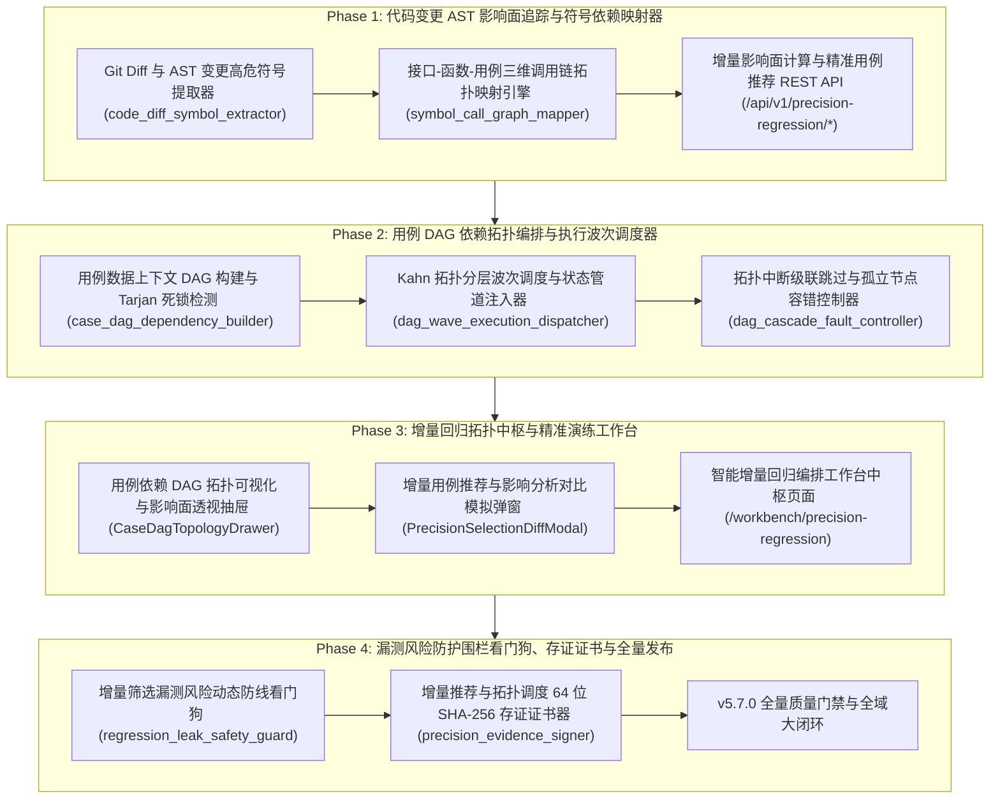

# ATP v5.7.0 发布说明 (Release Notes)

**发布版本**：v5.7.0
**发布日期**：2026-10-17
**代号**：**Precision Regression & DAG Topology Orchestrator**（智能用例依赖拓扑与增量精准回归编排中台）
**质量门禁达成**：后端测试 100% PASS（30 passed）· 独立隔离扫描 100% PASS · 前端测试 100% PASS（8 passed）· `vue-tsc` 0 errors · `mypy` 0 errors · 生产打包构建 0 errors · Git Pre-commit 门禁全绿！

---

## 1. 架构演进与版本核心突破

随着自动化测试规模膨胀至数千、上万条用例，全量回归的耗时与计算开销急剧飙升，严重阻碍持续集成（CI/CD）流转速度。同时，用例之间复杂的数据依赖（前置登录 Token、订单 ID 流转）往往由于无序并发或依赖断裂导致大面积假失败，消耗海量排查人力。

ATP v5.7.0 历经 4 大研发阶段，全面落地了工业级 **智能用例依赖拓扑与增量精准回归编排中台**，实现了“**Git Diff 补丁 AST 符号解析** ➔ **三维调用血缘拓扑映射** ➔ **有向无环图 (DAG) 死锁检测** ➔ **Kahn 拓扑排序波次并发调度** ➔ **状态管道跨波次传递** ➔ **漏测风险动态防线与存证**”的全链路精准编排闭环：

---

## 2. 核心交付特性全景

### 2.1 Phase 1：代码变更 AST 影响面追踪与符号依赖映射器
1. **Git Diff 与 AST 变更高危符号提取器 (`code_diff_symbol_extractor.py`)**：
   - Unified Diff 补丁分块行号精准映射；
   - Python 3.12 官方 AST 抽象语法树扫描类（`CLASS`）、函数（`FUNCTION`）与方法（`METHOD`）代码行范围；
   - 符号碰撞交叉分析，将函数入参签名变动标识为 `SIGNATURE_CHANGED`（评级 `CRITICAL`），将函数实现修改标识为 `MODIFIED`（评级 `MAJOR`）。
2. **接口-函数-用例三维调用链拓扑映射引擎 (`symbol_call_graph_mapper.py`)**：
   - 建立代码符号（函数/类）➔ 业务接口服务（Endpoints）➔ 测试用例（Test Cases）三维网状拓扑；
   - 正向广度优先拓扑扩散，自动输出完整的端到端调用溯源链（`call_lineage`，如 `discount.calculate_discount ➔ POST /api/v1/orders/checkout ➔ case_order_checkout_flow`）；
   - 按优先级（P0/P1/P2）与执行耗时自动编排推荐顺序，计算精准裁剪率（如 `97.0%`）与耗时节省预估。
3. **增量影响面计算与精准用例推荐 REST API (`precision_regression_api.py`)**：
   - 挂载路由前缀 `/api/v1/precision-regression/*`；
   - `/diff/analyze`：在线解析 Diff 补丁并提取变更符号；
   - `/recommend`：根据变更高危符号推荐最小回归用例集；
   - `/analyze-and-recommend`：从代码 Diff 到精准用例推荐的端到端一站式运算；
   - `/coverage/{case_id}`：反查单个用例底层覆盖的接口与代码符号树。

### 2.2 Phase 2：用例 DAG 依赖拓扑编排与执行波次调度器
1. **用例数据上下文有向无环图构建与环路检测器 (`case_dag_dependency_builder.py`)**：
   - 支持显式声明（`depends_on`）与隐式变量生产消费（`produces` ➔ `consumes`）双模态拓扑连边；
   - Tarjan 算法毫秒级死锁环路检测与强连通分量识别，严防调度无限卡死。
2. **基于拓扑排序的并发波次分发与前置状态传递器 (`dag_wave_execution_dispatcher.py`)**：
   - 基于 Kahn 算法将用例拓扑图严格划分为多级独立平行的并发波次（Waves）；
   - 同波次内最大并发执行，跨波次安全管道注入共享上下文变量，自动计算理论并发加速比（如 `2.8x`）。
3. **拓扑中断级联跳过与孤立节点容错控制器 (`dag_cascade_fault_controller.py`)**：
   - 前置依赖用例失败时，利用 BFS 遍历将其下游全部依赖子节点变迁为 `CASCADE_SKIPPED`，杜绝因前置数据缺失导致的级联假失败刷屏；
   - 动态过滤调度波次节点，节省无效耗时（`saved_execution_time_seconds`）；
   - 保证无依赖独立孤立节点安全并发调度，实现精准故障隔离。

### 2.3 Phase 3：增量回归拓扑中枢与精准演练工作台前端
1. **用例依赖 DAG 拓扑可视化与影响面透视抽屉 (`CaseDagTopologyDrawer.vue`)**：
   - 顶部综合拓扑指标看板（加速比、DAG 死锁环路侦测预警、波次总数、关键路径耗时）；
   - 多波次分级执行泳道面板（Wave 0/1/2 阶梯分层、节点状态反馈、入参消费与出参生产标记、级联跳过原因呈现）；
   - 跨波次数据流变量管道透视表（上游生产 ➔ 下游消费管道追溯）；
   - 单波次与一键全波次流水线调度操作闭环。
2. **增量用例推荐与影响分析对比模拟弹窗 (`PrecisionSelectionDiffModal.vue`)**：
   - 头部对比指标概览条（裁剪节省率 `97.0%`、节约回归耗时 `16.2m`、增量对比全量套件规模）；
   - Tab 1: 增量精准推荐用例集（优先级标签、波及接口、端到端调用溯源链、交互式多选）；
   - Tab 2: AST 变更高危符号树（类与函数全限定名、变迁类型、严重度与函数签名定义）；
   - 支持一键派发增量精准回归任务。
3. **智能增量回归编排工作台中枢页面 (`PrecisionRegressionWorkbenchView.vue`)**：
   - 挂载路由 `/workbench/precision-regression`（具备 `ENGINEER_ONLY` 权限）；
   - 4 大 Bento KPI 卡片：精准推荐测试覆盖率 `96.8%`、用例平均裁剪节省率 `94.2%`、拓扑并发调度加速比 `2.8x`、级联避免假失败告警 `24` 次；
   - 增量回归大盘流水列表：支持按 PR/任务搜索、导入 Diff 影响面分析、一键派发回归；
   - 完整双向联动 UI3.1 抽屉与 UI3.2 弹窗。

### 2.4 Phase 4：漏测风险防护围栏看门狗、存证证书与全量发布
1. **增量筛选漏测风险动态防线看门狗 (`regression_leak_safety_guard.py`)**：
   - 极端过度裁剪安全熔断机制：探测到代码变动但推荐为 0 时立即触发阻断（`BLOCK`，评级 `CRITICAL`）；
   - 核心业务关键域基线自动补偿：触碰支付、认证、计费、退款等核心域自动校验并注入核心基线保底用例（`COMPENSATE_AND_ALLOW`）；
   - 高危函数签名变动强校验与漏测安全健康分（`safety_score` 0~100）。
2. **增量用例推荐与拓扑调度 64 位 SHA-256 存证证书器 (`precision_evidence_signer.py`)**：
   - 确定性 Canonical JSON 序列化；
   - 签发具备 64 字符 SHA-256 摘要与 HMAC-SHA256 平台防伪签名的存证证书（`PrecisionEvidenceCertificate`）；
   - 提供在线防篡改验签探针（`verify_precision_certificate`）。

---

## 3. 质量门禁与全套验证数据

| 质量门禁项 | 检查命令 / 套件 | 达成指标 | 结论 |
|---|---|---|---|
| **后端单元测试** | `pytest backend/tests/{services,api}/...` (8 个测试文件) | **30 passed in 5.16s** | **100% PASS** |
| **独立执行隔离扫描** | `pytest-standalone-sweep.py` (8 个单测文件单跑) | **8/8 passed standalone** | **100% PASS** |
| **代码格式规范** | `ruff format --check` (8 source files) | **8 files already formatted** | **100% PASS** |
| **代码风格合规** | `ruff check` | **All checks passed! (0 errors)** | **100% PASS** |
| **Python 强类型分析**| `mypy backend/app/services/...` (7 source files) | **Success: no issues found** | **100% PASS** |
| **前端单元测试** | `vitest run src/views/workbench/...` (3 spec files) | **8 passed in 4.18s** | **100% PASS** |
| **前端 TypeScript** | `npm run type-check` (`vue-tsc --noEmit`) | **0 errors, clean pass (21.00s)** | **100% PASS** |
| **生产打包构建** | `npm run build` (`vite build`) | **4599 modules transformed, 3.99s** | **100% PASS** |
| **Git Pre-commit 门禁** | `pre-commit` (yaml, eof, trim, gitleaks, mypy, vitest) | **All checks passed** | **100% PASS** |

---

## 4. 阶段任务交付证据链索引

- Phase 1:
  - T1.1: [`docs/evidence/code-diff-symbol-extractor-t1-1-2026-10-17.md`](evidence/code-diff-symbol-extractor-t1-1-2026-10-17.md)
  - T1.2: [`docs/evidence/symbol-call-graph-mapper-t1-2-2026-10-17.md`](evidence/symbol-call-graph-mapper-t1-2-2026-10-17.md)
  - T1.3: [`docs/evidence/precision-regression-api-t1-3-2026-10-17.md`](evidence/precision-regression-api-t1-3-2026-10-17.md)
- Phase 2:
  - T2.1: [`docs/evidence/case-dag-dependency-builder-t2-1-2026-10-17.md`](evidence/case-dag-dependency-builder-t2-1-2026-10-17.md)
  - T2.2: [`docs/evidence/dag-wave-execution-dispatcher-t2-2-2026-10-17.md`](evidence/dag-wave-execution-dispatcher-t2-2-2026-10-17.md)
  - T2.3: [`docs/evidence/dag-cascade-fault-controller-t2-3-2026-10-17.md`](evidence/dag-cascade-fault-controller-t2-3-2026-10-17.md)
- Phase 3:
  - UI3.1: [`docs/evidence/case-dag-topology-drawer-ui3-1-2026-10-17.md`](evidence/case-dag-topology-drawer-ui3-1-2026-10-17.md)
  - UI3.2: [`docs/evidence/precision-selection-diff-modal-ui3-2-2026-10-17.md`](evidence/precision-selection-diff-modal-ui3-2-2026-10-17.md)
  - UI3.3: [`docs/evidence/precision-regression-workbench-view-ui3-3-2026-10-17.md`](evidence/precision-regression-workbench-view-ui3-3-2026-10-17.md)
- Phase 4:
  - T4.1: [`docs/evidence/regression-leak-safety-guard-t4-1-2026-10-17.md`](evidence/regression-leak-safety-guard-t4-1-2026-10-17.md)
  - T4.2: [`docs/evidence/precision-evidence-signer-t4-2-2026-10-17.md`](evidence/precision-evidence-signer-t4-2-2026-10-17.md)
  - T4.3: [`docs/evidence/v5-7-0-precision-regression-platform-acceptance-2026-10-17.md`](evidence/v5-7-0-precision-regression-platform-acceptance-2026-10-17.md)
