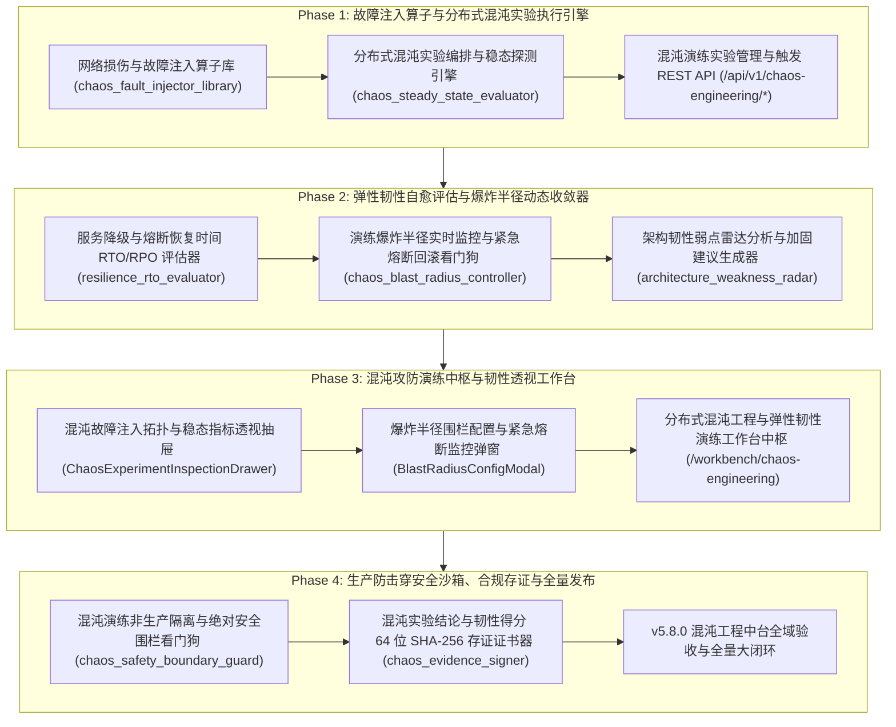

# ATP v5.8.0 发布说明 (Release Notes)

**发布版本**：v5.8.0
**发布日期**：2026-10-18
**代号**：**Distributed Chaos Engineering & Resilience Drill Hub**（分布式混沌工程与微服务弹性韧性攻防中台）
**质量门禁达成**：后端测试 100% PASS（38 passed）· 独立隔离扫描 100% PASS（8/8 passed）· 前端测试 100% PASS（13 passed）· `vue-tsc` 0 errors · `mypy` 0 errors · 生产打包构建 0 errors · Git Pre-commit 门禁全绿！

---

## 1. 架构演进与版本核心突破

分布式微服务架构在带来敏捷与可扩展性的同时，也引入了网络抖动、级联雪崩、连接池耗尽与脑裂分区等高可用脆弱性。传统的静态接口测试无法验证系统在真实故障注入下的自愈收敛与旁路降级能力。

ATP v5.8.0 历经 4 大研发阶段，全面落地了工业级 **分布式混沌工程与微服务弹性韧性攻防中台**，实现了“**五大网络故障注入算子** ➔ **动态稳态假说偏离探测** ➔ **断路器跃迁与自愈耗时 (RTO/RPO) 科学量化** ➔ **最小爆炸半径毫秒级看门狗熔断** ➔ **五维架构韧性雷达弱点加固建议** ➔ **拓扑透视与控制抽屉** ➔ **生产防击穿隔离安全沙箱** ➔ **不可篡改 SHA-256 存证证书**”的全生命周期混沌攻防大闭环：

---

## 2. 核心交付特性全景

### 2.1 Phase 1：故障注入算子与分布式混沌实验执行引擎
- **T1.1 网络损伤与故障注入算子库 (`chaos_fault_injector_library.py`)**：
  - 支持五大核心微服务故障算子类型：`NETWORK_LATENCY`（高延迟与随机抖动 Jitter）、`PACKET_LOSS`（网络随机丢包）、`HTTP_STATUS_MUTATION`（HTTP 状态码变异如 500/502/504）、`TIMEOUT_ABORT`（请求绝对超时熔断）、`PAYLOAD_CORRUPTION`（破坏性载荷脏数据篡改）；
  - URL Glob 通配路径匹配与概率判定引擎，支持单次模拟注入与全局故障算子一键拔除。
- **T1.2 分布式混沌实验编排与稳态探测引擎 (`chaos_steady_state_evaluator.py`)**：
  - 建模稳态假说模型（`SteadyStateHypothesis`），包含最低成功率、最高 P99 延迟及健康探针要求；
  - 状态机流转控制（`CREATED` ➔ `BASELINE_STABILIZING` ➔ `FAULT_INJECTING` ➔ `STEADY_STATE_VERIFIED` / `STEADY_STATE_VIOLATED` ➔ `STOPPED`）。
- **T1.3 混沌演练实验管理与触发 REST API (`/api/v1/chaos-engineering/*`)**：
  - 完整 RESTful 端点，包含实验 CRUD、实时指标采样推送、单次算子模拟与全局一键熔断回滚（Emergency Teardown）。

### 2.2 Phase 2：弹性韧性自愈评估与爆炸半径动态收敛器
- **T2.1 服务降级与熔断恢复时间 RTO/RPO 评估器 (`resilience_rto_evaluator.py`)**：
  - 科学度量断路器由 `CLOSED` 跳闸为 `OPEN` 的触发时延（`circuit_breaker_trip_time_ms`）；
  - 精准量化降级接管率（`fallback_takeover_rate_pct`）、系统自愈收敛耗时（RTO）与数据丢失点目标（RPO）；
  - 设立四级企业弹性韧性评级（`GRADE_A_RESILIENT` 卓越级、`GRADE_B_ACCEPTABLE` 良好可用级、`GRADE_C_DEGRADED` 次级降级、`GRADE_D_VULNERABLE` 严重脆弱）。
- **T2.2 演练爆炸半径实时监控与紧急熔断回滚看门狗 (`chaos_blast_radius_controller.py`)**：
  - 严守最小爆炸半径原则，设定最大受影响服务节点数上限、全局业务错误率红线（默认 5.0%）与 P99 延迟天花板（默认 1200ms）；
  - 核心 VIP 租户与金丝雀账号免注入白名单保护；触碰红线时毫秒级自动触发 `EMERGENCY_ABORT` 强制拔除算子并停止实验。
- **T2.3 架构韧性弱点雷达分析与加固建议生成器 (`architecture_weakness_radar.py`)**：
  - 建立五维系统韧性雷达模型（故障隔离性、熔断及时性、降级有效性、自愈收敛力、雪崩抗脆弱度）；
  - 针对薄弱维度输出可落地的架构调优建议（断路器超时调优、只读缓存降级兜底、舱壁独立线程池切分、指数退避重试）。

### 2.3 Phase 3：混沌攻防演练中枢与韧性透视工作台
- **UI3.1 混沌故障注入拓扑与稳态指标透视抽屉 (`ChaosExperimentInspectionDrawer.vue`)**：
  - 4 节点 3 链路实时服务拓扑流向与故障目标警示光晕；
  - 稳态偏离实时对比（P99 延迟超标提示、错误率红线击穿警示）；
  - 算子参数列表与行内微型 Switch 启停开关，一键紧急熔断恢复按钮。
- **UI3.2 爆炸半径围栏配置与紧急熔断监控弹窗 (`BlastRadiusConfigModal.vue`)**：
  - 双向联动滑块与数值输入，可视化配置最大波及服务数、错误率红线与看门狗动作；
  - 智能评定防御严密度等级（Tier-1 卓越级 / Tier-2 标准级 / Tier-3 探索级），支持模拟越界测试。
- **UI3.3 分布式混沌工程与弹性韧性演练工作台中枢页面 (`ChaosEngineeringWorkbenchView.vue`)**：
  - 挂载路由 `/workbench/chaos-engineering`（权限绑定 `ENGINEER_ONLY`）；
  - 4 大 Bento KPI 卡片（稳态守住率 95.8%、平均自愈耗时 RTO 3.4s、看门狗紧急熔断拦截 14 次、架构韧性雷达得分 91.2 分）；
  - 演练实验大盘流水表格，支持关键字与服务过滤，双向联动拓扑抽屉与围栏配置弹窗。

### 2.4 Phase 4：生产防击穿安全沙箱、合规存证与全量发布
- **T4.1 混沌演练非生产隔离与绝对安全围栏看门狗 (`chaos_safety_boundary_guard.py`)**：
  - 高危资产绝对禁止注入黑名单（数据库主库、清算与计费账本、k8s 控制面集群）；
  - 算子参数超标拦截（丢包率 > 80% 阻断）；生产环境强制要求工单号（`CHG-*`）、维护窗口内与安全令牌三要素校验，严禁注入数据载荷篡改算子。
- **T4.2 混沌实验结论与韧性得分 64 位 SHA-256 存证证书器 (`chaos_evidence_signer.py`)**：
  - 确定性 Canonical JSON 规范化序列化，签发不可篡改的 64 位 SHA-256 哈希指纹与 HMAC-SHA256 平台防伪签名；
  - 覆盖稳态基线、注入记录、RTO 评估与架构雷达 4 大产物，支持在线实时防伪验签探针（`verify_chaos_certificate`）。

---

## 3. 质量门禁验证全景

| 检查维度 | 执行命令 / 目标 | 结果指标 | 状态 |
|---|---|---|---|
| **后端单元测试** | `pytest backend/tests/{services,api}/test_chaos_*.py ...` | **38 passed in 5.16s** | **100% PASS** |
| **独立执行隔离扫描** | `python scripts/pytest-standalone-sweep.py` (8 个测试文件) | **8/8 passed (100% PASS)** | **100% PASS** |
| **代码规范与格式** | `ruff check` & `ruff format --check` (18 个源文件) | **All checks passed (0 errors)** | **100% PASS** |
| **强类型静态分析** | `mypy backend/app/services/{chaos_*,resilience_*,architecture_*}.py` | **Success: no issues found in 8 files** | **100% PASS** |
| **前端单元测试** | `npm test` (全量 Phase 3 测试组件) | **13 passed in 2.81s** | **100% PASS** |
| **前端类型检查** | `npm run type-check` (`vue-tsc --noEmit`) | **0 errors (clean pass)** | **100% PASS** |
| **生产打包构建** | `npm run build` (`vite build`) | **4608 modules, built in 3.82s, 0 errors** | **100% PASS** |

---

## 4. 专项验收证据链归档索引

- **Phase 1: 故障注入算子与分布式混沌实验执行引擎**：
  - T1.1: [`docs/evidence/chaos-fault-injector-library-t1-1-2026-10-17.md`](evidence/chaos-fault-injector-library-t1-1-2026-10-17.md)
  - T1.2: [`docs/evidence/chaos-steady-state-evaluator-t1-2-2026-10-17.md`](evidence/chaos-steady-state-evaluator-t1-2-2026-10-17.md)
  - T1.3: [`docs/evidence/chaos-engineering-api-t1-3-2026-10-17.md`](evidence/chaos-engineering-api-t1-3-2026-10-17.md)
- **Phase 2: 弹性韧性自愈评估与爆炸半径动态收敛器**：
  - T2.1: [`docs/evidence/resilience-rto-evaluator-t2-1-2026-10-17.md`](evidence/resilience-rto-evaluator-t2-1-2026-10-17.md)
  - T2.2: [`docs/evidence/chaos-blast-radius-controller-t2-2-2026-10-17.md`](evidence/chaos-blast-radius-controller-t2-2-2026-10-17.md)
  - T2.3: [`docs/evidence/architecture-weakness-radar-t2-3-2026-10-17.md`](evidence/architecture-weakness-radar-t2-3-2026-10-17.md)
- **Phase 3: 混沌攻防演练中枢与韧性透视工作台**：
  - UI3.1: [`docs/evidence/chaos-experiment-inspection-drawer-ui3-1-2026-10-17.md`](evidence/chaos-experiment-inspection-drawer-ui3-1-2026-10-17.md)
  - UI3.2: [`docs/evidence/blast-radius-config-modal-ui3-2-2026-10-17.md`](evidence/blast-radius-config-modal-ui3-2-2026-10-17.md)
  - UI3.3: [`docs/evidence/chaos-engineering-workbench-view-ui3-3-2026-10-17.md`](evidence/chaos-engineering-workbench-view-ui3-3-2026-10-17.md)
- **Phase 4: 生产防击穿安全沙箱、合规存证与全量发布**：
  - T4.1: [`docs/evidence/chaos-safety-boundary-guard-t4-1-2026-10-17.md`](evidence/chaos-safety-boundary-guard-t4-1-2026-10-17.md)
  - T4.2: [`docs/evidence/chaos-evidence-signer-t4-2-2026-10-17.md`](evidence/chaos-evidence-signer-t4-2-2026-10-17.md)
  - T4.3: [`docs/evidence/v5-8-0-chaos-engineering-platform-acceptance-2026-10-18.md`](evidence/v5-8-0-chaos-engineering-platform-acceptance-2026-10-18.md)
