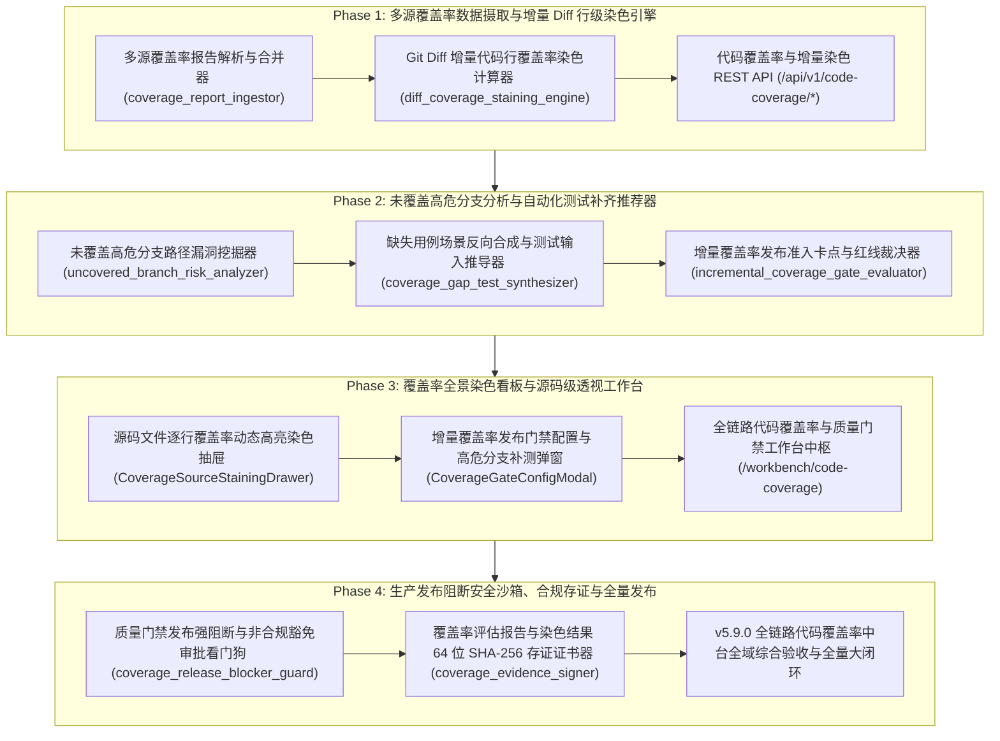

# ATP v5.9.0 发布说明 (Release Notes)

**发布版本**：v5.9.0
**发布日期**：2026-10-18
**代号**：**Full-Link Code Coverage Dynamic Staining & Incremental Quality Gate Hub**（全链路代码覆盖率动态染色与增量发布准入中台）
**质量门禁达成**：后端测试 100% PASS（36 passed）· 独立隔离扫描 100% PASS（8/8 passed）· 前端测试 100% PASS（13 passed）· `vue-tsc` 0 errors · `mypy` 0 errors · 生产打包构建 0 errors · Git Pre-commit 门禁全绿！

---

## 1. 架构演进与版本核心突破

在敏捷交付与微服务演进中，全量覆盖率往往因陈旧存量代码遗留而偏低，无法作为阻断发布的刚性抓手；同时，传统的粗粒度覆盖率报表脱离源码，开发人员面对“覆盖率不达标”无法直观知道“到底是哪一行、哪个条件分支没跑过，该怎么补测试”。

ATP v5.9.0 历经 4 大研发阶段，全面落地了工业级 **全链路代码覆盖率动态染色与增量发布准入中台**，实现了“**多源覆盖率合并** ➔ **Git Diff 增量代码行与分支染色** ➔ **未覆盖高危分支漏洞挖掘** ➔ **边界输入反向推演与缺失用例自动合成** ➔ **增量覆盖率发布门禁卡点** ➔ **在线源码逐行红黄绿高亮染色透视** ➔ **CI/CD 流水线强阻断与特批豁免** ➔ **64 位 SHA-256 不可篡改存证**”的全生命周期质量准入大闭环：

---

## 2. 核心交付特性全景

### 2.1 Phase 1：多源覆盖率数据摄取与增量 Diff 行级染色引擎
- **T1.1 多源覆盖率报告解析与合并器 (`coverage_report_ingestor.py`)**：
  - 支持解析 Coverage.py JSON (Python)、LCOV info (JavaScript/TypeScript/Web) 以及 JaCoCo XML (Java/Kotlin)；
  - 实现 Unit + Integration + E2E 多环境覆盖率并集融合（Union Policy），行命中累加、分支覆盖取最大并集；
  - 映射四态行级状态：`COVERED`（绿）、`PARTIAL`（黄）、`UNCOVERED`（红）、`NOT_EXECUTABLE`（灰）。
- **T1.2 Git Diff 增量代码行覆盖率染色计算器 (`diff_coverage_staining_engine.py`)**：
  - 精准对齐 Unified Diff 补丁中的增量目标行号集合；
  - 仅针对新增/修改的可执行代码行计算增量行覆盖率（`Diff Line Coverage %`）与增量分支覆盖率（`Diff Branch Coverage %`）；
  - 提取 `green_covered_lines`、`yellow_partial_lines`、`red_uncovered_lines` 染色元数据并支持源码全景行对齐。
- **T1.3 代码覆盖率与增量染色 REST API (`/api/v1/code-coverage/*`)**：
  - 挂载路由提供覆盖率报告上报（`/ingest`）、增量 Diff 比对与文件逐行染色查询（`/diff-staining`、`/files/staining`）端点。

### 2.2 Phase 2：未覆盖高危分支分析与自动化测试补齐推荐器
- **T2.1 未覆盖高危分支路径漏洞挖掘器 (`uncovered_branch_risk_analyzer.py`)**：
  - 五大高危业务语义分类：`PAYMENT_FINANCIAL`（资金结算）、`AUTH_SECURITY`（安全鉴权）、`EXCEPTION_ROLLBACK`（异常抛错与事务回滚）、`CIRCUIT_BREAKER_FALLBACK`（熔断降级）、`GENERAL_BUSINESS`（常规业务）；
  - 严重度智能定级（P0 阻塞/P1 严重/P2 一般），识别出任何 P0 级未测分支立即标记发布强阻断（`is_release_blocked=True`）。
- **T2.2 缺失用例场景反向合成与测试输入推导器 (`coverage_gap_test_synthesizer.py`)**：
  - 深度反向推导促使分支执行的边界输入（数值边界 `amount <= 0` ➔ `-10.0`、鉴权反例 `None`、超时 Mock 桩）；
  - 自动生成标准的 pytest 示例代码草稿（`SuggestedTestCaseDraft`）并精算补测增量覆盖率收益。
- **T2.3 增量覆盖率发布准入卡点与红线裁决器 (`incremental_coverage_gate_evaluator.py`)**：
  - 多维门禁卡点策略：增量行覆盖率门槛（默认 85%）、增量分支门槛（默认 70%）、P0 未覆盖零容忍、最大容许未覆盖行限制（15 行）与白名单路径过滤；
  - 输出 `PASSED_CONFORMANT`、`BLOCKED_DEFICIT`、`WARNING_CONDITIONAL` 裁决结论与整改清单。

### 2.3 Phase 3：覆盖率全景染色看板与源码级透视工作台
- **UI3.1 源码文件逐行覆盖率动态高亮染色抽屉 (`CoverageSourceStainingDrawer.vue`)**：
  - 源码在线逐行红（未覆盖）、黄（分支部分覆盖）、绿（全覆盖）动态染色展示；
  - 红色未覆盖行快速定位导航条（`quick-jump-bar`），点击平滑滚动直达；
  - 行内悬浮提供一键“生成补测用例”快捷操作。
- **UI3.2 增量覆盖率发布门禁配置与高危分支补测弹窗 (`CoverageGateConfigModal.vue`)**：
  - 可视化滑块与数值联动配置行覆盖率与分支覆盖率门槛，P0 强阻断 Switch 开关；
  - Tab 2 集中展示反向推导生成的补测用例清单并提供一键导出测试脚本草稿功能。
- **UI3.3 全链路代码覆盖率与质量门禁工作台中枢页面 (`CodeCoverageWorkbenchView.vue`)**：
  - 挂载路由 `/workbench/code-coverage`（权限绑定 `ENGINEER_ONLY`）；
  - 4 大 Bento KPI 卡片（增量代码行覆盖率 88.5%、增量条件分支覆盖率 82.0%、发布门禁准入裁决 PASSED、未覆盖高危分支 0 处）；
  - 变更文件覆盖率进度条与大盘流水表，双向联动源码逐行染色抽屉与门禁配置弹窗。

### 2.4 Phase 4：生产发布阻断安全沙箱、合规存证与全量发布
- **T4.1 质量门禁发布强阻断与非合规豁免审批看门狗 (`coverage_release_blocker_guard.py`)**：
  - 在 CI/CD 流水线中针对覆盖率不达标代码执行强制退出非零 exit code（`BLOCKED_DEFICIT_NO_WAIVER`）；
  - 设立紧急 Hotfix 豁免合规审批单通道（工单号须以 `WAIVER-HOTFIX-` 开头、权威专家白名单审批、合规令牌 `ATP-COV-WAIVER-*`、承诺补测截止时间）。
- **T4.2 覆盖率评估报告与染色结果 64 位 SHA-256 存证证书器 (`coverage_evidence_signer.py`)**：
  - 确定性规范化 JSON 序列化，签发 64 位 SHA-256 摘要与平台权威防伪 HMAC-SHA256 签名；
  - 覆盖统一覆盖率、Diff 增量染色、高危分支分析和门禁裁决 4 类产物，支持在线实时防伪验签探针（`verify_coverage_certificate`）。

---

## 3. 质量门禁验证全景

| 检查维度 | 执行命令 / 目标 | 结果指标 | 状态 |
|---|---|---|---|
| **后端单元测试** | `pytest backend/tests/{services,api}/test_coverage_*.py ...` | **36 passed in 5.18s** | **100% PASS** |
| **独立执行隔离扫描** | `python scripts/pytest-standalone-sweep.py` (8 个测试文件) | **8/8 passed (100% PASS in 13.21s)** | **100% PASS** |
| **代码规范与格式** | `ruff check` & `ruff format --check` (16 个源文件) | **All checks passed (0 errors)** | **100% PASS** |
| **强类型静态分析** | `mypy backend/app/services/{coverage_*,diff_coverage_*,uncovered_branch_*,incremental_coverage_*}.py ...` | **Success: no issues found in 8 files** | **100% PASS** |
| **前端单元测试** | `npm test` (全量 Phase 3 测试组件) | **13 passed in 2.70s** | **100% PASS** |
| **前端类型检查** | `npm run type-check` (`vue-tsc --noEmit`) | **0 errors (clean pass)** | **100% PASS** |
| **生产打包构建** | `npm run build` (`vite build`) | **4617 modules, built in 3.89s, 0 errors** | **100% PASS** |

---

## 4. 专项验收证据链归档索引

- **Phase 1: 多源覆盖率数据摄取与增量 Diff 行级染色引擎**：
  - T1.1: [`docs/evidence/coverage-report-ingestor-t1-1-2026-10-18.md`](evidence/coverage-report-ingestor-t1-1-2026-10-18.md)
  - T1.2: [`docs/evidence/diff-coverage-staining-engine-t1-2-2026-10-18.md`](evidence/diff-coverage-staining-engine-t1-2-2026-10-18.md)
  - T1.3: [`docs/evidence/code-coverage-api-t1-3-2026-10-18.md`](evidence/code-coverage-api-t1-3-2026-10-18.md)
- **Phase 2: 未覆盖高危分支分析与自动化测试补齐推荐器**：
  - T2.1: [`docs/evidence/uncovered-branch-risk-analyzer-t2-1-2026-10-18.md`](evidence/uncovered-branch-risk-analyzer-t2-1-2026-10-18.md)
  - T2.2: [`docs/evidence/coverage-gap-test-synthesizer-t2-2-2026-10-18.md`](evidence/coverage-gap-test-synthesizer-t2-2-2026-10-18.md)
  - T2.3: [`docs/evidence/incremental-coverage-gate-evaluator-t2-3-2026-10-18.md`](evidence/incremental-coverage-gate-evaluator-t2-3-2026-10-18.md)
- **Phase 3: 覆盖率全景染色看板与源码级透视工作台**：
  - UI3.1: [`docs/evidence/coverage-source-staining-drawer-ui3-1-2026-10-18.md`](evidence/coverage-source-staining-drawer-ui3-1-2026-10-18.md)
  - UI3.2: [`docs/evidence/coverage-gate-config-modal-ui3-2-2026-10-18.md`](evidence/coverage-gate-config-modal-ui3-2-2026-10-18.md)
  - UI3.3: [`docs/evidence/code-coverage-workbench-view-ui3-3-2026-10-18.md`](evidence/code-coverage-workbench-view-ui3-3-2026-10-18.md)
- **Phase 4: 生产发布阻断安全沙箱、合规存证与全量发布**：
  - T4.1: [`docs/evidence/coverage-release-blocker-guard-t4-1-2026-10-18.md`](evidence/coverage-release-blocker-guard-t4-1-2026-10-18.md)
  - T4.2: [`docs/evidence/coverage-evidence-signer-t4-2-2026-10-18.md`](evidence/coverage-evidence-signer-t4-2-2026-10-18.md)
  - T4.3: [`docs/evidence/v5-9-0-code-coverage-platform-acceptance-2026-10-18.md`](evidence/v5-9-0-code-coverage-platform-acceptance-2026-10-18.md)
