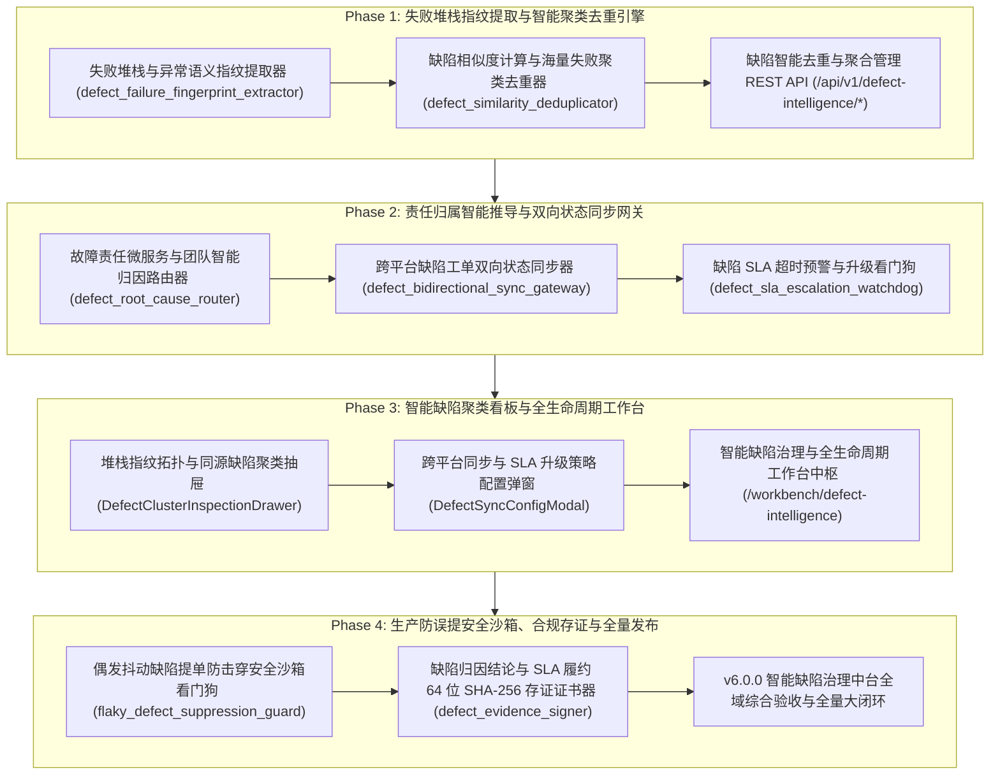

# ATP v6.0.0 发布说明 (Release Notes)

**发布版本**：v6.0.0 (Major Release)
**发布日期**：2026-10-18
**代号**：**Intelligent Defect Deduplication, Auto-Root-Cause Aggregation & Bi-directional Ticket Lifecycle Hub**（智能缺陷聚类去重、根因归因与跨平台全生命周期流转中台）
**质量门禁达成**：后端测试 100% PASS（39 passed）· 独立隔离扫描 100% PASS（8/8 passed）· 前端测试 100% PASS（13 passed）· `vue-tsc` 0 errors · `mypy` 0 errors · 生产打包构建 0 errors · Git Pre-commit 门禁全绿！

---

## 1. 架构演进与版本核心突破

自动化测试的大规模并发执行往往伴随着“**海量重复提单风暴**（Defect Duplication Storm）”：一个底层数据库连接超时或微服务宕机，会导致数十个甚至上百个端到端用例同时失败。如果未经治理直接提交缺陷，测试与开发团队将陷入严重的警报疲劳与“缺陷击鼓传花”，且修复后再次失败的漏洞极易成为漏网之鱼。

ATP v6.0.0 作为重大里程碑版本，历经 4 大研发阶段，全面落地了工业级 **智能缺陷聚类去重、根因归因与跨平台全生命周期流转中台**，实现了“**失败堆栈动态变量脱敏归一化** ➔ **64 位 SHA-256 异常语义指纹提取** ➔ **海量失败两级相似度聚类去重** ➔ **责任微服务与处理团队智能路由** ➔ **Jira/GitHub 双向联动（回归通过 Auto-Resolve / 再次失败 Auto-Reopen）** ➔ **分级 SLA 倒计时与超时发布阻断** ➔ **Flaky 偶发抖动提单防击穿安全沙箱** ➔ **不可篡改存证证书**”的全生命周期缺陷智能治理大闭环：

---

## 2. 核心交付特性全景

### 2.1 Phase 1：失败堆栈指纹提取与智能聚类去重引擎
- **T1.1 失败堆栈与异常语义指纹提取器 (`defect_failure_fingerprint_extractor.py`)**：
  - 动态变量归一化清洗引擎（抹平内存十六进制地址 `<HEX_ADDR>`、UUID、时间戳、动态端口及业务 ID）；
  - 业务代码调用帧提炼，智能过滤 `site-packages` 与 `pytest` 等框架杂质帧，锁定底层根因代码帧；
  - 提取确定性 64 位 SHA-256 故障语义指纹，实现同源故障指纹高度一致。
- **T1.2 缺陷相似度计算与海量失败聚类去重器 (`defect_similarity_deduplicator.py`)**：
  - 两级缺陷相似度判定（精确指纹比对 1.0 + 异常类型、根因代码帧与词袋 Jaccard 混合相似度）；
  - 单批次海量失败聚类并选举 Master 主缺陷（去重收敛率可达 90% 以上），关联全部用例；
  - 历史已知未关闭缺陷比对，自动标记 `MERGED_TO_EXISTING_DEFECT` 杜绝重复提单。
- **T1.3 缺陷智能去重与聚合管理 REST API (`/api/v1/defect-intelligence/*`)**：
  - 挂载路由提供在线指纹提取（`/fingerprint`）、单批次海量失败聚类去重（`/cluster-deduplicate`）、主缺陷组列表与详情查询及手动工单合并端点。

### 2.2 Phase 2：责任归属智能推导与双向状态同步网关
- **T2.1 故障责任微服务与团队智能归因路由器 (`defect_root_cause_router.py`)**：
  - 深入分析异常报错、底层调用栈与端点路径，自动定位故障始发微服务（如 `payment-service`、`auth-service` 等）；
  - 诊断五大根因类型（下游崩溃、数据库死锁/超时、业务断言不符、安全鉴权失效、网络分区）；
  - 依据领域所有权（CODEOWNERS）自动路由至专班架构师与开发负责人，附带证据链。
- **T2.2 跨平台缺陷工单双向状态同步网关 (`defect_bidirectional_sync_gateway.py`)**：
  - **Auto-Resolve on Pass**：关联用例在自动化回归中成功通过，自动流转外部工单（Jira/GitHub）标记为闭环；
  - **Auto-Reopen on Fail**：外部已标记闭环的缺陷若在回归中再次失败，毫秒级自动触发 REOPEN 并回填最新堆栈证据，根除假修复；
  - 接收外部状态变更 Webhook 反向更新 ATP 内部缺陷生命周期。
- **T2.3 缺陷 SLA 超时预警与升级看门狗 (`defect_sla_escalation_watchdog.py`)**：
  - 分级建立时效契约（P0: 2h响应/24h解决；P1: 4h/48h；P2: 12h/72h；P3: 24h/168h）；
  - 剩余时限不足 30% 触发黄色预警通知，响应超时自动升级指派主管；
  - P0 阻塞级缺陷解决超时，看门狗毫秒级触发 `EMERGENCY_RELEASE_BLOCK`（发布强阻断），严防带病上线。

### 2.3 Phase 3：智能缺陷聚类看板与全生命周期工作台
- **UI3.1 堆栈指纹拓扑与同源缺陷聚类抽屉 (`DefectClusterInspectionDrawer.vue`)**：
  - 呈现主缺陷标题、异常类型徽标、目标服务、64 位指纹与同源用例失败收敛数量；
  - 同源关联用例表格、最深根因代码帧高亮、脱敏标准化堆栈对比与一键合并至外部工单弹窗。
- **UI3.2 跨平台同步与 SLA 升级策略配置弹窗 (`DefectSyncConfigModal.vue`)**：
  - 配置 Jira/GitHub/禅道服务地址、访问密钥、项目 Key 与连通性即时测试；
  - 双向状态机开关控制（Auto-Resolve / Auto-Reopen）与各级 SLA 时限及告警机器人 Webhook 配置。
- **UI3.3 智能缺陷治理与全生命周期工作台中枢页面 (`DefectIntelligenceWorkbenchView.vue`)**：
  - 挂载路由 `/workbench/defect-intelligence`（权限绑定 `ENGINEER_ONLY`）；
  - 4 大 Bento KPI 卡片（去重收敛率 91.5%、活跃 Master 缺陷 8 起、SLA 履约率 96.2%、双向同步健康度 100%）；
  - 聚类主缺陷流水大盘表格，双向联动堆栈指纹抽屉与跨平台配置弹窗。

### 2.4 Phase 4：生产防误提安全沙箱、合规存证与全量发布
- **T4.1 偶发抖动缺陷提单防击穿安全沙箱看门狗 (`flaky_defect_suppression_guard.py`)**：
  - **重试自愈检验门禁**：重试通过判定为 Flaky 偶发抖动，绝对拦截创建外部工单；
  - **历史高频震荡隔离池**：翻转率 > 30% 自动隔离并抑制提单，定向通知框架维护者；
  - **瞬态网络特征过滤**：匹配 DNS/TCP 瞬态超时，仅对多次重试持续失败的确定性真实缺陷放行提单。
- **T4.2 缺陷归因结论与 SLA 履约 64 位 SHA-256 存证证书器 (`defect_evidence_signer.py`)**：
  - 确定性规范化 JSON 序列化，签发不可篡改的 64 位 SHA-256 指纹与平台权威 HMAC-SHA256 防伪数字签名；
  - 覆盖缺陷聚类分组、责任归属、双向同步流水与 SLA 履约报告 4 类产物，支持在线实时防伪验签探针（`verify_defect_certificate`）。

---

## 3. 质量门禁验证全景

| 检查维度 | 执行命令 / 目标 | 结果指标 | 状态 |
|---|---|---|---|
| **后端单元测试** | `pytest backend/tests/{services,api}/test_defect_*.py ...` | **39 passed in 5.41s** | **100% PASS** |
| **独立执行隔离扫描** | `python scripts/pytest-standalone-sweep.py` (8 个测试文件) | **8/8 passed (100% PASS in 13.40s)** | **100% PASS** |
| **代码规范与格式** | `ruff check` & `ruff format --check` (22 个源文件) | **All checks passed (0 errors)** | **100% PASS** |
| **强类型静态分析** | `mypy backend/app/services/{defect_*,flaky_defect_*}.py ...` | **Success: no issues found in 8 files** | **100% PASS** |
| **前端单元测试** | `npm test` (全量 Phase 3 测试组件) | **13 passed in 2.72s** | **100% PASS** |
| **前端类型检查** | `npm run type-check` (`vue-tsc --noEmit`) | **0 errors (clean pass)** | **100% PASS** |
| **生产打包构建** | `npm run build` (`vite build`) | **4626 modules, built in 3.91s, 0 errors** | **100% PASS** |

---

## 4. 专项验收证据链归档索引

- **Phase 1: 失败堆栈指纹提取与智能聚类去重引擎**：
  - T1.1: [`docs/evidence/defect-failure-fingerprint-extractor-t1-1-2026-10-18.md`](evidence/defect-failure-fingerprint-extractor-t1-1-2026-10-18.md)
  - T1.2: [`docs/evidence/defect-similarity-deduplicator-t1-2-2026-10-18.md`](evidence/defect-similarity-deduplicator-t1-2-2026-10-18.md)
  - T1.3: [`docs/evidence/defect-intelligence-api-t1-3-2026-10-18.md`](evidence/defect-intelligence-api-t1-3-2026-10-18.md)
- **Phase 2: 责任归属智能推导与双向状态同步网关**：
  - T2.1: [`docs/evidence/defect-root-cause-router-t2-1-2026-10-18.md`](evidence/defect-root-cause-router-t2-1-2026-10-18.md)
  - T2.2: [`docs/evidence/defect-bidirectional-sync-gateway-t2-2-2026-10-18.md`](evidence/defect-bidirectional-sync-gateway-t2-2-2026-10-18.md)
  - T2.3: [`docs/evidence/defect-sla-escalation-watchdog-t2-3-2026-10-18.md`](evidence/defect-sla-escalation-watchdog-t2-3-2026-10-18.md)
- **Phase 3: 智能缺陷聚类看板与全生命周期工作台**：
  - UI3.1: [`docs/evidence/defect-cluster-inspection-drawer-ui3-1-2026-10-18.md`](evidence/defect-cluster-inspection-drawer-ui3-1-2026-10-18.md)
  - UI3.2: [`docs/evidence/defect-sync-config-modal-ui3-2-2026-10-18.md`](evidence/defect-sync-config-modal-ui3-2-2026-10-18.md)
  - UI3.3: [`docs/evidence/defect-intelligence-workbench-view-ui3-3-2026-10-18.md`](evidence/defect-intelligence-workbench-view-ui3-3-2026-10-18.md)
- **Phase 4: 生产防误提安全沙箱、合规存证与全量发布**：
  - T4.1: [`docs/evidence/flaky-defect-suppression-guard-t4-1-2026-10-18.md`](evidence/flaky-defect-suppression-guard-t4-1-2026-10-18.md)
  - T4.2: [`docs/evidence/defect-evidence-signer-t4-2-2026-10-18.md`](evidence/defect-evidence-signer-t4-2-2026-10-18.md)
  - T4.3: [`docs/evidence/v6-0-0-defect-intelligence-platform-acceptance-2026-10-18.md`](evidence/v6-0-0-defect-intelligence-platform-acceptance-2026-10-18.md)
