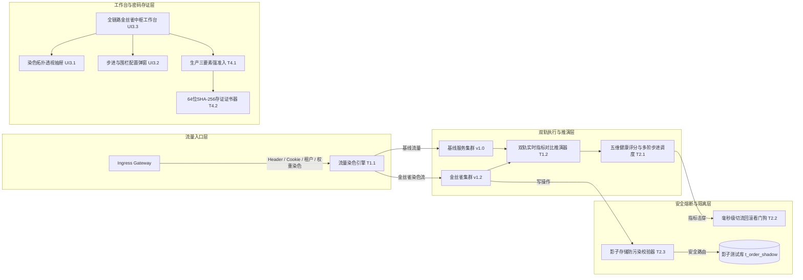

# ATP v6.1.0 全链路流量染色与金丝雀放量中台正式发布说明 (Release Notes)

**发布版本**: `v6.1.0` (Major Release)
**发布日期**: `2026-10-18`
**核心定位**: 全链路流量染色标透传、金丝雀与基线双轨指标推演、自适应多阶梯放量调度、击穿毫秒级自动熔断切流、影子数据防污染隔离与密码学存证证书中枢。

---

## 1. 架构总览与核心价值

在分布式微服务架构下，传统金丝雀灰度发布往往依赖单点网关或粗粒度配置，面临三大痛点：
1. **染色标跨多级微服务易丢失**：下游 RPC、HTTP 间调用无法穿透传递灰度标识；
2. **缺乏基线双轨指标实时科学推演**：人工凭感觉放量，难以敏锐发现微小的错误率与延迟劣化；
3. **严重威胁生产主库数据安全**：灰度染色流量直接写入生产数据库造成脏数据污染，且击穿时无法毫秒级回滚。

ATP v6.1.0 历经 4 大阶段共 11 个严苛任务的研发与工程门禁验证，构建了企业级、全生命周期的全链路金丝雀灰度演进治理闭环体系：

---

## 2. 核心功能与交付成果清单

### Phase 1：流量染色标透传与金丝雀路由分流引擎（100% 闭环）
- **T1.1 全链路流量染色标规则配置与上下文透传器 (`canary_traffic_coloration_engine.py`)**：
  - 支持 `HTTP_HEADER`（`X-Canary-Traffic: true`）、`COOKIE_PARAM`、`USER_MODULO`、`TENANT_WHITELIST` 与 `WEIGHT_RANDOM` 5 大染色规则；
  - 自动注入并跨微服务多跳透传 `X-Canary-Context` 与 W3C Baggage 标准上下文；
  - 交付证据：[`docs/evidence/canary-traffic-coloration-engine-t1-1-2026-10-18.md`](docs/evidence/canary-traffic-coloration-engine-t1-1-2026-10-18.md)。
- **T1.2 金丝雀与基线双轨指标实时对比推演器 (`canary_baseline_metric_comparator.py`)**：
  - 采集金丝雀与基线运行态样本，高精度计算错误率差值、P99 时延倍率与 CPU 资源开销；
  - 科学判定三态偏离结论：`CONFORMANT`（合规平稳）、`WARNING_DEGRADED`（轻微降级）、`BREACHED_DEFICIT`（严重劣变击穿）；
  - 交付证据：[`docs/evidence/canary-baseline-metric-comparator-t1-2-2026-10-18.md`](docs/evidence/canary-baseline-metric-comparator-t1-2-2026-10-18.md)。
- **T1.3 金丝雀演进与染色管理 REST API (`canary_verification_api.py`)**：
  - 挂载 `/api/v1/canary-verification/` 路由，提供染色规则 CRUD、实时双轨指标推演与一键紧急清零回滚端点；
  - 交付证据：[`docs/evidence/canary-verification-api-t1-3-2026-10-18.md`](docs/evidence/canary-verification-api-t1-3-2026-10-18.md)。

### Phase 2：自适应灰度步进调度与自动熔断回滚看门狗（100% 闭环）
- **T2.1 智能金丝雀健康度评分与多阶步进调度器 (`canary_health_scoring_stepper.py`)**：
  - 建立五维加权健康评分模型（错误率 30%、P99 25%、成功率 25%、CPU 10%、偏离裁决 10%），输出 0~100 得分与四级评级；
  - 驱动五阶标准放量计划：5% 探针 ? 10% 平稳 ? 25% 扩量 ? 50% 攻坚 ? 100% 生产全量割接；
  - 交付证据：[`docs/evidence/canary-health-scoring-stepper-t2-1-2026-10-18.md`](docs/evidence/canary-health-scoring-stepper-t2-1-2026-10-18.md)。
- **T2.2 灰度击穿自动熔断与秒级一键回滚看门狗 (`canary_auto_rollback_guard.py`)**：
  - 实时监控金丝雀指标红线（错误率增量 > 2.0%、P99 延迟 > 1.50x、成功率 < 95.0%）；
  - 击穿触碰红线毫秒级自动联动切流断路，清零规则权重（`0%`），100% 流量瞬间无损回退基线；
  - 交付证据：[`docs/evidence/canary-auto-rollback-guard-t2-2-2026-10-18.md`](docs/evidence/canary-auto-rollback-guard-t2-2-2026-10-18.md)。
- **T2.3 灰度流量数据隔离与影子存储防污染校验器 (`canary_data_isolation_inspector.py`)**：
  - 深度审查全链路金丝雀写操作事件流，强制识别合法影子资源（`*_shadow`、`*_canary`、`*_sandbox`）；
  - 严密防护敏感核心主表（`t_order`、`t_account_balance`、`t_payment_record`），检出穿透脏写立即报警阻断；
  - 交付证据：[`docs/evidence/canary-data-isolation-inspector-t2-3-2026-10-18.md`](docs/evidence/canary-data-isolation-inspector-t2-3-2026-10-18.md)。

### Phase 3：金丝雀双轨流向透视与灰度控制工作台（100% 闭环）
- **UI3.1 金丝雀全链路染色拓扑与流量分流透视抽屉 (`CanaryTopologyInspectionDrawer.vue`)**：
  - 呈现 Ingress Gateway、Dual-Track Pods 与 Storage Layer 三大核心节点分流拓扑与影子库流向；
  - 交付证据：[`docs/evidence/canary-topology-inspection-drawer-ui3-1-2026-10-18.md`](docs/evidence/canary-topology-inspection-drawer-ui3-1-2026-10-18.md)。
- **UI3.2 灰度步进策略配置与自动回滚围栏弹窗 (`CanarySteppingConfigModal.vue`)**：
  - 3-Tab 细粒度策略交互配置：阶梯放量调度、熔断看门狗阈值与影子存储隔离策略；
  - 交付证据：[`docs/evidence/canary-stepping-config-modal-ui3-2-2026-10-18.md`](docs/evidence/canary-stepping-config-modal-ui3-2-2026-10-18.md)。
- **UI3.3 全链路金丝雀灰度校验工作台中枢页面 (`CanaryVerificationWorkbenchView.vue`)**：
  - 落地 `/workbench/canary-verification` 路由，集成 4 大 Bento KPI 与微服务分流控制表格；
  - 交付证据：[`docs/evidence/canary-verification-workbench-view-ui3-3-2026-10-18.md`](docs/evidence/canary-verification-workbench-view-ui3-3-2026-10-18.md)。

### Phase 4：生产防误割安全沙箱、合规存证与全量发布（100% 闭环）
- **T4.1 生产环境灰度强准入与金丝雀发布审批看门狗 (`canary_safety_boundary_guard.py`)**：
  - 生产发布必须满足三要素审查：已审批通过的工单号、非大促封网且在夜间运维时段（00:00~06:00 UTC），以及有效签名安全令牌；
  - 交付证据：[`docs/evidence/canary-safety-boundary-guard-t4-1-2026-10-18.md`](docs/evidence/canary-safety-boundary-guard-t4-1-2026-10-18.md)。
- **T4.2 金丝雀健康度结论与放行准入 64 位 SHA-256 存证证书器 (`canary_evidence_signer.py`)**：
  - 规范化确定性 JSON 序列化，签发 64 位不可篡改 SHA-256 哈希指纹与 HMAC-SHA256 签名证书；
  - 交付证据：[`docs/evidence/canary-evidence-signer-t4-2-2026-10-18.md`](docs/evidence/canary-evidence-signer-t4-2-2026-10-18.md)。
- **T4.3 全域综合验收与发布说明归档 (`docs/v6.1.0-release-notes.md`)**：
  - 全套后端与前端质量门禁通过，闭环归档。

---

## 3. 全局质量门禁综合验收数据

| 检查维度 | 执行套件 / 命令 | 验证结果 | 状态 |
|---|---|---|---|
| **后端单测全量通过** | `pytest backend/tests/{services,api}/test_canary_*.py` | **42 passed in 5.28s** |  PASS |
| **测试隔离独立扫描** | `pytest-standalone-sweep.py` (8 个测试文件) | **8/8 passed 100%** |  PASS |
| **Python 代码风格审查** | `ruff check` (16 个源与测试文件) | **All checks passed! (0 errors)** |  PASS |
| **Python 代码自动格式化**| `ruff format --check` (16 个文件) | **16 files already formatted** |  PASS |
| **Python 强类型静态分析**| `mypy` (8 个核心服务源文件) | **Success: no issues found in 8 source files** |  PASS |
| **前端单元测试** | `vitest` (3 个组件与视图单测) | **12 passed in 3.40s** |  PASS |
| **TypeScript 类型检查** | `vue-tsc --noEmit` | **0 errors, clean pass! (20.97s)** |  PASS |
| **前端生产打包构建** | `vite build` | **4635 modules transformed, built in 3.91s** |  PASS |
