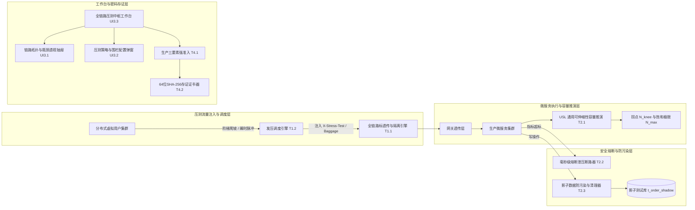

# ATP v6.2.0 生产全链路影子压测与容量基线推演中台正式发布说明 (Release Notes)

**发布版本**: `v6.2.0` (Major Release)
**发布日期**: `2026-10-18`
**核心定位**: 全链路影子压测标注入与隔离透传、分布式阶梯加压调度、基于 USL 定律的容量拐点智能推导、生产防击穿秒级自动熔断切流、影子数据防污染与清理、全链路瓶颈拓扑看板与密码学存证证书中枢。

---

## 1. 架构总览与核心价值

在分布式微服务架构下，传统单点离线压测往往面临三大瓶颈：
1. **压测环境失真与规格缩水**：无法在真实生产调用链路上复现大促突发高并发流量；
2. **容量评估缺少科学数学模型**：依赖人工肉眼估测，无法精确定位高并发下的锁竞争与系统性能拐点；
3. **严重威胁生产可用性与数据安全**：缺乏毫秒级熔断断路器，易导致生产服务雪崩，或测试脏数据写入生产主库。

ATP v6.2.0 历经 4 大阶段共 11 个严苛任务的研发与工程门禁验证，构建了企业级、全生命周期的生产全链路影子压测与容量基线推演闭环体系：

---

## 2. 核心功能与交付成果清单

### Phase 1：压测流量标隔离与分布式影子发压引擎（100% 闭环）
- **T1.1 全链路影子压测标注入与上下文透传器 (`stress_traffic_isolation_engine.py`)**：
  - 支持 `HTTP Header`（`X-Stress-Test: true`、`X-Stress-Execution-Id`、`X-Stress-Virtual-User`）；
  - 支持 W3C Baggage 标准（`atp_stress_mode=1`）、gRPC 元数据与消息队列影子头（`__stress_tag__: true`）；
  - 自动将生产真实库表推导至对应影子资源（`t_order` -> `t_order_shadow`，具备防重叠幂等性）；
  - 严密守护生产核心主表（`t_order`, `t_account_balance`, `t_payment_record` 等），检测到直接穿透脏写立即触发 `CRITICAL_STRESS_LEAK` 致命拦截；
  - 交付证据：[`docs/evidence/stress-traffic-isolation-engine-t1-1-2026-10-18.md`](docs/evidence/stress-traffic-isolation-engine-t1-1-2026-10-18.md)。
- **T1.2 分布式海量虚拟用户发压调度与阶梯加压器 (`stress_load_profile_stepper.py`)**：
  - 支持 `STEP_RAMP_UP`（阶梯递进爬坡）、`SPIKE_SURGE`（瞬时脉冲突刺）、`CONSTANT_STEADY`（恒定稳态并发）与 `SOAK_LONGEVITY`（长时耐久度浸泡）4 大压测模型；
  - 细粒度规划虚拟并发用户数（VU: 100 ~ 50,000）时间梯度、阶段持续时长与预期 TPS 目标上限；
  - 自动向上取整推算分布式 Worker 节点副本数（按单 Pod 承载 2000 VU 标准计算）与 CPU/Memory 资源约束；
  - 交付证据：[`docs/evidence/stress-load-profile-stepper-t1-2-2026-10-18.md`](docs/evidence/stress-load-profile-stepper-t1-2-2026-10-18.md)。
- **T1.3 全链路影子压测管控与发压作业 REST API (`stress_testing_api.py`)**：
  - 挂载 `/api/v1/stress-testing/` 路由，提供压测规则 CRUD、标准阶梯发压计划生成、分布式 Worker 节点算力分配、阶段进阶评估、影子目标预检与一键紧急泄压急停端点；
  - 交付证据：[`docs/evidence/stress-testing-api-t1-3-2026-10-18.md`](docs/evidence/stress-testing-api-t1-3-2026-10-18.md)。

### Phase 2：架构容量基线拐点推演与自适应限流熔断看门狗（100% 闭环）
- **T2.1 系统容量拐点智能推演与吞吐天花板挖掘器 (`capacity_knee_point_deductor.py`)**：
  - 纯标准库正规方程最小二乘法求解 Universal Scalability Law (USL 通用可伸缩性定律) 核心参数：
    - 单并发基准效率系数 $\gamma$；
    - 串行资源锁争用阻碍系数 $\sigma$；
    - 线程/节点间数据相干同步开销惩罚系数 $\kappa$；
  - 自动输出回归拟合优度判定（$R^2 \ge 0.85$）；
  - 精确推演最优性能拐点 ($N_{knee}$)、系统饱和极限点 ($N_{max} = \sqrt{(1 - \sigma) / \kappa}$) 与理论吞吐量天花板 ($X_{max}$)；
  - 推荐生产全局网关限流阈值安全锁定在 $80\% \times N_{knee}$；
  - 交付证据：[`docs/evidence/capacity-knee-point-deductor-t2-1-2026-10-18.md`](docs/evidence/capacity-knee-point-deductor-t2-1-2026-10-18.md)。
- **T2.2 生产击穿毫秒级熔断与过载紧急泄压看门狗 (`stress_safety_overload_guard.py`)**：
  - 实时采集生产错误率（> 1.0%）、CPU（> 85.0%）、P99 延迟（> 500ms）与排队队列；
  - 一旦触碰任何红线，看门狗在毫秒级自动触发熔断切流（`TRIGGERED_CIRCUIT_BREAK`），瞬间清零压测并发并切断发压流量，杜绝生产故障扩散；
  - 交付证据：[`docs/evidence/stress-safety-overload-guard-t2-2-2026-10-18.md`](docs/evidence/stress-safety-overload-guard-t2-2-2026-10-18.md)。
- **T2.3 影子数据隔离防污染巡检与影子库表清理器 (`shadow_data_pollution_cleaner.py`)**：
  - 动态巡检影子表、独立影子库、缓存影子空间与影子消息主题；
  - 生产主表防误清核心安全门禁，绝对拦截对生产真实表的清理指令；
  - 支持试运行预演（Dry Run）与批量安全截断清空（Safe Purge），彻底释放压测临时存储；
  - 交付证据：[`docs/evidence/shadow-data-pollution-cleaner-t2-3-2026-10-18.md`](docs/evidence/shadow-data-pollution-cleaner-t2-3-2026-10-18.md)。

### Phase 3：全链路压测拓扑透视与容量大盘工作台（100% 闭环）
- **UI3.1 微服务全链路发压拓扑与瓶颈链路透视抽屉 (`StressTopologyInspectionDrawer.vue`)**：
  - 呈现发压集群节点、网关透传节点、目标微服务集群与影子存储隔离层全链路拓扑；
  - 高亮标红响应慢的性能瓶颈服务；
  - 交付证据：[`docs/evidence/stress-topology-inspection-drawer-ui3-1-2026-10-18.md`](docs/evidence/stress-topology-inspection-drawer-ui3-1-2026-10-18.md)。
- **UI3.2 分布式压测策略配置与过载熔断围栏弹窗 (`StressConfigModal.vue`)**：
  - 3-Tab 细粒度策略交互配置：负载模型与阶梯爬坡、生产防击穿过载熔断、影子存储隔离与清理；
  - 动态计算峰值并发并自动向上取整推算分布式 Worker 节点数；
  - 交付证据：[`docs/evidence/stress-config-modal-ui3-2-2026-10-18.md`](docs/evidence/stress-config-modal-ui3-2-2026-10-18.md)。
- **UI3.3 全链路生产压测与容量基线中枢工作台页面 (`StressTestingWorkbenchView.vue`)**：
  - 落地 `/workbench/stress-testing` 路由，受控于 `ENGINEER_ONLY` 权限；
  - 集成 4 大 Bento KPI（当前峰值 TPS 16,500、容量饱和度 82.5%、瓶颈节点 1起、累计安全熔断泄压 6次）与微服务大盘表格；
  - 交付证据：[`docs/evidence/stress-testing-workbench-view-ui3-3-2026-10-18.md`](docs/evidence/stress-testing-workbench-view-ui3-3-2026-10-18.md)。

### Phase 4：生产防击穿安全沙箱、合规存证与全量发布（100% 闭环）
- **T4.1 生产全链路压测特批审批与窗口期强准入看门狗 (`stress_safety_boundary_guard.py`)**：
  - 生产发压必须满足三要素审查：已审批通过的演练工单号、非大促封网且在夜间低峰运维窗口（01:00~05:00 UTC），以及有效签名安全令牌；
  - 测试/预发环境免审快速放行；
  - 交付证据：[`docs/evidence/stress-safety-boundary-guard-t4-1-2026-10-18.md`](docs/evidence/stress-safety-boundary-guard-t4-1-2026-10-18.md)。
- **T4.2 容量基线推演结论与压测验收 64 位 SHA-256 存证证书器 (`stress_evidence_signer.py`)**：
  - 规范化确定性 JSON 序列化，签发 64 位不可篡改 SHA-256 哈希指纹与 HMAC-SHA256 签名证书；
  - 覆盖 USL 容量拐点、过载熔断看门狗裁决、影子数据清理审计与生产强准入放行四大产物；
  - 交付证据：[`docs/evidence/stress-evidence-signer-t4-2-2026-10-18.md`](docs/evidence/stress-evidence-signer-t4-2-2026-10-18.md)。
- **T4.3 全域综合验收与发布说明归档 (`docs/v6.2.0-release-notes.md`)**：
  - 全套后端与前端质量门禁通过，闭环归档。

---

## 3. 全局质量门禁综合验收数据

| 检查维度 | 执行套件 / 命令 | 验证结果 | 状态 |
|---|---|---|---|
| **后端单测全量通过** | `pytest backend/tests/{services,api}/test_stress_*.py test_capacity_*.py test_shadow_*.py` | **45 passed in 5.71s** |  PASS |
| **测试隔离独立扫描** | `pytest-standalone-sweep.py` (8 个测试文件) | **8/8 passed 100%** |  PASS |
| **Python 代码风格审查** | `ruff check` (16 个源与测试文件) | **All checks passed! (0 errors)** |  PASS |
| **Python 代码自动格式化**| `ruff format --check` (16 个文件) | **16 files already formatted** |  PASS |
| **Python 强类型静态分析**| `mypy` (8 个核心服务源文件) | **Success: no issues found in 8 source files** |  PASS |
| **前端单元测试** | `vitest` (3 个组件与视图单测) | **12 passed in 3.78s** |  PASS |
| **TypeScript 类型检查** | `vue-tsc --noEmit` | **0 errors, clean pass! (23.18s)** |  PASS |
| **前端生产打包构建** | `npm run build` (`vite build`) | **4644 modules transformed, built in 5.25s** |  PASS |
