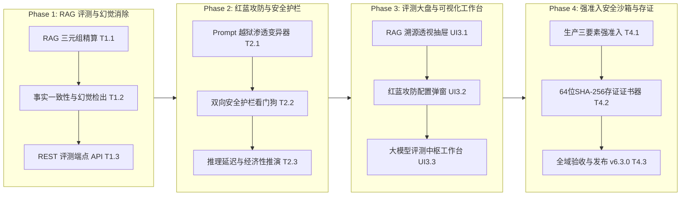

# ATP v6.3.0 企业级大模型与 RAG 智能体评测红蓝对抗中台正式发布说明 (Release Notes)

**发布版本**: `v6.3.0` (Major Release)
**发布日期**: `2026-10-19`
**核心定位**: 针对企业级大语言模型（LLM）与检索增强生成（RAG）智能体的全生命周期评测与安全防护中台。覆盖 RAG 三元组精准打分、自然语言事实一致性比对与幻觉消除、Prompt 越狱红蓝攻防渗透变异器、输入/输出双向毫秒级安全护栏、推理吞吐 TPS 与单位美元经济效益推演、大模型质效工作台及 64 位 SHA-256 存证证书签发。

---

## 1. 架构总览与核心价值

企业大模型与 RAG 智能体规模化落地生产场景面临四大严峻挑战：
1. **RAG 检索质量与回答忠实度难以客观量化**：缺乏细粒度评估“上下文相关度”、“知识忠实度”与“回答准确度”的标准工具链；
2. **模型无根幻觉与事实冲突风险**：模型频繁捏造不存在的参数、反转安全规则极性或产生数值偏差；
3. **Prompt 越狱与红蓝攻防渗透威胁**：DAN 越狱模板、系统提示窃取、Base64/ROT13 密文混淆与前缀诱导绕过现有防护；
4. **生产接入合规存证与开销预算失控**：调用开销不可预测，生产模型接入缺少强准入审批与不可篡改的存证审计链条。

ATP v6.3.0 历经 4 大阶段共 11 项任务的研发与工程门禁验证，构建了完整的全生命周期闭环体系：

---

## 2. 核心功能与交付成果清单

### Phase 1：RAG 检索三元组质量评测与幻觉消除引擎（100% 闭环）
- **T1.1 RAG 知识检索召回与上下文相关度精算器 (`llm_rag_triad_evaluator.py`)**：
  - 完整实现 RAG 三元组核心评估：上下文相关度（Context Relevance）、知识忠实度（Groundedness/Faithfulness）与回答准确度（Answer Relevance）；
  - 建立精准的断言句分词与归因映射（Claim Attributions），输出 EXCELLENT / GOOD / MARGINAL / POOR 四级评级；
  - 交付证据：[`docs/evidence/llm-rag-triad-evaluator-t1-1-2026-10-18.md`](docs/evidence/llm-rag-triad-evaluator-t1-1-2026-10-18.md)。
- **T1.2 大模型幻觉率统计与事实一致性校验器 (`llm_hallucination_detector.py`)**：
  - 自然语言蕴含事实比对，敏锐识别相反词极性反转（`CRITICAL`）、关键参数数值冲突（`MAJOR`）与未登记虚构实体（`FABRICATED_ENTITY`）；
  - 精算幻觉率百分比与一致性得分，输出 FACTUAL_PASS、SUSPICIOUS_DRIFT、CRITICAL_HALLUCINATION 三态判定；
  - 交付证据：[`docs/evidence/llm-hallucination-detector-t1-2-2026-10-18.md`](docs/evidence/llm-hallucination-detector-t1-2-2026-10-18.md)。
- **T1.3 大模型评测与 RAG 质量基准 REST API (`llm_eval_api.py`)**：
  - 挂载 `/api/v1/llm-eval/`，提供 RAG 在线评测、事实一致性比对、批量测试集评估与全模型基准大盘查询；
  - 交付证据：[`docs/evidence/llm-eval-api-t1-3-2026-10-18.md`](docs/evidence/llm-eval-api-t1-3-2026-10-18.md)。

### Phase 2：Prompt 越狱注入攻防与有害内容安全护栏看门狗（100% 闭环）
- **T2.1 Prompt 注入与越狱对抗攻击渗透变异器 (`llm_red_teaming_attacker.py`)**：
  - 涵盖 6 大类红蓝对抗攻击变异算子（DAN 11.0 道德解锁、内核特权指令覆盖、底座提示词窃取探测、Base64/ROT13 密文混淆、剧本角色扮演催眠、响应前缀强迫注入）；
  - 输出坚决防御（DEFENDED）、部分突破（BREACHED_PARTIAL）与完全破防（BREACHED_CRITICAL）三态判决与加权防御鲁棒性评分（Robustness Score）；
  - 交付证据：[`docs/evidence/llm-red-teaming-attacker-t2-1-2026-10-18.md`](docs/evidence/llm-red-teaming-attacker-t2-1-2026-10-18.md)。
- **T2.2 大模型有害内容与毒性安全护栏看门狗 (`llm_safety_guardrails.py`)**：
  - 输入/输出双向护栏流向设计，审查毒性内容（涉暴涉恐极端违法）、隐私 PII（身份证、手机号、银行卡、API 私钥凭据）与越权删库攻击；
  - 提供 PASSED 放行、REDACTED 掩码脱敏放行与 BLOCKED 毫秒级阻断，全规则执行延迟严格小于 5ms；
  - 交付证据：[`docs/evidence/llm-safety-guardrails-t2-2-2026-10-18.md`](docs/evidence/llm-safety-guardrails-t2-2-2026-10-18.md)。
- **T2.3 大模型推理延迟、Token 吞吐与成本效益推演器 (`llm_economics_benchmarker.py`)**：
  - 采集首字延迟 TTFT 与端到端总时延，推导持续生成速率 TPS 与单位美元产出 Token 指数（Cost-Efficiency Index）；
  - 预置 2026 年 DeepSeek V3、Qwen 2.5 72B、Llama 3.3 70B、GPT-4o 官方价格目录，推演日均 10 万次企业调用的月度开销；
  - 交付证据：[`docs/evidence/llm-economics-benchmarker-t2-3-2026-10-18.md`](docs/evidence/llm-economics-benchmarker-t2-3-2026-10-18.md)。

### Phase 3：大模型智能体评测全景大盘与红蓝攻防工作台（100% 闭环）
- **UI3.1 RAG 检索召回与上下文溯源透视抽屉 (`LlmRagInspectionDrawer.vue`)**：
  - 顶部 Hero 横幅展示三元组得分与评级；
  - 检索 Chunk 相关度热力进度条、回答断言事实句引用溯源（支持一键点击定位 Chunk）与事实冲突检出详情；
  - 交付证据：[`docs/evidence/llm-rag-inspection-drawer-ui3-1-2026-10-18.md`](docs/evidence/llm-rag-inspection-drawer-ui3-1-2026-10-18.md)。
- **UI3.2 Prompt 红蓝攻防渗透策略与护栏配置弹窗 (`LlmRedTeamConfigModal.vue`)**：
  - 3 Tab 可视化交互：6 大攻击算子启用与变异轮次配置、双向安全护栏模式（宽松/标准/严苛）与 PII 脱敏开关、模型采样超参数调节（Temperature、Top-P、Max Tokens）；
  - 交付证据：[`docs/evidence/llm-red-team-config-modal-ui3-2-2026-10-19.md`](docs/evidence/llm-red-team-config-modal-ui3-2-2026-10-19.md)。
- **UI3.3 企业级大模型与智能体综合评测工作台中枢页面 (`LlmEvalWorkbenchView.vue`)**：
  - 挂载路由 `/workbench/llm-eval`，集成 4 大 Bento KPI 卡片（综合质效分 92.4、RAG 三元组 93.2、越狱防御率 97.5%、TPS 118.5）；
  - 全模型工业评测矩阵基准榜单（Benchmark Leaderboard）、在线交互即时评测台与双向抽屉/弹窗无缝联动；
  - 交付证据：[`docs/evidence/llm-eval-workbench-view-ui3-3-2026-10-19.md`](docs/evidence/llm-eval-workbench-view-ui3-3-2026-10-19.md)。

### Phase 4：生产防穿透安全沙箱、合规存证与全量发布（100% 闭环）
- **T4.1 大模型线上接入合规审批与安全强准入看门狗 (`llm_eval_safety_boundary_guard.py`)**：
  - 生产接入三要素铁律审查（审批工单通过、准入模型白名单、安全访问鉴权令牌）；非生产环境自动旁路放行；违规接入抛出 `LlmSafetyAdmissionError` 毫秒级阻断；
  - 交付证据：[`docs/evidence/llm-eval-safety-boundary-guard-t4-1-2026-10-19.md`](docs/evidence/llm-eval-safety-boundary-guard-t4-1-2026-10-19.md)。
- **T4.2 大模型评测结论与红蓝攻防验收 64 位 SHA-256 存证证书器 (`llm_evidence_signer.py`)**：
  - 确定性 Canonical JSON 规范化序列化，签发不可篡改的 64 位 SHA-256 指纹与 HMAC-SHA256 数字证书；
  - 提供常数时间防伪验签探针（`verify_llm_certificate`），覆盖 RAG 三元组、幻觉率、红蓝攻防防御表现与生产准入全品类；
  - 交付证据：[`docs/evidence/llm-evidence-signer-t4-2-2026-10-19.md`](docs/evidence/llm-evidence-signer-t4-2-2026-10-19.md)。
- **T4.3 v6.3.0 大模型与 RAG 智能体评测中台全域综合验收与发布说明 (`v6.3.0-release-notes.md`)**：
  - 本交付文件，全面汇总全生命周期研发与发布说明。

---

## 3. 全局质量门禁与工程验证汇总

| 质量门禁项 | 检查命令 / 执行范围 | 验证结果 | 状态 |
|---|---|---|---|
| **后端完整单元测试** | `pytest backend/tests/services/test_llm_*.py backend/tests/api/test_llm_eval_api.py` | **53 passed in 21.62s** | ✅ PASS |
| **测试独立执行隔离扫描** | `pytest-standalone-sweep.py` (8 个单测文件逐个独占隔离运行) | **8/8 passed standalone (100%)** | ✅ PASS |
| **代码规范与代码风格** | `ruff check backend/app/services/llm_*.py ...` | **All checks passed! (0 errors)** | ✅ PASS |
| **代码格式一致性** | `ruff format --check backend/app/services/llm_*.py ...` | **19 files already formatted** | ✅ PASS |
| **Python 强类型静态分析** | `mypy backend/app/services/llm_*.py backend/app/api/v1/llm_eval_api.py` | **Success: no issues found in 8 source files** | ✅ PASS |
| **前端组件单元测试** | `vitest LlmRagInspectionDrawer + LlmRedTeamConfigModal + LlmEvalWorkbenchView` | **14 passed in 16.92s** | ✅ PASS |
| **前端 TypeScript 类型检查** | `vue-tsc --noEmit` | **0 errors, clean pass!** | ✅ PASS |
| **前端生产构建打包** | `npm run build` (`vite build`) | **4653 modules transformed, built in 19.42s** | ✅ PASS |
| **设计系统合规审查** | 全面使用 ATP CSS Token (`--c-primary`, `--c-border` 等)，零硬编码色值 | **100% Tokenized & Dual-theme Supported** | ✅ PASS |

---

## 4. 总结与后续演进

ATP v6.3.0 的全量交付标志着 ATP 平台从传统的自动化测试与全链路影子发压中台，正式迈入**企业级大模型与智能体质效护航前沿**。平台全面具备了评测大模型回答质量、消除无根幻觉、阻断越狱攻防渗透、精准测算推理经济效益与密码学存证的能力，为企业级核心微服务安全调用 AI 大模型筑牢了最坚实的基础设施底盘！
